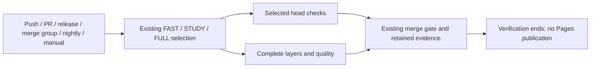

# Workflow behavior in this checkout

This file summarizes the checked-in workflows, not the adopted future component qualification policy. For task-level test choice, use [docs/testing.md](../../docs/testing.md); for the target component map, use [the architecture guide](../../docs/architecture/component-reconstruction.md) and [issue #192](https://github.com/aaweaver-actuary/tempo/issues/192).

At this revision, `pages.yml` selects repository-wide FAST, STUDY, or FULL plans and defines `quality` and `merge-gate` jobs. `verify-layer.yml` and `verify-browser.yml` implement current verification layers. Their actual selection logic is in the workflow and planner code; do not infer that a component package is independently qualified from a selected tier.

The adopted policy is to qualify the affected component, actual consumers, and relevant contracts/boundaries. A full-system check is an integration or periodic checkpoint, not a universal task entrance gate. This documentation does not change workflows, hosted required checks, branch protection, or the result of any check. Confirm hosted protection settings directly before describing the current merge gate.

## Verification without publishing

`pages.yml` retains its filename for existing consumers but is named **Verify
Tempo**. Push, PR, release, merge-group, nightly and manual events retain their
existing verification selection, artifacts, `quality` and `merge-gate`. It has no
Pages build, upload or deployment jobs, publishing permissions or manual publish
option. This removes workflow publication; it does not delete the hosted site.

Source: [`pages.yml`](pages.yml),
[`ci-quality.mjs`](../../scripts/ci-quality.mjs), and
[`ci-merge-gate.mjs`](../../scripts/ci-merge-gate.mjs). This diagram describes the
changed workflow source, not runtime installation or verification execution.
