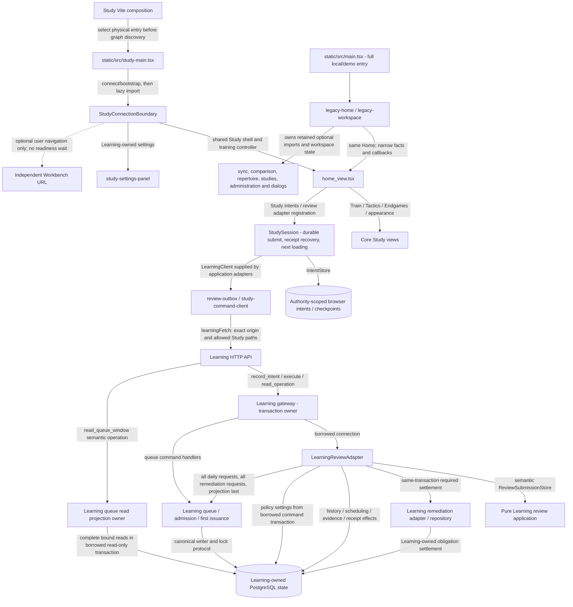
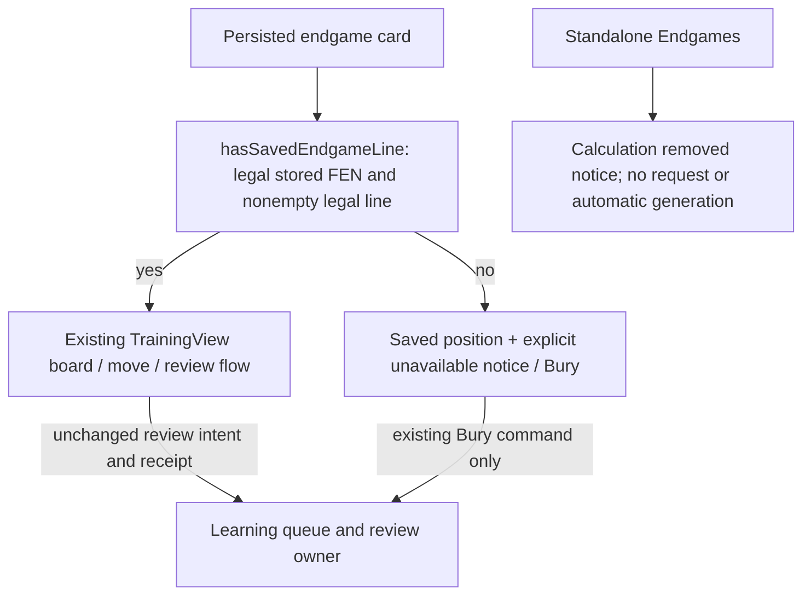

# Frontend application

`app` is the shared React + TypeScript application used by both the local
Docker web service and the static browser practice build. The full local/demo and physical Study entry points are in `static/src`; Study
uses the core shell while the full entry owns optional workspace composition.

## Architecture drawings

These are the canonical drawings for the views below. Edit the blocks here;
peer documents link to them instead of maintaining copies. See the
[diagram index and source/status baseline](../docs/architecture/diagrams/README.md) and
[maintenance procedure](../docs/architecture/diagrams/README.md#maintenance-and-review-procedure).

### Main Study path and source gap

**MAIN IMPLEMENTED SOURCE:** the physical Study composition and Learning-owned
semantic boundaries below are merged in main at
[`588cea54`](https://github.com/aaweaver-actuary/tempo/commit/588cea54574c2b56799f0a22f8235976171c4fba).
PR324 separates optional legacy workspace ownership from the shared Study shell;
PR327 reads policy through the borrowed submission transaction; PR329 owns queue
read projections and ordered refresh operations. The gateway retains transaction,
first-issuance and settlement authority. See the
[integration receipt](../docs/architecture/study-isolation-integration-2026-10-20.md)
for exact reviewed feature/merge inputs and scoped proof. Deployment and effective
host resource isolation remain unverified.

| Interface / decision | Source correspondence |
| --- | --- |
| Physical entry and loaded graph guard | [`studyComposition`](../scripts/study-composition.ts) changes the HTML entry before graph discovery. Its semantic optional implementation list rejects loaded Games/sync, authoring, comparison, administration, and legacy composition roots, even if later tree-shaken. [`study-main.tsx`](../static/src/study-main.tsx) has no legacy import. |
| Optional state, presentation and handoff owner | [`LegacyHome`](views/legacy-home.tsx) injects [`LegacyWorkspace`](views/legacy-workspace.tsx). It owns discovery/filter/paste/repair state, repair race fencing, deletion recovery and retained optional dialogs. Builder editing and its handoffs, plus the Games and analytics dashboards, were retired; Repertoire import and paste remain. [`LegacyWorkspaceProps` / slots / controller](components/optional-workspace.ts) expose explicit queue/card commands; they do not pass the Home store. Home owns one training controller and queue acquisition. Unsupported controls are omitted when their action capability is absent. |
| Genuine Study settings and navigation | [`StudyConnectionBoundary`](components/study-connection-boundary.tsx) retains [`StudySettingsPanel`](components/study-settings-panel.tsx) for Learning settings. [`StudySettingsView`](views/study-settings-view.tsx) changes browser appearance/shortcuts. [`canOpenWorkspace`](lib/study-workspace-policy.ts) checks direct intents as well as Navbar visibility. |
| Connection and allowed transport | [`study-connection.ts`](lib/study-connection.ts): `connectStudy`, `studyWorkspace`, `learningPaths`, `authenticatedLearningFetch`. Only the configured Learning origin/Study paths receive the credential; no Games fallback. The boundary waits for Learning bootstrap or explicitly permitted cached practice. |
| Session and browser data ownership | [`study-session-runtime.ts`](lib/study-session-runtime.ts) composes adapters into [`createStudySession`](../packages/study-session/src/index.ts); [`study-intent-storage.ts`](lib/study-intent-storage.ts) supplies [`IntentStore`](../database/browser-intents/src/index.ts). [`review-outbox.ts`](lib/review-outbox.ts) and [`study-command-client.ts`](lib/study-command-client.ts) preserve family-specific payloads/identities. |
| Borrowed policy and queue persistence ownership | [`LearningReviewAdapter.policy`](../services/learning/runtime/src/tempo_learning_runtime/review_adapter.py) reads settings through the caller's borrowed command transaction, unless an injected policy provider is supplied; it acquires no second connection. [`queue_application.read_queue_window`](../services/learning/runtime/src/tempo_learning_runtime/queue_application.py) owns complete parameter-bound card/count/projection reads; HTTP composes semantic facts and retains canonical head-issuance commands. `mark_queue_refresh_pending_in_transaction` owns the projection write; review refresh orders all daily tasks, all remediation tasks, then projections. No second transaction writer is introduced. |
| Serving, borrowed review and settlement | [API registration](../services/learning/runtime/src/tempo_learning_runtime/api.py), [gateway](../services/learning/runtime/src/tempo_learning_runtime/gateway.py), [`submit_review` / ports](../services/learning/application/src/tempo_learning_review/application.py), [review adapter](../services/learning/runtime/src/tempo_learning_runtime/review_adapter.py), [queue application](../services/learning/runtime/src/tempo_learning_runtime/queue_application.py), [admission](../services/learning/runtime/src/tempo_learning_runtime/admission.py), [receivers](../services/learning/runtime/src/tempo_learning_runtime/receivers.py), [remediation adapter](../services/learning/runtime/src/tempo_learning_runtime/remediation_adapter.py). The review application receives semantic capabilities; gateway retains transaction authority. Settlement uses Learning-local facts, not an online Games call. |

The independent Learning install closure contains no Game Evidence service,
Intelligence service, legacy backend, Redis/Celery or engine/model runtime. Its
[package definition](../services/learning/runtime/pyproject.toml) includes
Game Evidence **contracts** and Learning's own remediation module. Pure shared
libraries do not create a producer lifecycle dependency.

**Acceptance invariant:** Study must have no Games call, import, wait,
readiness, transaction or lifecycle dependency. Games must be able to fail
completely while ordinary Study continues. The physical Study composition repairs the browser source and artifact boundary.
The proposed removal below retires optional endgame calculation; HostActivity
ownership and deployment resource isolation retain their separate limits.

Optional practice influence enters the **Learning/queue owner's semantic
interface**, as the [existing evidence sequence](../services/game-evidence/README.md#observed-game-evidence-to-learning-main)
shows. Learning owns validation, eligibility/admission, idempotency, transactions
and ordinary queue consumption. Producers must not write Learning queue, review
or scheduling tables. PR319 remains paused; no proposed encountered-card API is
assumed here.

## Directories

- `components/` — reusable UI, dialogs, board controls, and the persistent
  board shell.
- `domain/` — product types, branded primitives, schemas, and adapters for
  untrusted transport records.
- `hooks/` — React lifecycle integration for workers, polling, and background
  APIs.
- `lib/` — current shared runtime utilities; it is intentionally documented as
  a future split point for API, persistence, workers, engines, and chess logic.
- `state/` — cross-workspace Zustand state and selectors.
- `utils/` — small chess, date, settings, URL, and local-runtime helpers.
- `views/` — workspace composition and user workflows.

Keep domain code independent of React. Validate external records at the
boundary, preserve the local API error, and do not turn the static demo's
sample data into an implicit fallback for a failed service.

### Saved endgame practice after calculation removal

**PROPOSED removal:** on-demand generation and tablebase calls are removed from
both independent Study and the legacy Endgames screen. The canonical Learning
[request/resource drawing](../services/learning/runtime/README.md#shared-learning-request-execution-gaps-main)
owns the server view; this browser view owns dispatch and user-visible behavior.

[`saved-endgame-practice.ts`](lib/saved-endgame-practice.ts) rejects empty,
placeholder and illegal lines. [`practice-card-adapters.ts`](domain/adapters/practice-card-adapters.ts) preserves
the server-provided legal line; [`home_view.tsx`](views/home_view.tsx) and
[`training_view.tsx`](views/training_view.tsx) use the same saved-line guard so
valid saved endgames follow the actual ordinary move/review caller.
[`endgames_view.tsx`](views/endgames_view.tsx) shows material-only saved cards
without fabricating a solution, move defense or review; their saved state/history
is retained and Bury remains available. The standalone view has no template
admission, generation or provider request. The compatibility probe helper fails
locally and never falls back to an external provider. Existing operation-ID
recovery remains server-owned. No stored card, attempt, history or study is deleted.

This preserves ordinary saved-line practice; a historical material-only template
cannot provide calculated practice after the calculator is removed. Its explicit
unavailable notice is the safe fallback, with no automatic grade or completion.
