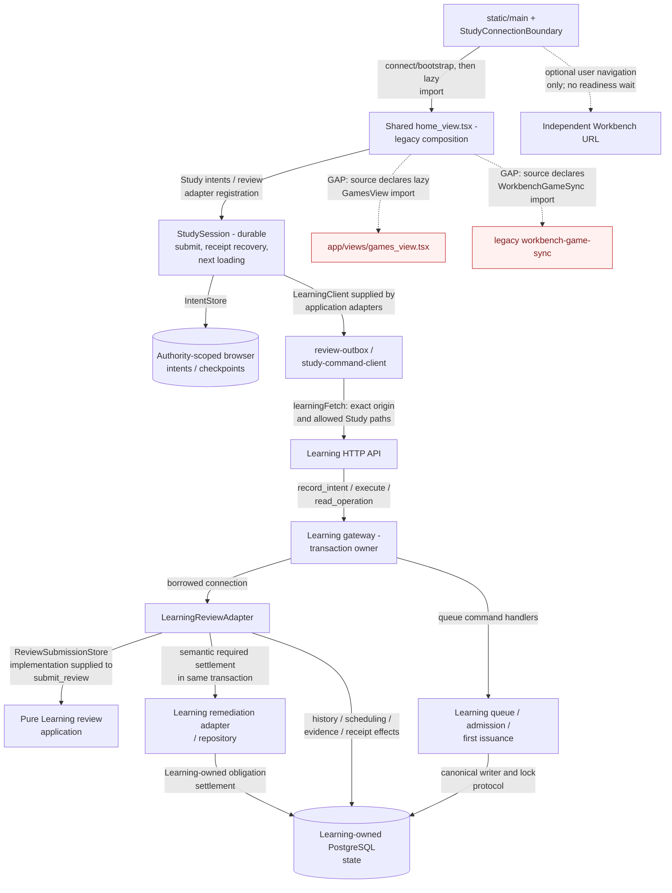

# Frontend application

`app` is the shared React + TypeScript application used by both the local
Docker web service and the static browser practice build. The static entry point
is in `static/src`; it mounts the same workspace views and components.

## Architecture drawings

These are the canonical drawings for the views below. Edit the blocks here;
peer documents link to them instead of maintaining copies. See the
[diagram index and source/status baseline](../docs/architecture/diagrams/README.md) and
[maintenance procedure](../docs/architecture/diagrams/README.md#maintenance-and-review-procedure).

### Main Study path and source gap

**MAIN:** `TEMPO_TARGET=study` selects the Learning connection boundary. The
diagram separates its HTTP serving path from the shared browser source that it
still loads. It does **not** certify that the whole Study artifact is free of
Games imports.

The `React.lazy` declarations shown as source gaps do **not** themselves execute
Games or sync code during ordinary Study. They defer the import factory until the
corresponding component is rendered; Home's Games subtree is conditional on
`currentView === "games"`. Source reachability is distinct from execution and from
the [conditional build/offline asset dependency in the static README](../static/README.md#conditional-study-build-and-offline-assets-main).
No emitted Study artifact was inspected for these drawings.

| Interface / decision | Source correspondence |
| --- | --- |
| Connection, bootstrap, authority and allowed transport | [`study-connection.ts`](lib/study-connection.ts): `connectStudy`, `studyWorkspace`, `learningPaths`, `authenticatedLearningFetch`. Only configured Learning origin/Study paths receive the credential; no fallback to Games. [Connection boundary](components/study-connection-boundary.tsx) waits for Learning bootstrap or explicitly permitted cached practice. |
| Browser composition and retained import gap | [`static/src/main.tsx`](../static/src/main.tsx) loads the boundary, which imports [`home_view.tsx`](views/home_view.tsx). Home declares lazy `GamesView` and `WorkbenchGameSync` imports and contains Games-related navigation/state. [`Navbar`](components/Navbar.tsx) filters Study navigation; that is not source/import separation. The [planned Study artifact](../apps/study-web/README.md) has no independent build claim. |
| Session and browser data ownership | [`study-session-runtime.ts`](lib/study-session-runtime.ts) composes adapters into [`createStudySession`](../packages/study-session/src/index.ts); [`study-intent-storage.ts`](lib/study-intent-storage.ts) supplies the [`IntentStore`](../packages/browser-intents/src/index.ts). [`review-outbox.ts`](lib/review-outbox.ts) and [`study-command-client.ts`](lib/study-command-client.ts) preserve family-specific payloads/identities. |
| Borrowed review capabilities | [`ReviewStore` / `ReviewSubmissionStore`](../services/learning/application/src/tempo_learning_review/ports.py), [`submit_review`](../services/learning/application/src/tempo_learning_review/application.py), [`LearningReviewAdapter`](../services/learning/runtime/src/tempo_learning_runtime/review_adapter.py). The application receives semantic facts/operations; it does not acquire/commit a connection. |
| Serving and settlement | [API handler registration](../services/learning/runtime/src/tempo_learning_runtime/api.py), [gateway](../services/learning/runtime/src/tempo_learning_runtime/gateway.py), [queue application](../services/learning/runtime/src/tempo_learning_runtime/queue_application.py), [admission](../services/learning/runtime/src/tempo_learning_runtime/admission.py), [receivers/settlement](../services/learning/runtime/src/tempo_learning_runtime/receivers.py), [remediation adapter](../services/learning/runtime/src/tempo_learning_runtime/remediation_adapter.py). Settlement uses accepted Learning-local facts, not an online Games call. |

The independent Learning install closure contains no Game Evidence service,
Intelligence service, legacy backend, Redis/Celery or engine/model runtime. Its
[package definition](../services/learning/runtime/pyproject.toml) includes
Game Evidence **contracts** and Learning's own remediation module. A contract or
pure shared library is not a dependency on the producer lifecycle.

**Acceptance invariant:** Study must have no Games call, import, wait,
readiness, transaction or lifecycle dependency. Games must be able to fail
completely while ordinary Study continues. Existing shared Home imports are a
named **legacy source gap**, not an exception permitting new coupling or evidence
that the invariant is already met. This documentation makes no bundle-elimination
claim and changes no runtime source. PR322 does not remove this gap.

Any optional practice influence enters the **Learning/queue owner's semantic
interface**, as the [existing evidence sequence](../services/game-evidence/README.md#observed-game-evidence-to-learning-main)
shows. Learning owns validation, eligibility/admission, idempotency, transactions
and ordinary queue consumption. Study must not learn how to contact the producer;
the producer must not write Learning queue, review or scheduling tables. PR319 is
paused; no proposed encountered-card API is assumed here.

## Directories

- `components/` — reusable UI, dialogs, board controls, and the persistent
  board shell.
- `domain/` — product types, branded primitives, schemas, and adapters for
  untrusted transport records.
- `hooks/` — React lifecycle integration for workers, polling, and background
  APIs.
- `lib/` — current shared runtime utilities; it is intentionally documented as
  a future split point for API, persistence, workers, engines, and chess logic.
- `state/` — cross-workspace Zustand state and selectors.
- `utils/` — small chess, date, settings, URL, and local-runtime helpers.
- `views/` — workspace composition and user workflows.

Keep domain code independent of React. Validate external records at the
boundary, preserve the local API error, and do not turn the static demo's
sample data into an implicit fallback for a failed service.
