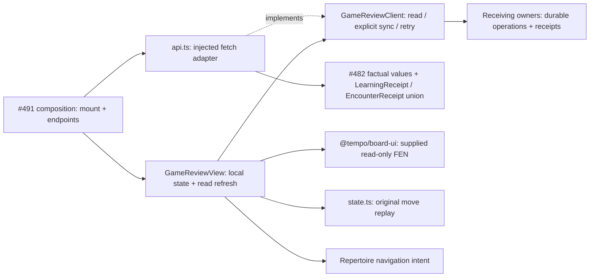

# Game Review (#490 / T09)

Isolated product-v0.2 screen. Source implementation is separate from product
mounting, provider installation and browser acceptance, which belong to #491.
The pinned [SPEC v0.2](https://github.com/aaweaver-actuary/tempo/blob/6885b9420320517ac74df47e631ed796da96c94a/SPEC.md)
and #481 govern scope.

Consumes #482/#506's additive UI checkpoint
`e269421bddfeed9d00d868af085bbe0adda14e51`, interface 0.2.0. No shared contract
file or root application surface is owned by this feature.

## Public interface and ownership

`GameReviewView({ api, repertoireId?, onReviewGap? })` accepts a typed injected
`GameReviewClient`. `createGameReviewApi` adapts injected fetch and endpoint URLs;
composition supplies actual routes. Shared wire values and validators come from
#482's `product-api/contracts.ts`; this module defines only screen capabilities
and navigation intents. Read requests never sync, deliver feedback, or edit content.

The feature owns request cancellation, selected game, board cursor, displayed
receipts and in-memory operation identities. Provider/coordinator/Study owners
own durable operations and learning effects. Requests abort on unmount; selection
replaces the detail generation even if a transport ignores cancellation. A retry
reuses its operation identity, and a synchronous in-flight guard prevents duplicate
submissions before React updates. The server remains responsible for durable
deduplication after a reload. Failed provider receipts reuse their supplied original
operation ID. The stable semantic game/decision effect identity still belongs to
Study; a UI UUID never authorizes a second lapse. Error and pending states stay
in this feature. `LearningReceipt` is displayed verbatim: `applied` does not prove
queue availability, and `available_by` is a deadline rather than completion.

The separate next-release encounter display accepts #482/#536's shared receipt
union at `59b07fcea6eee9ef5c281d953dd86023e372bdd4`.
Legacy `LearningReceipt` labels remain unchanged. `EncounterReceipt` additionally
shows whether the encounter was recorded, the Study owner's disposition, actual
admission status and explicit deferral reason. Recorded importance, `status=applied`
and a pending first introduction do not imply availability. Only an actual
`admission_status=available` is labeled available for Study. This display changes
no admission/retry policy and is independent of operator history-to-Study proof.

`onReviewGap` emits a repertoire navigation intent naming the original finding;
it grants no content mutation. The injected API has no Study reset/start/save,
card-creation, SQL, browser-storage or engine capability.

## Practical review and refresh

Refreshing games/status re-reads the selected game's detail even when its source
revision is unchanged. The game-only refresh uses the same read capability. Both
preserve the selected board ply; a changed game/repertoire/source still gets its
own position identity and cancels stale requests. During refresh the last result
remains visible, and a failed refresh explicitly labels it as the previous result.
A completed manual sync refreshes the read projections; opening or refreshing the
screen never imports games or applies feedback.

Owner receipts without a matching finding are shown separately, including their
actual pending/applied/deferred/admission facts, source game and decision. Jumping
to their ply is allowed only for the displayed source revision and available move
history. Another revision does not borrow the current moves. Missing expected
moves remain explicitly unsupplied. An empty findings array is not a full-coverage
claim, and receipts naming a different game fail closed in this screen.

Opponent gaps and missing own continuations retain their coverage labels, source
game, played move and any supplied expected moves. A missing navigation callback
leaves the gap action visible but disabled with a manual Repertoire fallback.

Parent/#491 integration needs observed at `cbc221218a9235ec23ee6441a6f5ac4edf031b4c`:
`LegacyWorkspace` mounts this view with only `api`. Supply its existing `onReviewGap`
callback to enable exact repertoire navigation; no root file is edited here.
The public summary/detail currently supplies provider/game identity but no verified
source URL, and an unmatched receipt supplies no expected move. If clickable
provider links or those expected moves are needed, the parent should request small
factual read-projection additions from the API owner. The UI does not guess a
Chess.com live/daily URL or reconstruct repertoire policy from game moves.

## Dependency and lifecycle view



No Study/Tactics implementation is imported or called. Shared React/board/chess.js
and HTTP resources remain in the host browser; installed process/resource isolation
is unverified here. The feature owns and cancels only its requests. No polling,
document hotkeys, background workers, timers or new state manager are installed.

## Reuse

Reuse the public `@tempo/board-ui` renderer and its exported stylesheet (via its
repository path until the integration owner registers the package), shared `Button`, and the pure
`positionsFromMoves` helper. Validate complete replay rather than silently showing
a truncated history. The board uses full original FENs with move clocks and has
no legal-move editing, drawing, hint or Study answer state. Arrow/Home/End handling
is attached only to the game-history region; form controls keep their native keys.

## Minimal mount patch for #491

```tsx
import { GameReviewView } from "./features/game-review/GameReviewView";
import { createGameReviewApi } from "./features/game-review/api";

// Construct once in the composition owner, with its actual authenticated routes.
const gameReviewApi = createGameReviewApi({ endpoints: gameReviewEndpoints });

// In the existing root route/surface switch, owned by #491:
<GameReviewView api={gameReviewApi} repertoireId={selectedRepertoireId}
  onReviewGap={intent => openRepertoire(intent.repertoire_id, intent.position_key)} />
```

Do not instantiate the client inline on each render. Unmount the surface on
navigation. The feature imports its own stylesheet and Board UI styles. The host
retains its existing shared button/token styles.

## Focused proof

`make unit-file FILE=tests/unit/product-game-review.test.tsx` uses a typed fake
API and the real Board UI public renderer. The selected component boundary needs
no backend, provider, model or database. Use the shared nontruncating advisory
validation lock; #491 owns actual product/browser acceptance.

`node node_modules/typescript/bin/tsc --project app/features/game-review/tsconfig.json`
checks this screen, adapter, state helper and the typed fake-port test against
the existing root compiler settings. This local file adds no central registration.

The 23 cases cover all eight finding labels, uncertain times, exact original and
custom-FEN replay, invalid-history refusal, read-only loading, empty/error/retry
states, owner receipt states, operation-key retention/double-click guards, stale
game/repertoire/revision/feedback results, cancellation on unmount, navigation-only
gap actions, local keyboard handling, validated HTTP and a scoped import guard.
Typed fake-provider failure preserves the actual existing Study store object.

The encounter-display follow-on adds only seven focused owner receipt-label
cases and one mixed legacy/encounter HTTP detail-read case (31 cases total).
Legacy retry commands and their response validator remain unchanged; the detail
read preserves the actual encounter subtype through the shared union.

The practical-review follow-on adds eight focused cases for same-revision owner
status refresh, preserved cursor/stale-result retry, explicit-sync readback,
unmatched and source-mismatched receipts, and coverage-gap navigation fallbacks
(39 cases total, passed). The selected unit file and scoped static checks used a
free nonblocking advisory slot. No database/browser/full-product qualification
or release-owner checkout was used; installed UI acceptance remains #491's work.

The focused test is discovered by the existing unit glob. #491 coordinates the
central regression inventory entry with #488's current `tests/REGRESSIONS.md`
reservation. This component check does not establish hosted merge qualification,
pixel layout, installed endpoints, live imports or receiving-owner persistence.
