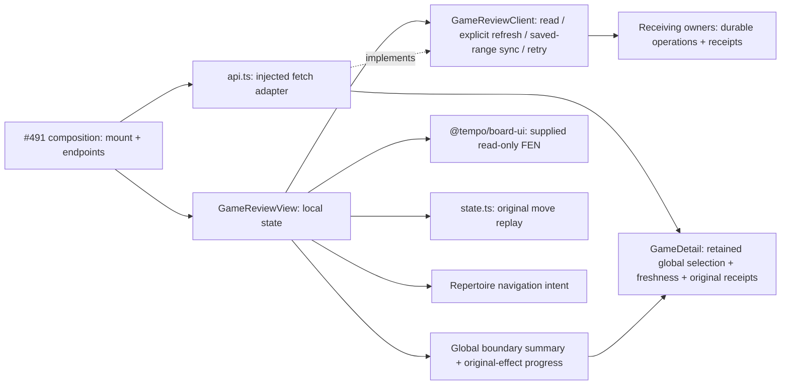

# Game Review (#490 / T09)

Isolated product-v0.2 screen. Source implementation is separate from product
mounting, provider installation and browser acceptance, which belong to #491.
The pinned [SPEC v0.2](https://github.com/aaweaver-actuary/tempo/blob/6885b9420320517ac74df47e631ed796da96c94a/SPEC.md)
and #481 govern scope.

Consumes #482/#506's additive UI checkpoint
`e269421bddfeed9d00d868af085bbe0adda14e51`, interface 0.2.0. No shared contract
file or root application surface is owned by this feature.

## Public interface and ownership

`GameReviewView({ api, repertoireId?, onReviewGap? })` accepts a typed injected
`GameReviewClient`. `createGameReviewApi` adapts injected fetch and endpoint URLs;
composition supplies actual routes. Shared wire values and validators come from
#482's `product-api/contracts.ts`; this module defines only screen capabilities
and navigation intents. Read requests never sync, deliver feedback, or edit content.

The feature owns request cancellation, selected game, board cursor, displayed
receipts and feedback operation identities. Refresh identities also use the existing browser adapter as described below. Provider/coordinator/Study owners
own durable operations and learning effects. Requests abort on unmount; selection
replaces the detail generation even if a transport ignores cancellation. A retry
reuses its operation identity, and a synchronous in-flight guard prevents duplicate
submissions before React updates. The server remains responsible for durable
deduplication after a reload. Failed provider receipts reuse their supplied original
operation ID. The stable semantic game/decision effect identity still belongs to
Study; a UI UUID never authorizes a second lapse. Error and pending states stay
in this feature. `LearningReceipt` is displayed verbatim: `applied` does not prove
queue availability, and `available_by` is a deadline rather than completion.

The separate next-release encounter display accepts #482/#536's shared receipt
union at `59b07fcea6eee9ef5c281d953dd86023e372bdd4`.
Legacy `LearningReceipt` labels remain unchanged. `EncounterReceipt` additionally
shows whether the encounter was recorded, the Study owner's disposition, actual
admission status and explicit deferral reason. Recorded importance, `status=applied`
and a pending first introduction do not imply availability. Only an actual
`admission_status=available` is labeled available for Study. The existing feedback retry endpoint replays stored lapse deliveries only; a
pending `EncounterReceipt` therefore has no legacy Retry feedback action. This
view adds no encounter replay API and is independent of operator history-to-Study
proof.

`onReviewGap` emits a repertoire navigation intent naming the original finding;
it grants no content mutation. The injected API has no Study reset/start/save,
card-creation, SQL, browser-storage or engine capability.

## Authoritative first departure (#624)

The existing `GameDetail` adds the retained global `first_departure`, original
`determined_at`, opaque `comparison_revision` and honest `comparison_freshness`.
Missing older fields parse as null/unknown. The headline and initial board use
this selection, never the first per-repertoire diagnostic. A known boundary opens
immediately before its move; covered or absent boundary opens the original initial
position. Move labels use legal replay from that FEN, including Black and non-initial
fullmove numbers. Diagnostic repertoire filtering does not narrow the global answer.

All seven selector results remain distinct. Opponent-first, authored endpoint,
missing continuation and unresolved results authorize no later diagnostic penalty.
A missing selection is unknown rather than covered. Stale and unknown comparisons
remain inspectable with explicit freshness labels; the browser does not recalculate
repertoire membership or current authority.

Primary Study progress correlates workspace/provider/game/decision/occurrence and
canonical revision, plus source digest for encounter receipts. Provider-source and
canonical-source revision numbers are separate domains. Physical card coincidence
never links a receipt; ambiguous original-effect receipts remain unknown. An owner
remap displays its current target while retaining the original presentation link.
Only actual progress fields establish Again, canonical introduction, issuance and
genuine review settlement. Legacy applied receipts retain their original labels.

The legacy retry action requires an exact matching own-actionable original finding
and a compatible legacy pending receipt (or no receipt). The registered writer
command independently qualifies and fences that original delivery. No retry action
is offered for later/opponent-first diagnostics, absent selection or encounter-only
admission. Mount, selection and status refresh remain read-only.

The summary exposes `data-testid=first-departure-summary`, `data-status`, and
`data-progress-stage` for the owning packaged browser journey. Component checks
use the same shared GameDetail fixtures as both wire parsers. Real API, persistence,
packaging and installed feedback remain the integration owner's evidence.

## Dependency and lifecycle view



No Study/Tactics implementation is imported or called. Shared React/board/chess.js
and HTTP resources remain in the host browser; installed process/resource isolation
is unverified here. The feature owns and cancels only its requests. Refresh
polling is described below; no document hotkeys, browser workers or new state
manager are installed.

## Reuse

Reuse the public `@tempo/board-ui` renderer and its exported stylesheet (via its
repository path until the integration owner registers the package), shared `Button`, and the pure
`positionsFromMoves` helper. Validate complete replay rather than silently showing
a truncated history. The board uses full original FENs with move clocks and has
no legal-move editing, drawing, hint or Study answer state. Arrow/Home/End handling
is attached only to the game-history region; form controls keep their native keys.

## Minimal mount patch for #491

```tsx
import { GameReviewView } from "./features/game-review/GameReviewView";
import { createGameReviewApi } from "./features/game-review/api";

// Construct once in the composition owner, with its actual authenticated routes.
const gameReviewApi = createGameReviewApi({ endpoints: gameReviewEndpoints });

// In the existing root route/surface switch, owned by #491:
<GameReviewView api={gameReviewApi} repertoireId={selectedRepertoireId}
  onReviewGap={intent => openRepertoire(intent.repertoire_id, intent.position_key)} />
```

Do not instantiate the client inline on each render. Unmount the surface on
navigation. The feature imports its own stylesheet and Board UI styles. The host
retains its existing shared button/token styles.

## Focused proof

`make unit-file FILE=tests/unit/product-game-review.test.tsx` uses a typed fake
API and the real Board UI public renderer. The selected component boundary needs
no backend, provider, model or database. Use the shared nontruncating advisory
validation lock; #491 owns actual product/browser acceptance.

`node node_modules/typescript/bin/tsc --project app/features/game-review/tsconfig.json`
checks this screen, adapter, state helper and the typed fake-port test against
the existing root compiler settings. This local file adds no central registration.

The 23 cases cover all eight finding labels, uncertain times, exact original and
custom-FEN replay, invalid-history refusal, read-only loading, empty/error/retry
states, owner receipt states, operation-key retention/double-click guards, stale
game/repertoire/revision/feedback results, cancellation on unmount, navigation-only
gap actions, local keyboard handling, validated HTTP and a scoped import guard.
Typed fake-provider failure preserves the actual existing Study store object.

The encounter-display follow-on adds only seven focused owner receipt-label
cases and one mixed legacy/encounter HTTP detail-read case (31 cases total).
Legacy retry response validation retains the shared union; the detail
read preserves actual encounter subtypes. The #624 additions above narrow UI retry
authority to its exact selected original effect.

The focused test is discovered by the existing unit glob. #491 coordinates the
central regression inventory entry with #488's current `tests/REGRESSIONS.md`
reservation. This component check does not establish hosted merge qualification,
pixel layout, installed endpoints, live imports or receiving-owner persistence.

## Refresh now

Games uses `POST /api/product/game-review/refresh` with `{provider, operation_id}`
and reads `GET /api/product/game-review/refresh/{operation_id}`. The configured
fixed-range `/sync` action remains in Settings. The read-only list/status refresh
button starts no acquisition.

`use-game-refresh.ts` retains one original request and accepted job per provider
through the existing browser adapter, scoped to the Games API URL and workspace.
It polls only pending requests every two seconds while visible, recovers at
visibility/online changes, and cancels requests/timers on unmount. Completion
reloads summaries without replacing an unchanged selection or board cursor.
Uncertain responses retain the original identity. A confirmed rejected command
or terminal job releases it for a new explicit refresh. Pending command receipts,
provider retries and actual completed acquisition remain distinct states.
