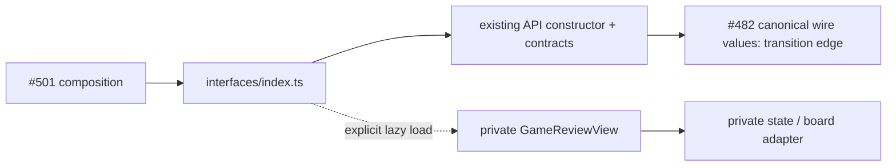

# Game Review public surface

Owner: #490 UI; composition and caller migration: #501. This is the explicit
feature entry, not a completed decoupling or installed-runtime claim.

`index.ts` exports `createGameReviewApi` and the existing `GameReviewClient`,
`GameReviewEndpoints`, `GameSelection`, `GameReviewViewProps`, `GapReviewIntent`
contracts. `loadGameReviewView()` returns the same existing component on explicit
request. Its lazy boundary preserves the existing optional-screen loading model;
a cold surface import neither loads the private view nor starts network/storage.
The API constructor performs no I/O; composition supplies actual routes/fetch.

The feature owns selection, board cursor, request cancellation and UI retry keys.
Provider/Games/Study owners retain durable effects, admission, receipts and
settlement. No private stores, receipt-label helpers or mutation authorities are
exported. All existing Game Review implementation bytes are retained, including
qualified encounter receipts and practical-review checkpoint `507111af`.

## Exact transition edges

- `../api.ts` still references canonical wire values in
  `app/features/product-api/contracts.ts` (#482). These are aliases, not copied
  DTOs. Move that import only after its owner publishes the TS wire surface.
- `../GameReviewView.tsx` and `../state.ts` still use the board's current public
  package entry, shared UI buttons and `app/hooks/use-board-history.ts` (which
  shares a module with keyboard policy). Those are existing edges, not newly
  certified independence; board adoption coordinates #500/#501.
- #491's published `app/product-composition/game-review.ts` and
  `app/views/legacy-workspace.tsx` still import the old feature paths. They are
  outside this allocation and are unchanged. #501 should replace the API import
  with `../features/game-review/interfaces` and use
  `lazy(async () => ({ default: await loadGameReviewView() }))` at its screen root.

Remove compatibility paths only after all caller patches, packaging/registration
and #482's negative import/DAG checks pass. No old alias is removed in this pass.

Focused proof: `tests/unit/public-surface-study-games.test.ts` covers cold import,
named export limits, canonical identity and explicit capability use. Existing
`product-game-review.test.tsx` owns the screen's 39 semantic cases. The whole
declared graph and export-bypass negative controls remain #482's checker scope.
