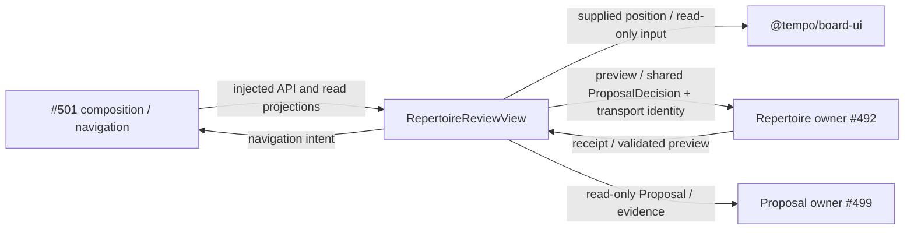

# Repertoire review — #500 / T19

Isolated screen for #501, using #482's published `0.2.0` contract checkpoint
`2db98217`. No root mount, Study controller, provider, engine, persistence or
content-policy implementation belongs here. Private read projections supplement
the shared Proposal/ProbabilityEvidence/EngineEvidence values; they do not
replace or copy those DTOs. Repertoire owns all validation and publication.

## Public interface

`api.ts` exports `RepertoireReviewClient`, `RepertoireReviewRead`, `ConflictRow`,
`ReviewFinding`, `ReviewPosition`, and `RepertoireNavigationIntent`.
The client extends shared `RepertoireReviewApi` unchanged, adding the screen's
read projection and optional owner-prepared edit draft. `preview` is read/validation only;
when supplied, `prepareEdit` must construct a coherent replacement Proposal without publishing.
The screen then sends shared `decide(action=edit)` for revalidation. As required
by the shared port, edit returns a fresh preview and never publishes. Only a
later, separately approved `decide(action=accept)` applies the displayed edit
and all associated card changes. Dismiss uses `decide(action=dismiss)`.

The optional second `decide` argument carries transport `operation_id` outside
the shared factual decision DTO. #501 maps it to its command idempotency header
or owner transport. `RepertoireReviewSession` coalesces a double click and retries
the exact decision with the same key after a lost acknowledgment. Inject and
retain one session if the surrounding shell unmounts/reopens the screen.
This memory journal is not a durable owner receipt or a reload-recovery claim.

No read automatically sends a command. Proposal, preview and command generations
are scoped to selected repertoire/source/selection; late results are ignored.
Unknown counts/mass remain unknown. Engine scores are rendered from the learner
perspective; CP subtraction is display only and never an approval policy.

## Integration owner handoff

#501 owns actual endpoint composition, root mount/navigation, central regression
registration and the real browser acceptance. Supply immutable owner projections:
conflict alternatives include complete proposals, affected routes and actual
Study-block facts; findings include exact target/history, reach/conditional
evidence, staleness and distinct similarity differences. Existing-card common
blunders emit practice/introduction intents instead of content commands.

Shared renderer reuse: `@tempo/board-ui` public `Board` and existing
`positionsFromMoves` history projection. No legacy board wrapper/controller is
copied. Shared native UI primitives are reused where applicable.

### Minimal mount patch for #501

In #501's reserved composition file, import the view and keep a session for the
shell lifetime. The shell supplies its existing navigation handler; this feature
does not install navigation or retire any existing view.

```tsx
import { useState } from "react";
import { RepertoireReviewView } from "./features/repertoire-review/RepertoireReviewView";
import { RepertoireReviewSession } from "./features/repertoire-review/state";
import type { RepertoireReviewClient, RepertoireNavigationIntent } from "./features/repertoire-review/api";

export function RepertoireReviewMount({ api, repertoireId, navigate }: {
  api: RepertoireReviewClient;
  repertoireId: string;
  navigate: (intent: RepertoireNavigationIntent) => void;
}) {
  const [session] = useState(() => new RepertoireReviewSession());
  return <RepertoireReviewView api={api} repertoireId={repertoireId}
    session={session} onNavigate={navigate} />;
}
```

Optional `repertoires` plus `onRepertoireChange` render a controlled repertoire
selector. Read requests have an AbortSignal and a selection-generation fence;
shared `proposals(repertoireId)` responses are also fenced when they cannot abort.
Errors stay in this optional screen. A failed read has a local Refresh action.

The injected adapter maps `review` to its immutable owner projection, `proposals`
to #499, and `preview`/`decide` to #492. Its `prepareEdit` prepares coherent full
route PGN, associated cards and fresh evidence before the UI submits shared
`decide(action=edit)`. This capability is optional so #501's audit checkpoint can
mount before engine-backed editing is ready. Without it, inline editing is
disabled and the existing manual-editor navigation intent remains available.
The UI never rewrites PGN or fabricates engine evidence in React.

Reviewed #492 checkpoint: PR #520, `c30d40fd790cd54f3dabada674fc09fc486b27d6`.
Its `conflict_report` supplies exact scope/competing moves/routes;
`manual_resolution` prepares alternative Proposals for the selected response.
`RepertoireChanges.preview/decide` and injected `http.routes` own approval and
atomic replay. The UI imports only shared contracts, never these implementations.
#501 adapts those values to the small display projection and supplies actual
Study-block facts. An unknown block renders **unknown**, never a fabricated block.
The current HTTP owner uses the shared decision identity for replay; the optional
transport ID is an additional retry correlation, not a competing owner identity.

### Four executable synthetic examples

The regular [focused suite](../../../tests/unit/product-repertoire-review.test.tsx)
is the fake API/mount example; its `fakeApi`, `read`, `finding` and `mount` helpers
use the published synthetic Proposal/ProbabilityEvidence fixtures directly.
No fixture is copied into a parallel DTO or read from live storage.

| Example | Named executable case | Supplied projection / behavior |
| --- | --- | --- |
| Exact conflict | `manual conflict choice previews precise affected content and requires explicit confirmation` | `conflicts[].choices[].proposal`, precise affected routes and actual block status; preview then accept. |
| Missing reply | `associated new cards are visible before approval and covered by the same display digest` | `findings[kind=missing_reply]` and shared Proposal with displayed card additions. |
| Covered outlier | `covered consistency finding keeps the current/proposed moves and distinct support visible` | `findings[kind=consistency]`, current/proposed moves, distinct support and similarity differences. |
| Covered common blunder | `covered common blunder requests existing-card intent (introduced=%s), without a proposal command` | `findings[kind=common_blunder].existing_card` emits an existing-card practice/introduction intent, even when a proposal ID is also supplied. |

Missing common-blunder content uses the normal content proposal path. No practice
intent fabricates a recall miss or creates a duplicate card.

## Boundary (implemented source; not mounted or deployed)



Ephemeral selection, approval and transport state belongs to this feature.
Repertoire owns content/card publication; Study owns Study blocks and practice.
No Study import/call/wait/lifecycle edge is added. #501 owns provider resource
limits; host/deployment isolation and actual Study-block integration are unverified.

## Focused verification

```sh
make unit-file FILE=tests/unit/product-repertoire-review.test.tsx
```

30 focused cases use a typed fake API and the real retained board adapter in
jsdom. Scope includes explicit approval/additions, manual conflict scope, edited
and stale previews, uncertain acknowledgments and duplicate keys, dismissal,
30 CP/mate/inconclusive display, probability unknowns, source/selection races,
history and the new feature's import boundary. No backend/native or actual
browser product pass is claimed; #501 owns one real browser integration path.

#501 should register this exact file and these behaviors in the central regular
regression inventory when mounting. No central registration was edited here.
Source-file TypeScript and ESLint are bounded to this feature/test; unchanged
contract/board suites are reused, not rerun. No software installation is needed
with the existing toolchain and compiled pure-package artifacts.
