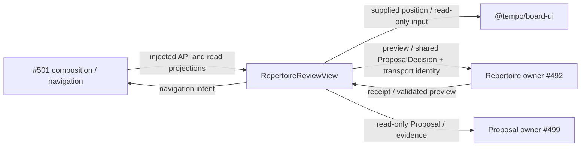

# Repertoire review — #500 / T19

Isolated screen for #501, using #482's published `0.2.0` contract checkpoint
`2db98217`. No root mount, Study controller, provider, engine, persistence or
content-policy implementation belongs here. Private read projections supplement
the shared Proposal/ProbabilityEvidence/EngineEvidence values; they do not
replace or copy those DTOs. Repertoire owns all validation and publication.

## Public interface checkpoint

`api.ts` exports `RepertoireReviewClient`, `RepertoireReviewRead`, `ConflictRow`,
`ReviewFinding`, `ReviewPosition`, and `RepertoireNavigationIntent`.
The client extends shared `RepertoireReviewApi` unchanged, adding the screen's
read projection and owner-prepared edit draft. `preview` is read/validation only;
`prepareEdit` must construct a coherent replacement Proposal without publishing.
The screen then sends shared `decide(action=edit)` for revalidation. As required
by the shared port, edit returns a fresh preview and never publishes. Only a
later, separately approved `decide(action=accept)` applies the displayed edit
and all associated card changes. Dismiss uses `decide(action=dismiss)`.

The optional second `decide` argument carries transport `operation_id` outside
the shared factual decision DTO. #501 maps it to its command idempotency header
or owner transport. `RepertoireReviewSession` coalesces a double click and retries
the exact decision with the same key after a lost acknowledgment. Inject and
retain one session if the surrounding shell unmounts/reopens the screen.
This memory journal is not a durable owner receipt or a reload-recovery claim.

No read automatically sends a command. Proposal, preview and command generations
are scoped to selected repertoire/source/selection; late results are ignored.
Unknown counts/mass remain unknown. Engine scores are rendered from the learner
perspective; CP subtraction is display only and never an approval policy.

## Integration owner handoff

#501 owns actual endpoint composition, root mount/navigation, central regression
registration and the real browser acceptance. Supply immutable owner projections:
conflict alternatives include complete proposals, affected routes and actual
Study-block facts; findings include exact target/history, reach/conditional
evidence, staleness and distinct similarity differences. Existing-card common
blunders emit practice/introduction intents instead of content commands.

Shared renderer reuse: `@tempo/board-ui` public `Board` and existing
`positionsFromMoves` history projection. No legacy board wrapper/controller is
copied. Shared native UI primitives are reused where applicable.

## Boundary (source under construction, not mounted or deployed)

Ephemeral selection, approval and transport state belongs to this feature.
Repertoire owns content/card publication; Study owns Study blocks and practice.
No Study import/call/wait/lifecycle edge is added. #501 owns provider resource
limits; host/deployment isolation and actual Study-block integration are unverified.
