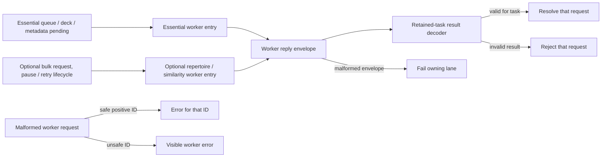
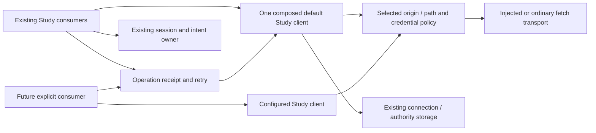
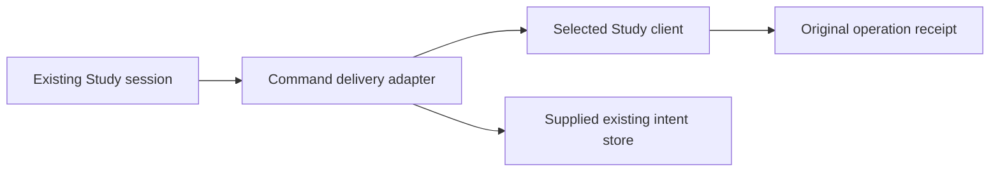
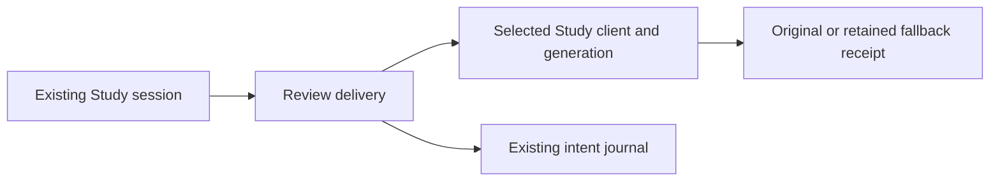

# Frontend runtime libraries

This directory is the current home for shared runtime code: IndexedDB and
backups, API/response handling, workers, engine brokers, analysis, imports,
performance, and chess calculations.

It is intentionally a documented refactor target. New code should make its
category clear and avoid adding another unrelated helper to `lib`; the audit
proposes gradual `api`, `persistence`, `workers`, `engines`, and `chess` seams.

Study computation's `StudyTaskResult` maps each task kind to its owner result:
`queue` returns practice cards; `deck` returns record/card pairs; `workspace`
remains unknown until its URL-specific decoder; `transportLines` and `lines`
return analysis lines; `index` returns indexed positions; both repertoire
preparation kinds return an alternative snapshot; `matches` and `similarity`
return ranked indexed positions with distances. The browser's essential and
bulk worker lanes retain their existing routing and reply handling. The essential entry imports queue, deck and workspace metadata computation; the optional entry imports repertoire and position computation. The shared wire/request schemas and URL-owned workspace validator remain shared; they are not workspace UI or engine startup.

Worker replies are checked against the retained task by `study-result-decoder`;
queue cards, deck pairs, lines, positions, ranked matches, and alternative
snapshots (including their maps and sets) use owner schemas. A workspace result
stays unknown and is checked using the existing URL-specific workspace owner.
An invalid result rejects its request; malformed reply envelopes retain the
existing lane failure behavior. A malformed worker request with a safe positive
integer ID receives an error for that ID; an unsafe ID raises a worker error.
The two worker lanes, pause/termination behavior, and wire version are unchanged.

### Study worker reply and failure boundary (proposed I2)

The lanes have separate worker and pending ownership. This is a source-level
validation boundary; it does not establish packaged or live behavior.

### Study client authority and transport (proposed J2)

`createStudyClient` owns one connection, generation and injected transport per
instance. Independent clients check origin and allowed API paths, attach only
that client's credential and workspace, and fence stale authentication events.
The local/full adapter uses ordinary fetch. Custom clients do not restore or
persist session credentials unless explicitly configured to do so; callers
that enable persistence must supply the intended session-scoped storage. The
existing exported connection functions delegate to one default client, whose
browser storage keys and `LEARNING_URL` compatibility binding remain. Session
settlement and saved intents still belong to `study-session-runtime` and its
existing storage owner; consumer capability injection remains J3.

This is a source-level capability change, not a live authority migration or
proof that durable session consumers have adopted explicit client injection.

`operation-status` now consumes the composed default client directly, or an
explicitly supplied Study client for receipt polling and retry. It binds the
selected origin and generation across a request before publishing receipt
status. Existing custom fetch/base URL callers retain their own transport;
background polling keeps its work-class classification. This cut does not bind
outbox or retained intent stores to arbitrary custom authorities: those remain
owned by the existing default session and storage composition.

Study command delivery is composed with an explicit client and intent-store
supplier. The registered default uses the existing default client and the sole
session's existing store; it keeps the authority generation fixed through the
original command and its receipt checks.

Review delivery captures the selected client generation and existing intent
store before its guided marker, review and receipt checks. Evidence fallback
and reconciliation retain their original journal identities.

