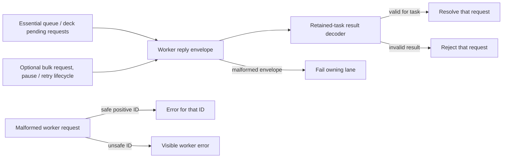

# Frontend runtime libraries

This directory is the current home for shared runtime code: IndexedDB and
backups, API/response handling, workers, engine brokers, analysis, imports,
performance, and chess calculations.

It is intentionally a documented refactor target. New code should make its
category clear and avoid adding another unrelated helper to `lib`; the audit
proposes gradual `api`, `persistence`, `workers`, `engines`, and `chess` seams.

Study computation's `StudyTaskResult` maps each task kind to its owner result:
`queue` returns practice cards; `deck` returns record/card pairs; `workspace`
remains unknown until its URL-specific decoder; `transportLines` and `lines`
return analysis lines; `index` returns indexed positions; both repertoire
preparation kinds return an alternative snapshot; `matches` and `similarity`
return ranked indexed positions with distances. The browser's essential and
bulk worker lanes retain their existing routing and reply handling.

Worker replies are checked against the retained task by `study-result-decoder`;
queue cards, deck pairs, lines, positions, ranked matches, and alternative
snapshots (including their maps and sets) use owner schemas. A workspace result
stays unknown and is checked using the existing URL-specific workspace owner.
An invalid result rejects its request; malformed reply envelopes retain the
existing lane failure behavior. A malformed worker request with a safe positive
integer ID receives an error for that ID; an unsafe ID raises a worker error.
The two worker lanes, pause/termination behavior, and wire version are unchanged.

### Study worker reply and failure boundary (proposed I2)

The lanes have separate worker and pending ownership. This is a source-level
validation boundary; it does not establish packaged or live behavior.
