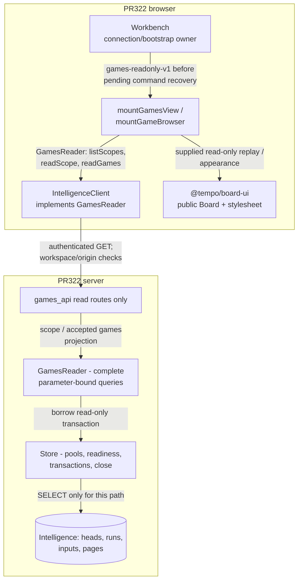
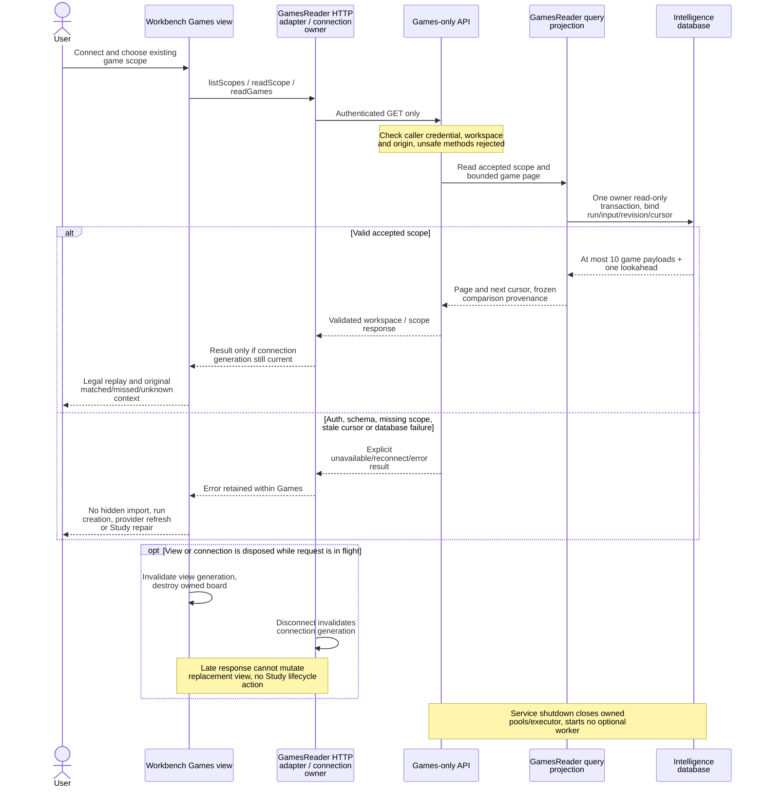

# Independent Analysis Workbench

Narrow Analysis UI, with its own dependencies and static build. No Study source,
store, queue client, engine/model runtime, Python or database is required.
Connect explicitly to Intelligence using its caller token. Session storage retains
that token; URLs, exports and durable command documents do not. Configure the exact
browser origin in `TEMPO_INTELLIGENCE_ORIGINS`. No API proxy or live fallback exists.

```sh
npm ci --prefix packages/board-ui --workspaces=false --ignore-scripts
npm run build --prefix packages/board-ui --workspaces=false
npm ci --prefix apps/workbench-web --workspaces=false
npm test --prefix apps/workbench-web
npm run test:browser --prefix apps/workbench-web -- /absolute/native/workbench-producer.json /absolute/evidence/browser
node apps/workbench-web/qualify.mjs /absolute/evidence/restricted
```

The native fixture is produced by Intelligence's PostgreSQL runner, not hand-authored
UI recommendations. Its games are explicitly synthetic. Native tests use a private
ephemeral static host, strict API interception, real storage/reload, desktop/phone
boards and declared traffic. Restricted qualification packages the static build,
removes source, installs the tarball and repeats public-client/native browser proof.
No offline/service-worker claim is made. Both board surfaces use the public `@tempo/board-ui` component and exported
stylesheet/assets through `src/board.tsx`. There is no Workbench palette, piece
copy or direct Chessground constructor. The qualifier packs the renderer and
installs its artifact before removing source.

Use the existing F2 `TEMPO_WORKBENCH_URL` launch setting to link this independent
static origin. No Study source change or credential handoff is required.

PR295 recovery uses the exported small `PendingCommands` coordinator. It keeps one
immutable serialized request per exact origin/workspace in session storage,
persists before dispatch, and blocks new commands until authoritative receipt
recovery or identical retry succeeds. Receipts must match workspace, command ID
and request digest. Lost responses, missing receipts and authentication failures
retain pending intent. Legacy v1 pending records migrate without credentials;
conflicting/malformed records remain retained and block transmission. The public
client's `requestSerialized` method preserves saved request bytes and its existing
connection-generation fences. Storage failure prevents transmission.

Run creation uses that same mutation slot and fence. `submitRun` generates one
run ID, retains exact POST bytes and a path/body digest in a credential-free v3
`run_create` record, and verifies persistence before dispatch. `recoverRun` reads
`GET /v1/analysis/runs/{run_id}` and compares its complete immutable request scope,
including normalized defaults. A matching status resolves creation without
another POST; 404, rejected authentication, lost responses and scope conflicts
retain the original intent. `retryRun` replays identical bytes and the original
run ID, then confirms through GET. The existing authority storage key is retained;
v2 commands and v1 migration remain supported. Commands and creation block each
other until resolution. Reload recovery navigates only after confirmation, and
switching origin/workspace retains the original record for reconnection.

Unknown engine repertoire/lineage is displayed explicitly. Old report generations
remain readable with a legacy attribution notice. A report or response draft does
not approve, publish, activate or admit training content.

“Browse selected games” reads the accepted input even when a game has no positive
finding. It pages through the exact selected scope, renders its full legal move
order and original comparison status/reason at each learner position, and retains
explicit unknowns. It uses only Intelligence's authenticated read endpoint;
provider links are supplied provenance, never guessed IDs. The native producer
fixture now includes the actual games read response for browser qualification.


## Architecture drawings

These are the canonical drawings for the views below. Edit the blocks here;
peer documents link to them instead of maintaining copies. See the
[diagram index and source/status baseline](../../docs/architecture/diagrams/README.md) and
[maintenance procedure](../../docs/architecture/diagrams/README.md#maintenance-and-review-procedure).

### Merged PR322 Games reader

**MAIN / MERGED PR322:** implementation
`653a85bb5f5b3e520c0eda0c36234d3b416708b4` merged as
`bc746728ca1967cc8ad9991cbe8c12099a01a3ae`. It restores frozen accepted
input viewing through an enforced read composition. It does not restore live
sync, fresh repertoire comparison, analysis creation or practice commands.



Source links below follow the merged implementation. The index retains the exact
implementation and merge SHAs; no deployed process or effective grant is inferred.

| Boundary | Merged PR322 concrete source |
| --- | --- |
| Typed view port | [`GamesReader`](src/games-reader.ts): three typed read methods; [`games-view.ts`](src/games-view.ts) and [`game-browser.ts`](src/game-browser.ts) receive it. [`client.ts`](src/client.ts) adapts HTTP and fences connection generations. |
| Shared Workbench composition | [`workbench.ts`](src/workbench.ts) still imports its ordinary Analysis controller/commands. It selects Games mode after bootstrap, before mutation recovery. Games view modules do not import that controller. The whole Workbench artifact is not claimed to contain only read code. |
| Server composition / enforcement | [`api.py`](../../services/intelligence/src/tempo_intelligence/api.py) returns after registering [`games_api.py`](../../services/intelligence/src/tempo_intelligence/analysis/games_api.py), rejects unsafe methods, and starts no worker/provider in read-only mode. Health, bootstrap, scope and game reads are registered; mutation/job/report-progress routes are absent. |
| Query / cursor owner | [`games_reader.py`](../../services/intelligence/src/tempo_intelligence/analysis/games_reader.py) queries only `analysis_heads`, `analysis_runs`, `analysis_inputs`, `analysis_pages`. Cursor binds workspace/run/revision/input/ordering. Scope and page share one transaction. Ordinary Analysis delegates the same game reader. |
| Database and lifecycle | [`Store`](../../database/tempo_intelligence_database/adapters/store.py) forces read-only transactions even when a caller omits the flag. Startup checks SELECT access for these tables plus metadata, without requiring engine/write grants. [`Configuration`](../../services/intelligence/src/tempo_intelligence/config.py) rejects worker/model configuration in read-only mode and needs caller/read configuration rather than operator/worker secrets. This is not a claim that live grants were provisioned or every possible write privilege is audited away. |

**Before PR322 (historical `4fc2eb8c`):** the earlier
[Workbench](https://github.com/aaweaver-actuary/tempo/blob/4fc2eb8c6b534345b25668761b3746c91be08cf0/apps/workbench-web/src/workbench.ts)
browsed selected games inside ordinary Analysis. The earlier
[`AnalysisStore.runs` / `games`](https://github.com/aaweaver-actuary/tempo/blob/4fc2eb8c6b534345b25668761b3746c91be08cf0/database/tempo_intelligence_database/adapters/analysis_store.py)
used engine-position aggregates for run listing and loaded accepted input through
`_input` before paging games in memory. The earlier
[API composition](https://github.com/aaweaver-actuary/tempo/blob/4fc2eb8c6b534345b25668761b3746c91be08cf0/services/intelligence/src/tempo_intelligence/api.py)
registered mutation/provider/job routes and could start a background worker.
The mutable mode still has those capabilities; merged PR322 adds the separate
read-only composition, narrow view port and bounded game projection above.

### Games read, failure and disposal (MAIN, merged PR322)

PR322 implementation `653a85bb5f5b3e520c0eda0c36234d3b416708b4` merged as
`bc746728ca1967cc8ad9991cbe8c12099a01a3ae`; see the
[source-linked component view](#merged-pr322-games-reader).



The query reader does not use engine-position progress, change accepted inputs,
write a command, contact a provider or query Study/Learning. Repertoire conformance
is frozen to the accepted input; a current-repertoire comparison would require a
separate explicit operation. Failure/shutdown isolation is a source boundary;
[shared host/database budgets remain deployment-unverified](../../docs/architecture/diagrams/study-games.md#failure-lifecycle-and-resource-acceptance).
Parsing this sequence or passing component tests cannot certify a live allocation.

## Connected navigation

`TEMPO_STUDY_URL` is an optional, public **build-time** setting for the general
Open Study link. It must be an absolute HTTP(S) root URL, without userinfo, path,
query or fragment. For example:

```sh
TEMPO_STUDY_URL=http://127.0.0.1:3000/ TEMPO_INTELLIGENCE_ORIGIN=http://127.0.0.1:8149 npm run build --prefix apps/workbench-web
```

The owning Vite config rejects unsafe settings before emitting assets and does
not echo the rejected value. The public `mountWorkbench(root, {studyUrl})` API
applies the same validation. With no setting, no Study link appears. A finding
link opens the normal Study destination and explicitly leaves its physical-card
identity unverified. A gap does not imply an existing Study card. No card-specific
URL, admission, review, Content operation or credential transfer occurs.

The full local app can launch this independent app using its existing public
`TEMPO_WORKBENCH_URL` build setting. Supported query keys are only `run`,
`category` and `dismissal`; userinfo, fragments and non-HTTP(S) schemes are rejected
before bundling. Neither setting is a runtime switch for an already built app.

The Intelligence origin is an API address to enter in the connection form, not
the Workbench page to navigate to. Connection credentials remain in the existing
per-tab session storage: reload or return to that connected tab to stay connected;
a fresh tab needs Connect. No localStorage credential, proxy, cross-window
handoff or persistent credential is added.

The owning qualifier builds with the non-secret fixture Study URL
`https://study.example.test/`; the browser intercepts this target locally and
proves a general root GET with no Authorization, referrer, card query or API
mutation. The regular `test:browser` entry builds with those fixture settings before running
the browser, and the registered component command uses that entry. A normal
`npm test` separately checks empty public defaults and does not leave a guessed
API origin. The source-removed qualifier sets the same explicit fixture settings
when building its artifact.
The qualifier also executes the actual public Vite build-config rejection checks
before bundling, then verifies the source-removed package as before.

`TEMPO_INTELLIGENCE_ORIGIN` is a separate optional public build setting. It must
be a root HTTP(S) origin with no userinfo, path, query or fragment. It prefills the
connection form only; it never auto-connects or carries a token. Without it, the
origin field is empty rather than guessing a port. An existing per-tab connection
continues to use its saved origin. The owning build boundary rejects unsafe values
before embedding them. The qualifier uses `https://intelligence.example.test` as
its explicit non-secret fixture form default, then fills the intercepted test API
through the normal connection UI.

## Games-only restoration

An authenticated Intelligence bootstrap advertising `games-readonly-v1` opens a
Games-only view automatically. It reuses `mountGameBrowser`, its board/navigation
and accepted run/input reader. It shows existing scopes and frozen provenance,
including games without positive findings; engine completion is unnecessary.
No saved mutation recovery, import, run creation/continuation, dismissal, or
training control is offered. The client refuses mutation delivery on that
connection, while the server separately enforces read-only HTTP and PostgreSQL.
The mode is not inferred from a URL or a hidden button.

There is no implicit current-repertoire refresh. The snapshot identity/revision
is displayed, and a fresh comparison is identified as a separate unavailable
operation. A new accepted input without a run is not made viewable by silently
creating one. Study opens separately using its existing general link; no Study
credential, card identity, queue request or DB connection is transferred.

The Games views depend on the public `GamesReader` semantic interface, not
`IntelligenceClient`, fetch, URLs, request schemas or mutation storage. The
existing HTTP client implements `listScopes/readScope/readGames`; another reader
can substitute without changing game presentation. The composition root selects
the mode after bootstrap and retains connection/session ownership. Shared pure
chess/render libraries and navigation are acceptable; Study never imports, calls
or waits for the Games reader. Its shutdown owns only its board and pending UI
responses. Deployment/resource isolation is a separate unverified rollout gate.

## Shared appearance

`WorkbenchOptions.appearance` injects a shared `BoardAppearance`. Normal startup
uses validated `boardTheme` and `pieceSet` launch fields, then this origin's last
saved `tempo-board-theme` / `tempo-piece-set` selection, then brown/CBurnett.
`readWorkbenchAppearance` is the public bootstrap helper; denied storage leaves
the launch snapshot/default usable. Filters and history retain launch fields.
Already-open separate Workbench tabs keep their snapshot until the next launch
from Tempo. No live cross-origin synchronization, opener, credential handoff,
Study storage access or Study service dependency is introduced.

Canonical [board ownership and adoption drawing](../../packages/board-ui/README.md#presentation-ownership).
