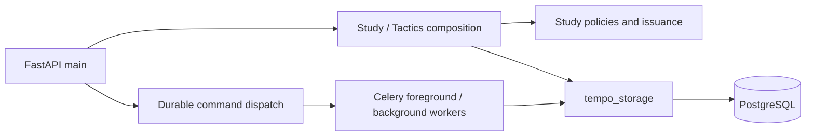

# Tempo backend

The current backend is the local FastAPI/Celery product with PostgreSQL storage.
This is a source navigation guide, not an installed-health receipt. The independent
Learning service, optional feedback/analysis assemblies and SQLite runtime routing
are retired; retained tables/contracts do not reactivate them.

## Current owners

- [main.py](app/main.py): HTTP routes and application composition.
- [product composition](app/product_composition/README.md): Study queue issuance,
  borrowed Tactics capture and process database admission binding.
- [Study](app/study): issuance, position learning, review and scheduling policy.
  [Pure policy helpers](app/study/policy/README.md) and the retained
  [review application library](../services/learning/application/README.md) are not
  independent services.
- [Transport contracts](app/contracts/transport/README.md): named request models.
  `app/models.py` is removed; import the actual owning contract module.
- [Repertoire projections](app/repertoire/README.md) and
  [source changes](app/repertoire/changes/README.md): supplied-source policy.
- [PostgreSQL storage](../database/tempo_storage/README.md): concrete persistence;
  [connections](../database/tempo_storage/connections.py) borrow admission and
  [postgres.py](../database/tempo_storage/postgres.py) owns pools/transactions.
- [Command gateway](app/command_gateway.py), [dispatch](app/command_dispatch.py)
  and [Celery root](app/celery_app.py): durable command/worker composition.
- [Operational readiness](app/operations/README.md): schema, worker and queue facts.

This source view does not claim complete isolation: the shared broker, application
root and storage still need their applicable integration proof. Study owns learning
and receipts; an optional producer is not a second scheduling writer. Preserve
original issued attempts, durable journals and receipts across retries.

## Operate and verify

Use the [registered Tempo CLI](../docs/TEMPO-CLI.md) for the live installation,
not ad hoc Compose commands. Use [focused test selection](../docs/testing.md)
and [contribution/resource rules](../CONTRIBUTING.md) for isolated checks. A source
checkout or component pass is not evidence of a live update or playable successor.

## Historical assembly

The [pre-reconciliation guide](https://github.com/aaweaver-actuary/tempo/blob/799b66234b8be386a33d980df10b8b1d9a9d8b36/backend/README.md)
records earlier feedback/evidence bridges and legacy architecture drawings.
`BorrowedFeedbackStore`, `game_evidence_commands.py`, the old
`tempo_legacy_database` namespace and independent Learning runtime are not current
navigation targets. Their historical evidence is not an instruction to restore them.
