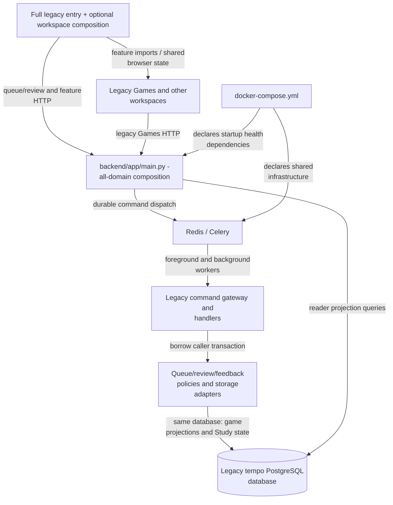

# Tempo backend

This directory contains the authoritative local product backend: FastAPI,
Python domain services, and PostgreSQL persistence in Docker. SQLite remains a
compatibility path for focused tests and verified historical import. Docker runs this backend at
`http://localhost:8000`; the static browser demo does not use it.

## Architecture drawings

These are the canonical drawings for the views below. Edit the blocks here;
peer documents link to them instead of maintaining copies. See the
[diagram index and source/status baseline](../docs/architecture/diagrams/README.md) and
[maintenance procedure](../docs/architecture/diagrams/README.md#maintenance-and-review-procedure).

### Legacy assembly and existing coupling

**MAIN / LEGACY:** the full app and legacy backend still combine domain concerns.
This is a separate assembly from the independent Learning runtime. The declared
PostgreSQL Compose stack below is source configuration, **deployment unverified**.
SQLite compatibility paths also exist; see [storage](../docs/STORAGE.md).



The extracted feedback/queue ports improve local decision/effect ownership; they
do not split this database, broker or application root. The legacy
[`QueueAdmissionAdapter`](app/services/queue_admission_adapter.py)
still joins gameplay priorities, opportunities and miss projections while preparing
ordinary queue candidates. Its
[feedback composition](app/services/real_game_feedback_adapter.py)
wraps the caller connection with
[`BorrowedFeedbackStore`](../database/tempo_legacy_database/adapters/real_game_feedback.py);
the [miss projection](../database/tempo_legacy_database/adapters/real_game_miss_projection.py)
and [accepted-scope storage](../database/tempo_legacy_database/adapters/legacy_game_evidence_scope.py)
own those queries. Queue policies must not acquire a second writer.

The legacy [evidence command](app/game_evidence_commands.py)
also borrows the existing [command gateway](app/command_gateway.py)
transaction. This legacy-local bridge is not the independent Learning receiver
and must not be mistaken for permission for another service to write these tables.
[Games view](../app/views/games_view.tsx),
[legacy root](app/main.py), [command dispatch](app/command_dispatch.py),
[Celery root](app/celery_app.py) and
[Compose](../docker-compose.yml) are the source anchors for the graph.

These are scoped legacy backend gaps, not a claim that Games can fail
independently throughout the full local app. The merged PR324
[Study composition](../app/README.md#main-study-path-and-source-gap) uses a physical
entry without the legacy optional workspace root; the full local/demo entry owns
that root and supplies narrow capabilities to the shared core shell. The
[canonical build view](../static/README.md#conditional-study-build-and-offline-assets-main)
retains PR324's actual emitted-artifact and synthetic offline proof, without
qualifying a combined deployment or repairing the backend's shared broker/data
assembly. No live cutover is authorized.

## Start and test

From the repository root:

```bash
docker compose up --build
python -m pytest backend/tests
```

The backend can also be run through the repository launchers. Use the root
`README.md` and `docs/STORAGE.md` for Docker data, backups, and restore rules.

## Map

- `app/main.py` — current FastAPI application and route registration. It is a
  known extraction target; see [the organization audit](../docs/CODE-ORGANIZATION-AUDIT.md).
- `app/database.py` — PostgreSQL connection routing and the SQLite compatibility
  path. PostgreSQL is authoritative for cards, reviews, queues, repertoires,
  games, and sync metadata after the verified cutover.
- `app/models.py` — request/response models used at the HTTP boundary.
- `app/services/` — business logic, provider clients, and durable derived-data
  handlers. See its local README for the service clusters.
- `tests/` — backend unit and integration coverage, including concurrency,
  restart, idempotency, and provider failure behavior.

## Boundary rules

Route handlers should translate transport data and call domain/application
functions. Services must report real provider and storage failures; they must
not substitute sample records or claim success. Background work follows the
bounded-slice contract in `docs/BACKGROUND-WORK.md`: claim one item, close
SQLite before computation or network I/O, then publish one idempotent result.


### Removed on-demand endgame calculation

Probe, generated-template admission and new generated-attempt routes return 410.
Their provider/cache/generation paths and generator implementation are removed;
queued template-generation commands also decline without calculation. Existing
immutable attempt receipts retain template binding and canonical status/result
recovery. Saved cards, attempts, history and ordinary review storage are not
migrated or deleted. See the canonical
[Learning request/resource drawing](../services/learning/runtime/README.md#shared-learning-request-execution-gaps-main)
and [saved browser practice policy](../app/README.md#saved-endgame-practice-after-calculation-removal).
