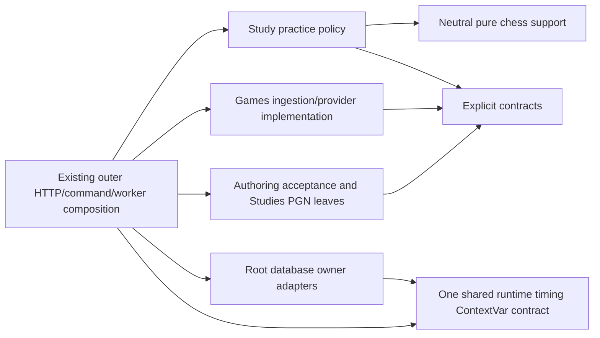

# Backend application

**Current unmerged source; deployment unverified.** This Python package contains the local product's legacy HTTP/application composition and progressively separated logical owners. Start with the [finite organization checklist](../ORGANIZATION.md); 202 source reviews are not 202 completed implementation changes.

| Location | Responsibility |
| --- | --- |
| [contracts](contracts/README.md) | Explicit request/fact/interface definitions, grouped by owner. |
| [chess](chess/README.md) | Neutral pure chess algorithms and established identity exports; no engine execution. |
| [study](study/README.md) | Daily practice policy, not authored/imported chapters. |
| [games](games/README.md) | Game records, provider adapters and ingestion/profile calculations. |
| [authoring/discovery](authoring/discovery/README.md) | Pure acceptance decisions over supplied facts/capabilities. |
| [studies](studies/README.md) | Authored/imported PGN and chapter/exercise concerns; distinct from daily Study. |
| [services](services/README.md) | Remaining legacy workflows and mixed composition awaiting the recorded splits. |
| [main.py](main.py) | Existing HTTP/composition root; handler/lifecycle separation remains pending. |
| [models.py](models.py) | Explicit compatibility exports of canonical owner transport models; no model implementations. |

This bounded view describes the newly separated leaves and timing import, not every legacy workflow or a deployed isolation claim. Each domain can use its own internals, explicit contracts, neutral pure libraries and external packages. Sibling implementation imports are forbidden even through a public entry point. Outer composition connects implementations and injects capabilities; it must not make ordinary Study depend on Games.

Database implementation belongs in the single [root database tree](../../database/README.md), with owner packaging and transaction authority retained. The remaining technical composition edges are tracked there; physical relocation is not proof of full independence. The former `app.database` and its SQLite-first description are obsolete: current connections retain explicit PostgreSQL/SQLite compatibility routing in the database owner, without changing deployment here.

See [validation and existing limitations](../../database/VALIDATION.md), the [architecture index](../../docs/architecture/diagrams/README.md) and the single [proposal-only simplification list](../../database/SIMPLIFICATION.md).
