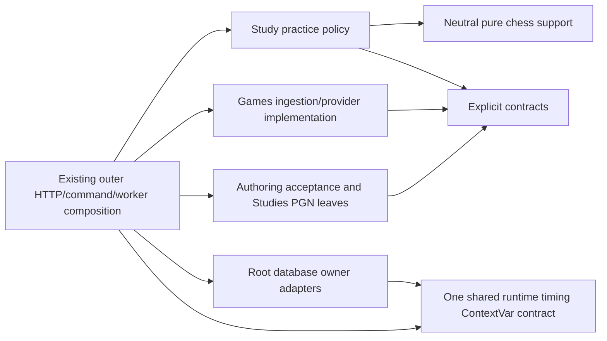

# Backend application

**MAIN source; deployment unverified.** Reviewed against `1ce172e9` (October 26, 2026 UTC). This Python package contains the local product's legacy HTTP/application composition and progressively separated logical owners. Start with the [finite organization checklist](../ORGANIZATION.md); 202 source reviews are not 202 completed implementation changes.

| Location | Responsibility |
| --- | --- |
| [contracts](contracts/README.md) | Explicit request/fact/interface definitions, grouped by owner. |
| [chess](chess/README.md) | Neutral pure chess algorithms and established identity exports; no engine execution. |
| [study](study/README.md) | Daily practice policy, not authored/imported chapters. |
| [games](games/README.md) | Game records, provider adapters and ingestion/profile calculations. |
| [authoring/discovery](authoring/discovery/README.md) | Pure acceptance decisions over supplied facts/capabilities. |
| [studies](studies/README.md) | Authored/imported PGN and chapter/exercise concerns; distinct from daily Study. |
| [services](services/README.md) | Remaining legacy workflows and mixed composition awaiting the recorded splits. |
| [main.py](main.py) | Existing HTTP/composition root; handler/lifecycle separation remains pending. |
| [models.py](models.py) | Explicit compatibility exports of canonical owner transport models; no model implementations. |

This bounded view describes the newly separated leaves and timing import, not every legacy workflow or a deployed isolation claim. Each domain can use its own internals, explicit contracts, neutral pure libraries and external packages. Sibling implementation imports are forbidden even through a public entry point. Outer composition connects implementations and injects capabilities; it must not make ordinary Study depend on Games.

## Public surfaces and extension boundary

| Surface | Exported functionality / permitted direction | Remaining limit |
| --- | --- | --- |
| [Explicit contracts](contracts/README.md) | Import named `app.contracts.<owner>` facts, request types and semantic ports. Domain code uses its own implementation, explicit contracts and neutral pure libraries. | Contracts include established framework/model dependencies; a public barrel does not authorize sibling-implementation imports. |
| [Frozen Study policy](study/frozen_order/README.md) | `annotate`, `proposal_valid`, `order_queue_slots` and typed facts/predicates accept supplied data/capabilities. Outer composition binds the database adapter. | The legacy facade still reaches feedback and queue-ordering implementation. The pure leaf's separation does not isolate every caller. |
| [Learning review application](../../services/learning/application/src/tempo_learning_review/__init__.py) | `apply_review`, `review_context`, `submit_review`, `ReviewStore` and `ReviewSubmissionStore` provide semantic review behavior. `register_review_commands(register, submit=..., reconcile=...)` explicitly registers `cards.review` and `cards.review.reconcile`; import alone does not register them. | Caller/gateway owns the transaction and settlement. This separate installed package is not an extension of the legacy global registry. |
| [Legacy command gateway](command_gateway.py) | `register_command(name, handler, prepare=...)` registers existing command handlers; the gateway owns receipt/transaction execution. | Process-global handler/preparer dictionaries, concrete `PostgresConnection` handlers and command-specific execution branches remain. It is not a generic isolated-plugin contract. |
| [HTTP and worker composition](main.py) | Routes translate requests and compose existing capabilities; [background worker](background_worker.py) starts/stops its coordinator. | That worker imports `main.coordinator` to register handlers and waits for API health. HTTP startup and worker lifecycle remain coupled in this legacy assembly. |

**Coupling has been reduced, not eliminated.** Moved policy leaves and removed
optional producers remove specific edges; the [retirement map](services/README.md#retired-optional-capabilities)
names them. Existing local `organized-*` import contracts cover selected moved
namespaces, not all services, commands or `main.py`; no repository-wide cycle or
plugin lifecycle audit is claimed here. The
[resume priorities](../../docs/architecture/diagrams/README.md#bounded-resumption-priorities)
separate concrete follow-up work from the already-implemented public surfaces.

An additional optional integration must supply a narrow owner contract and be
wired at an outer composition root, with one owner for state, effects, retry and
shutdown. It must not gain direct queue/review writes or make ordinary Study wait
for its availability. Adding another global registry entry is not evidence of
safe removal, failure independence or bounded shared-host resources.

Database implementation belongs in the single [root database tree](../../database/README.md), with owner packaging and transaction authority retained. The remaining technical composition edges are tracked there; physical relocation is not proof of full independence. The former `app.database` and its SQLite-first description are obsolete: current connections retain explicit PostgreSQL/SQLite compatibility routing in the database owner, without changing deployment here.

See [validation and existing limitations](../../database/VALIDATION.md), the [architecture index](../../docs/architecture/diagrams/README.md) and the single [proposal-only simplification list](../../database/SIMPLIFICATION.md).
