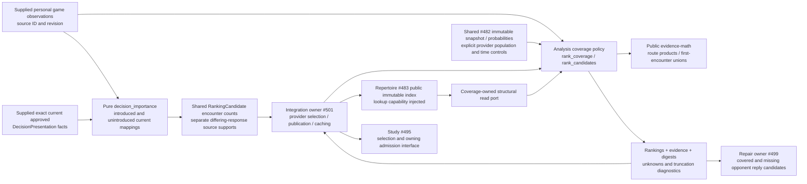

# Pure coverage and encounter ranking

This is #494 / T13's source implementation for SPEC v0.2 S01/S02/S04, P01,
D04 and the ranking part of A06. It is proposed, unmerged code, with no live
product wiring or deployment claim. Analysis owns these calculations and no
persisted state. Study owns eligibility, global introduction allowance, relative
repertoire weights, card membership deduplication, queue admission and scheduling.

## Public API and dependencies

- [`ranking.rank_candidates(RankingInput) -> RankingOutput`](ranking.py) consumes
  the factual shared [#482 contracts](../../contracts/product_v02/analysis.py).
- `ranking.rank_coverage(*, snapshot, index, policy, root_fen,
  approved_route_ids, population, provider, model, evidence, limits,
  personal_games=()) -> CoverageRanking` supplies ranked `gaps` and
  `introductions`, immutable `details`, diagnostics and provenance. Each call
  covers one repertoire, selected own policy and common root. It performs no I/O.
- [`ports.RepertoireIndex`](ports.py) is a structural capability matching
  [#483's public index](../../repertoire/README.md). Outer composition supplies
  `app.repertoire.build_index(snapshot)`; this module never imports that sibling
  implementation. Index snapshot/source/revision/digest must match exactly.
- `ports.AnalysisLimits(max_routes, max_plies, max_positions)` bounds analyzed
  routes, route depth and total analyzed occurrences. All are mandatory positive
  integers. Source inventory is additionally bounded to #483's 100,000 plies.
- [`personal_evidence.PersonalGame`, `PersonalEncounter`, `deduplicate_games`,
  `encounter_sources`](personal_evidence.py) are local immutable policy inputs
  and normalization helpers, not another provider DTO or persistence model.
- `personal_evidence.decision_importance(current_approved_decisions=...,
  games=...) -> tuple[DecisionImportance, ...]` is a separate next-release
  projection for **both introduced and unintroduced** currently approved mapped
  decisions. Existing `rank_coverage` and `rank_candidates` APIs are unchanged.

Reuse: public `tempo_evidence_math.LearnerPolicy`, `opening_position_key`,
`route_probability`, `decision_reach`, `RouteReach`, `coverage_mass_summary` and
`stable_key`; shared `RepertoireSnapshot`, `DecisionPresentation`,
`ProbabilityEvidence`, `PopulationSelection` and factual ranking DTOs. Existing
probability/route arithmetic needs no owning-library change. No preparedness,
recall, card-value optimizer, engine or legacy priority-service implementation is
imported. The specific new behavior is adapting the approved snapshot/index to
gap and unintroduced-decision events with explainable personal tie-breaking.



This diagram describes the proposed source boundary. Integration connections are
owner responsibilities. No provider, database, transaction, worker, connection,
thread, persistent cache or lifecycle is owned here. An unavailable computation
can be discarded; integration/Study retain the last usable ranking or safe order.
Study never calls or waits for this optional producer. Host resource/deployment
isolation and normal-product behavior remain unverified here.

## Route and identity semantics

The caller supplies **approved route IDs from the owning Repertoire snapshot**;
proposal routes are excluded. Snapshot `available` and `complete` must be true.
Each own move must match the explicitly selected deterministic `LearnerPolicy`.
It contributes no probability multiplier. Different selected responses across
repertoires are separate computations, never interchangeable decisions.
Same-repertoire conflicts from the index block the affected route prefix, even
when a caller would prefer one conflicting response.

At each opponent position, a gap's score is position reach multiplied by the
conditional reply likelihood. All legal replies retain their exact supplied
probability or an unknown bound. Already-covered replies remain in `details`
with `covered=True` and a legal `target_fen` for #499; this policy assigns no
engine quality or blunder label. Deliberate route ends produce no extra gap.
Non-deliberate ends and route/depth/position truncation remain diagnostics.
The complete bounded approved inventory determines covered edges before analysis
limits are applied, so an unvisited route cannot become a fabricated gap.

One semantic introduction entry requires the actual index-supplied decision and
presentation mapping, available and explicitly unintroduced. Unknown, introduced,
incomplete-route, conflicting or ambiguous mappings are excluded. No physical
card ID is synthesized. Gap IDs identify semantic opponent edges, never cards.
Multiple supported routes and supplied presentation memberships survive in detail.
Study may subsequently deduplicate compatible memberships of the same card.

`decision_reach` unions mutually exclusive opponent prefixes from a common root,
deduplicates identical route copies and absorbs later revisits contained in an
earlier prefix. Two disjoint transposition supports `.2*.5*.8` and `.3*.4*.8`
therefore yield `.176` once. A cycle revisiting an already encountered decision
does not add another independent chance. Outputs are **first-encounter
probabilities within the supplied finite routes/horizon**, conditional on own
policy; they are not expected visit counts or an infinite-horizon estimate.
Different roots must be separate calls, because their scenarios have no supplied
mixture weights. No hidden repertoire-selection frequency is inferred.

## Unknowns and personal policy

D04 `PopulationSelection` is mandatory, including explicit rating bounds and time
controls. Provider and model are explicit selections. Matching-provider evidence
with different settings or multiple competing snapshots for a position fails
explicitly. A different provider's same numeric rating band is never reused.
Explorer and Maia can each supply this seam; source choice happens outside it.

Missing/unavailable evidence spans `[0,1]`. An unassigned move has bounds
`[0, unknown_mass]`; partial distributions are never renormalized. Known values
stay exact *within the supplied model*, not statistically calibrated estimates.
Each detail includes position and encounter bounds, conditional per-route reply
bounds, population evidence, counts/unknown counts and observation provenance.
The shared factual `reach_probability` is `None` unless the encounter bound is
exact. Its `uncertainty` is the bound width, not a confidence interval. Unknown
reach follows known reach and an all-unknown list reports unavailable. Support
is the minimum supplied source denominator along the supporting paths, only when
every used source has counts; duplicate routes never add sample counts. This is
a conservative ordering fact, not an effective sample size or significance test.

Version `population-reach-personal-tie-v1` orders by known population encounter
probability descending, then distinct personal-game encounter count descending
**only on equal reach**, then lower bound width, known/higher support, repertoire
and decision ID. This intentionally small personal-priority tie-break is not a
Bayesian fusion or a calibrated statistical model. Personal distributions stay
separate in `personal_evidence`; they do not overwrite population probabilities.

Game identity is `(provider, account, game_id)`. Reimport/recompare duplicates
count once per exact repertoire/position/move, including repeated visits within
a game. Own-decision priority counts reaching the position even when the learner
played another response; opponent-edge priority requires the observed reply.
The newest supplied source revision replaces that game's complete
observation set; equal-revision conflicting contents fail explicitly. This input
is a **complete observation set**, not an incremental observation delta. A newer
empty set can retract obsolete observations. Personal IDs/revisions remain in
each affected candidate's detail. Cross-provider copies are not guessed to be
the same game.

## Revision and publication boundary

`CoverageRanking` carries the source revision, snapshot digest, settings digest,
policy version and dependency digest. Each `CandidateDetail.dependency_digest`
binds its used paths, mapping revisions, selected settings/policy/limits,
population evidence payloads and relevant personal observations/estimates.
Changed evidence or a new personal game invalidates only dependent candidates;
unrelated supplied probability records do not enter their digest. A changed
repertoire source revision/digest conservatively invalidates that repertoire's
ranking. Calls for other repertoires retain independent publication/cache keys.

Consumers must retain this provenance alongside `RankingOutput`, compare it to
the current source/settings before publication or admission and reject stale
results. The shared factual output alone is insufficient for freshness checking.
There is no mutable cache or invalidation registry here. Composition #501 owns
acquisition/cache/publication; Study #495 owns the final eligibility and admission
recheck. Ordinary reviews and admitted game-lapse obligations take precedence.

Errors are explicit `ValueError` reasons: stale index, missing explicit settings,
population mismatch, unavailable/incomplete source, unsupported scope, foreign
approval, multiple roots, illegal approved routes, ambiguous probability
snapshots/identities, conflicting personal revisions or exceeded source bounds.
An error is not an empty/full-coverage result. Integration retains its safe order.

## Focused checks and handoff

```sh
make python-file FILE=backend/tests/test_product_coverage_ranking.py
```

Use the existing Python environment with chess, Pydantic and pytest. This regular
test file adds this checkout's existing package source paths explicitly; no
software install, provider, network, database, engine, browser or production
corpus is needed. The suite uses the actual #483 index with synthetic legal
routes and invokes #482's scoped dependency/cycle guard on these new files.
The eleven named #494 acceptance cases and additional source/revision/boundary
cases live there. Run serially under the existing nontruncating advisory lock.

Global runner/regression/dependency registration remains the integration owner's
shared-file task: add `backend/tests/test_product_coverage_ranking.py` to the
current regular backend inventory, and supply the already-existing shared
evidence-math / game-review / analysis-jobs contracts as needed. No central file
was changed. #495 can consume `result.introductions` with its provenance;
#499 can inspect `result.details` for covered/missing opponent replies. #501
must wire actual acquisition, approved-route authority, settings and publication.
These pure checks do not establish A06's budget/queue or A07's engine/product proof.

## Next-release historical importance checkpoint

`decision_importance` reuses the existing normalized comparison's scoped
`PersonalGame` observations and the owner's exact current approved
`DecisionPresentation` facts. It does not traverse PGN, recapture games, infer a
physical card from FEN or introduce another worker/backfill pipeline. The caller
must supply observations already scoped by the existing exact comparison and
current owner mappings. A generic FEN match does not establish that authority.
Unavailable/unknown-state mappings are withheld; conflicting current responses
and ambiguous copies of a decision fail explicitly.

Each local immutable `DecisionImportance` calculation result contains the shared
current mapping, a shared `RankingCandidate` with the existing
`personal_encounters` unique-game count, stable encounter source IDs/revisions,
separate `differing_response_sources`, policy version
`current-decision-personal-importance-v1`, and a dependency digest. These local
calculation details are not another shared encounter/admission DTO. Shared
command/receipt transport remains #482/#487-owned; composition supplies these
factual values without making Study import an Analysis implementation.

A differing observation means the normalized game played another move than the
supplied current prescribed response. It is **importance evidence**, not proof
that the player forgot historically learned content. Correct observations count
only as encounter frequency. One source game/current decision contributes once
across duplicate imports, recomparisons and route/transposition copies; if a
game revisits and plays differently on one visit, it has one differing-game
support as well. Counts are deduplicated within each repertoire/decision scope;
Study owns compatible same-card membership deduplication.

No introduction date, current schedule, latest review, obligation settlement or
lapse eligibility filters this evidence. A miss before introduction or before
later genuine learning therefore retains one importance contribution when the
current mapping becomes introduced. Mapping/state changes update the result
digest while stable game/decision support remains. A newer complete source-game
revision may retract corrected/obsolete observations, using the existing
deduplication policy. There is no extra numeric miss bonus or probability fusion;
Study receives differing-game supports separately and owns their current priority
consequences.

This projection writes no priority, history, FSRS state, introduction or receipt,
and grants no Again authority. Study must revalidate current approval/membership,
source identity, mapping revision and any shared delivery fences. The original
pipeline retains full canonical game provenance/detection; this compact result
does not replace it. Actual unchanged-schedule/history and durable-priority proof
belongs to #487's owning/native tests. Allowance, pause and Study-only exceptions
remain undecided here. The qualified first installation and #521 are unchanged.

Five additional focused cases in the same regular owning suite cover both
states, duplicate/recomparison/transposition identity, historical relevance after
later introduction/learning, correct frequency versus differing play, and source
correction/current-mapping fences. No provider, engine or state writer is used.
