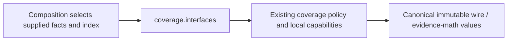

# Coverage interface

Owner: Analysis coverage, #494. This first-wave surface exposes existing policy
from the manifest's qualified D/E checkpoint `c5c5f2f0`, over main `d87accc5`.
It changes no implementation, score, signature, class identity or serialization.
The separate next-release #532 `cc6937aa` remains preserved on its own branch;
its later importance APIs are not silently added to this older qualified source.

Inputs: canonical shared `RankingInput`, approved `RepertoireSnapshot`, selected
own policy, explicit population/evidence and finite `AnalysisLimits`. Composition
injects `RepertoireIndex`; the structural protocols and personal observation
values are exported here. Outputs: `RankingOutput` or `CoverageRanking` with
details, bounds, route support, source/settings provenance and diagnostics.
See [the implementation contract](../README.md) for exact semantics.

Operations: `rank_candidates`, `rank_coverage`, `deduplicate_games` and
`encounter_sources`. Named result/capability classes and `POLICY_VERSION` are
listed explicitly in [__init__.py](__init__.py). Shared wire/math types remain
owned by their canonical packages and are not re-exported here.

Dependencies: existing `app.contracts.product_v02` immutable values,
`tempo_evidence_math` and python-chess. No provider, engine, storage or Study
implementation is selected. No connection, process, queue, transaction or state
write is owned here. Unknown evidence remains unknown; invalid/stale input raises
the existing `ValueError`; callers retain their existing safe order on failure.

Remaining edges: `product_composition/analysis.py` and `analysis/jobs/ports.py`
still import the old coverage module paths; #501 owns their migration. The
policy's existing wire/math imports retain their exact canonical origins until
#482/#503 surfaces are integrated and the owning caller files are leased. This
allocation leases only new interface/test files, so old aliases and internal
imports remain unchanged. #501 removes exact bypasses after migration/negative
controls. No whole-graph decoupling, installed routing or deployment is claimed.

Checks: `backend/tests/test_public_surface_coverage.py` proves named export
identity, closed owner exports, cold no-I/O import and a numerical fixture.
Retained semantic suite: `backend/tests/test_product_coverage_ranking.py`.
Root registration/packaging belongs to #501; whole-graph guards belong to #482.
