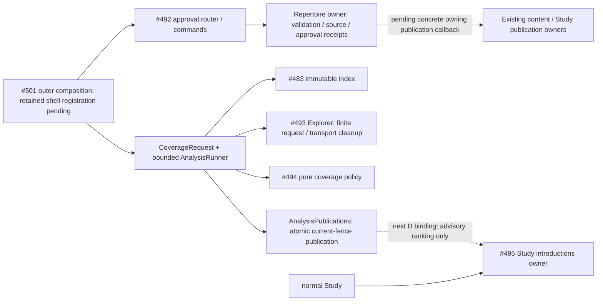

# Bounded repertoire composition — #501 private checkpoint

Unmerged source preparation for SPEC v0.2 C/D/E. Nothing here mounts a route,
starts a worker, writes live settings, creates cards, or activates introductions.
The working Study/Tactics shell remains with #488/#491's shared-root windows.

| Checkpoint | Usable source now | Remaining product proof |
| --- | --- | --- |
| C audit | [Composition router factory](../../product_composition/repertoire.py) delegates to #492's actual conflict/preview/decision router; shared commands pass unchanged to the approval owner. | Current retained-source projection/publication, affected Study suspension without lapse, persistent conflicting-import preview, #500 mount and A05 browser/PG proof. |
| D introductions | [CoverageRequest / prepare_coverage](../../product_composition/analysis.py) joins #483 index, #493 Explorer and #494 coverage; this runner fences publication against current source/settings/personal/evidence generations. | Concrete Analysis store/cache, explicit saved settings, #495 accepted-ranking/current-facts/canonical-writer binding, A06 ordinary introduction and PG/browser proof. |
| E repairs | C's shared approval command accepts the same exact #482 Proposal/ProposalDecision. | #496/#497/#499 evidence orchestration, exact displayed changes and #500 UI, real bounded Stockfish request, existing-card Study practice command, A07 product proof. |

These are independently reviewable checkpoints; no row claims A05/A06/A07 is
complete. C has no probability/engine dependency. D has no similarity/engine
dependency. Maia and R11 do not gate this lane.

## Public use and ownership

`AnalysisRunner(publications, timeout_seconds=...).run_once(fence, prepare)`
executes one explicitly requested unit, returns `published`, `obsolete`,
`setup_required`, `unavailable`, `cancelled`, `busy` or `stopped`, and starts no
polling/retry loop. `request_stop()` prevents publication and cancels/awaits owned
async work. Caller cancellation propagates after cleanup. Borrowed stores and
providers are never closed. One runner permits one unit; its timeout is 1–60
seconds and each prepared Explorer request has its own 20-second ceiling. Source
indexing/ranking also retain their owning finite route/ply/position bounds.

`AnalysisFence` is Analysis-local publication metadata, not a second probability,
ranking, snapshot or proposal DTO. `coverage_settings_digest(...)` binds the
explicit population/time controls, Explorer months, selected policy/root,
approved routes and limits. `CoverageRequest` rejects mismatched source/settings.
The context also carries separate source, settings, personal-game and evidence
generations. A settings owner must persist the explicit selection before a real
ranking can be enabled; a missing population returns `setup_required` before I/O.
No live cohort is guessed. The fixture cohort is synthetic.

`prepare_coverage` performs at most 32 sequential requests; overflow fails visibly
instead of pretending partial acquisition is complete. It calls the actual
Explorer adapter with a request-owned transport and then the actual coverage
policy. Unknown mass, counts and provider provenance remain those owners' facts.
An acquisition failure, all-unknown ranking, cancellation or obsolete context
does not overwrite a previous accepted ranking. Credentials exist only for the
invocation and never enter persisted result/fence/cache keys.

[`AnalysisPublications`](ports.py) requires `current(repertoire_id)` and an atomic
`publish_if_current(prepared)` that compares **every fence field** inside its own
short transaction. The future concrete Analysis adapter owns result persistence;
the current fake proves the semantic boundary only. It must never hold a DB
connection across HTTP/engine work or write Study state. A prepared result is
advisory, not an introduction or permission to publish cards. #495 owns final
ranking acceptance, eligibility, global budget, weights, unique charges, fallback
and canonical admission. Its owner rechecks controls/revisions in the borrowed
writer transaction. Analysis must never call that writer directly.

#489's `FeedbackRunner` was inspected for reuse. Its run-once operation claims
Games jobs and alternates provider pages with lapse/control delivery; it is not
an owner-neutral execution primitive. Importing it into Analysis would import
Games lifecycle and store semantics. This small async unit retains the same
run-once/stop pattern without copying Games persistence, leasing or retries.
No universal job framework or second scheduler is introduced.

## Canonical affected boundary

Source paths: [application](application.py), [capabilities](ports.py),
[analysis composition](../../product_composition/analysis.py),
[repertoire composition](../../product_composition/repertoire.py),
[#492 owner](../../repertoire/changes/README.md),
[#493 owner](../probability/README.md), [#494 owner](../coverage/README.md),
[#495 owner](../../study/introductions/README.md).
Solid edges are this source checkpoint; dotted edges are unimplemented product
bindings. Study imports/calls/waits for none of these optional producers. Shared
host/database contention and deployed stop/isolation behavior remain unverified.
No new schema, migration, pool, process or state owner is activated here.

## Focused verification

`make python-file FILE=backend/tests/test_product_repertoire_integration.py`
uses synthetic legal sources, real index/Explorer/coverage/change-owner code,
fake HTTP and semantic fake publication stores. It covers 20%/2% ordering,
unknown mass, setup-before-I/O, in-flight revision changes, outage fallback,
stop/timeout/concurrency cleanup, manual approval/replay and unchanged unrelated
content. The changed boundary reuses #482's import/cycle guard. This is not native
PostgreSQL, ordinary Study, browser, real provider or engine evidence.

Run under the existing nontruncating advisory validation lock and yield to the
first milestone; never unlink it. Reuse unchanged leaf receipts rather than rerun
their suites. The exact central regression/dependency/schema/navigation edits
will be reserved separately when their checkpoint can use a short root window.
The pending named browser command is `make ui-file
FILE=product-repertoire-review.spec.ts` on task-owned fixtures; no browser pass is
claimed before that file, root binding and resources exist.
