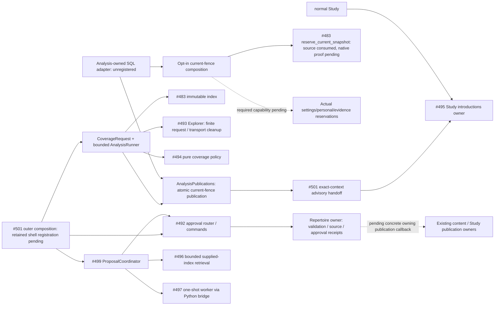

# Bounded repertoire composition — #501 private checkpoint

Unmerged source preparation for SPEC v0.2 C/D/E. C's optional audit tab is mounted
inside the retained Repertoire workspace; backend registration still awaits its
short root window and the actual current-owner callbacks. Nothing starts a
worker, writes live settings, creates cards, or activates introductions.
The working Study/Tactics shell remains with #488/#491's shared-root windows.

| Checkpoint | Usable source now | Remaining product proof |
| --- | --- | --- |
| C audit | [Composition router/projection](../../product_composition/repertoire.py) delegates to #492's actual conflict/preview/decision owner; complete alternatives feed #500's [HTTP client](../../../../app/features/product-api/repertoire-review-api.ts). The retained workspace mounts the optional audit tab. Read/choice generation is inert and Study block defaults to unknown. | Current retained-source publication callback, affected Study suspension without lapse, persistent conflicting-import preview, backend root registration and A05 browser/PG proof. |
| D introductions | [CoverageRequest / prepare_coverage](../../product_composition/analysis.py) joins #483/#493/#494; this runner fences publication. `accept_published_introductions` submits merged factual rankings to actual #495 acceptance/preview/commit. | Concrete Analysis store/cache, explicit saved settings, #495's retained current-facts/canonical-writer bridge, A06 ordinary introduction and PG/browser proof. |
| E repairs | `create_proposal_coordinator` wires actual #496 retrieval and #499 policy to the [#497 Python bridge](stockfish.py). `preview_repair` delegates proposed changes to #492 and never accepts them. | Full result/frequency projection into #500, confirmed existing-card Study practice command, explicit approval through retained publication, A07 product proof. |

These are independently reviewable checkpoints; no row claims A05/A06/A07 is
complete. C has no probability/engine dependency. D has no similarity/engine
dependency. Maia and R11 do not gate this lane.

C transport [command handlers](../../product_composition/repertoire_commands.py)
borrow the existing foreground gateway transaction and delegate every effect to
the supplied owning factory. Stable payload-bound command identities survive
remount/retry; a 202 remains pending rather than being parsed as an approval.
GETs are inert. The separate explicit audit POST requires an actual Study-owned
block/suspend/restore command; absent capability returns 503. The mounted audit
keeps the existing Repertoire library available, has an explicit repertoire
selection and retains the proposal session across tab changes. The independent
Study shell is unchanged. Actual backend callbacks are never replaced by fakes
for product acceptance.

## Public use and ownership

`AnalysisRunner(publications, timeout_seconds=...).run_once(fence, prepare)`
executes one explicitly requested unit, returns `published`, `obsolete`,
`setup_required`, `unavailable`, `cancelled`, `busy` or `stopped`, and starts no
polling/retry loop. `request_stop()` prevents publication and cancels/awaits owned
async work. Caller cancellation propagates after cleanup. Borrowed stores and
providers are never closed. One runner permits one unit; its timeout is 1–60
seconds and each prepared Explorer request has its own 20-second ceiling. Source
indexing/ranking also retain their owning finite route/ply/position bounds.

`AnalysisFence` is Analysis-local publication metadata, not a second probability,
ranking, snapshot or proposal DTO. `coverage_settings_digest(...)` binds the
explicit population/time controls, Explorer months, selected policy/root,
approved routes and limits. `CoverageRequest` rejects mismatched source/settings.
The context also carries separate source, settings, personal-game and evidence
generations. A settings owner must persist the explicit selection before a real
ranking can be enabled; a missing population returns `setup_required` before I/O.
No live cohort is guessed. The fixture cohort is synthetic.

The fixture helper `introduction_context(fences)` binds its synthetic receiver's
repertoire revision/digest plus source/settings/personal/evidence generations.
Global budget/weight controls advance the explicit settings revision. The actual
#495 receiver supplies/rechecks its own current context in the borrowed owner
transaction and owns all selection/charges. A source-only fake proves one global slot,
replay and preservation of an unrelated active attempt; it is not ordinary Study.

The concrete #495 follow-on is consumed unchanged at `5f87902f`.
`current_introduction_sources(snapshots, repertoire_ids)` wraps actual public
repertoire-only snapshots in `RepertoireIntroductionSource`. It creates no game
or authority token. `create_current_introduction_receiver(database, sources=...,
settings=..., current_snapshots=..., conflicts=...)` binds that same current
snapshot port and optional public Study conflict reader to the canonical factory.
`accept_current_owner_rankings(..., sources=...)` obtains the receiver's own
context and invokes Study's public `repertoire_introduction_binding` for these
sources. Legacy captured sources retain their published authority binding. It
supplies shared factual rankings only. No eligibility callback, SQL or canonical
writer is introduced in composition. The future Analysis adapter must hold its publication/settings
fence during the short delivery transaction; foreground Study reads its own
accepted cache and must not call Analysis. Actual generation reservations,
explicit saved D04 settings and normal-product D acceptance remain pending.
The current owner still defers over 64 authored routes, 128 physical cards or
256 mappings. This source fixture does not establish actual-user repertoire
support, and composition does not bypass those bounds. Encounter admission and
its explicit cap/pause decisions remain in the separate Study-owned next release.

`prepare_coverage` performs at most 32 sequential requests; overflow fails visibly
instead of pretending partial acquisition is complete. It calls the actual
Explorer adapter with a request-owned transport and then the actual coverage
policy. Unknown mass, counts and provider provenance remain those owners' facts.
An acquisition failure, all-unknown ranking, cancellation or obsolete context
does not overwrite a previous accepted ranking. Credentials exist only for the
invocation and never enter persisted result/fence/cache keys.

[`AnalysisPublications`](ports.py) requires `current(repertoire_id)` and an atomic
`publish_if_current(prepared)` that compares **every fence field** inside its own
short transaction. The [Analysis-owned publication adapter](../../../../database/tempo_legacy_database/adapters/analysis/README.md)
now supplies bounded public-value JSON storage, atomic upsert and separate current
versus historical reads. The opt-in [current-fence composition](../../product_composition/analysis_publications.py)
now consumes #483's published `reserve_current_snapshot` on the exact borrowed
writer transaction. The required Analysis settings/personal/evidence capability
has no default implementation. Source native qualification, the changed native
publication boundary and remaining generation reservations are explicitly
pending. The existing three SQL cases use private generation facts; they do not
qualify this source binding. Numbered migration/product activation remain pending.
It must never hold a DB
connection across HTTP/engine work or write Study state. A prepared result is
advisory, not an introduction or permission to publish cards. #495 owns final
ranking acceptance, eligibility, global budget, weights, unique charges, fallback
and canonical admission. Its owner rechecks controls/revisions in the borrowed
writer transaction. Analysis must never call that writer directly.

#489's `FeedbackRunner` was inspected for reuse. Its run-once operation claims
Games jobs and alternates provider pages with lapse/control delivery; it is not
an owner-neutral execution primitive. Importing it into Analysis would import
Games lifecycle and store semantics. This small async unit retains the same
run-once/stop pattern without copying Games persistence, leasing or retries.
No universal job framework or second scheduler is introduced.

## Canonical affected boundary

Source paths: [application](application.py), [capabilities](ports.py),
[analysis composition](../../product_composition/analysis.py),
[repertoire composition](../../product_composition/repertoire.py),
[#492 owner](../../repertoire/changes/README.md),
[#493 owner](../probability/README.md), [#494 owner](../coverage/README.md),
[#495 owner](../../study/introductions/README.md).
Solid edges are this source checkpoint; dotted edges are unimplemented product
bindings. Study imports/calls/waits for none of these optional producers. Shared
host/database contention and deployed stop/isolation behavior remain unverified.
No new schema, migration, pool, process or state owner is activated here.

## E transport and policy preparation

`StockfishBridge(node=..., script=..., executable=..., timeout_seconds=18)`
implements the shared synchronous `EngineEvaluationPort`. All three paths are
explicit trusted existing files. It launches #497's one-shot JSON worker in a
fresh owned process group with only its required environment, never a shell,
download or foreground engine. One bridge permits one active request. Outer
optional scheduling must retain that single-run allocation and run blocking
evaluation outside the foreground/asynchronous serving path.

The bridge checks request/response correlation, the exact shared context and
every explicit candidate. #497 retains all CP/mate/bound/depth/version/baseline
decisions. Failures expose stable safe reasons, with no raw output or configured
paths. Stop/timeout sends SIGTERM, allows 800ms for worker-owned engine cleanup,
then terminates its own process group and verifies the bridge exits within 500ms.
Normal completion also clears any abnormal orphan in that same owned group.
The 32KiB request/response protocol is #497's unchanged bound; its trusted worker
also caps UCI output. This is not a general arbitrary subprocess runner.

`create_proposal_coordinator` supplies #496's actual bounded read capability and
translates expected bridge failure to #499's `CapabilityUnavailable`. The policy
owns the unchanged 30CP decision. `preview_repair` saves only an owner-validated
preview; an existing-card result remains an intent with no fabricated game miss,
Again, review, admission or new card. Explicit acceptance remains separate.

One actual installed Stockfish19 request traversed Python → #497 JSON worker →
native engine at depth2, one thread, 16MiB, two explicit legal candidates. One
shallow candidate retained `baseline_inconsistent`; this was truthful transport
evidence, not proof of a repair's quality. The familiar-missing-reply policy/
approval composition test uses separate explicitly synthetic 30CP evidence.

## Focused verification

`make python-file FILE=backend/tests/test_product_analysis_integration.py`
uses synthetic legal sources, real index/Explorer/coverage/change-owner code,
fake HTTP and semantic fake publication stores. It covers 20%/2% ordering,
unknown mass, setup-before-I/O, in-flight revision changes, outage fallback,
stop/timeout/concurrency cleanup, the #495 receiver and its factual source bindings, and the
actual similarity/proposal/approval policy chain. The changed boundary reuses
#482's import/cycle guard. This is not native PostgreSQL, ordinary Study, browser
or real provider evidence. The separate explicit native bridge smoke is above.

`make unit-file FILE=tests/unit/product-repertoire-integration.test.ts` checks
the concrete #500 client mapping, exact approval payload/transport identity,
abort propagation and safe optional failure. Shared strict schemas validate
approval-bearing proposals/receipts. It does not rerun #500's unchanged UI suite.

Run under the existing nontruncating advisory validation lock and yield to the
first milestone; never unlink it. Reuse unchanged leaf receipts rather than rerun
their suites. The exact central regression/dependency/schema/navigation edits
will be reserved separately when their checkpoint can use a short root window.
The pending named browser command is `make ui-file
FILE=product-repertoire-review.spec.ts` on task-owned fixtures; no browser pass is
claimed before that file, root binding and resources exist.
