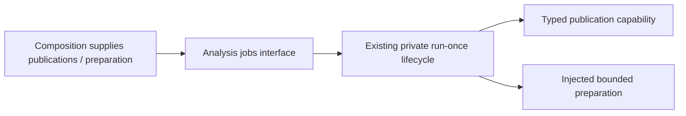

# Analysis runner interface

Owner: #501. Use `app.analysis.jobs.interfaces` for the existing `AnalysisRunner`,
`AnalysisRun`, `AnalysisFence`, `AnalysisPublications`, `Cancellation` and
`PreparedAnalysis`. These are explicit aliases of existing typed owners; there
is no new runner, DTO, queue, scheduler or retry framework.

`AnalysisRunner(publications, timeout_seconds=...).run_once(fence, prepare)` owns
one bounded async preparation and its stop/timeout/cancellation cleanup.
`request_stop()` affects that runner only. Borrowed publications/providers are
not closed. Storage owns its short transaction and compares every fence field;
preparation owns provider/process resources outside database sections. Results
remain advisory. Study alone owns acceptance and learning effects.

The exact existing lifecycle/failure semantics are preserved. Import opens no
connection, provider, engine or worker. The existing `ports.PreparedAnalysis`
still names the private coverage value type; #501 routes that exact edge when
#494 publishes its compatible coverage surface. Canonical wire origins likewise
await #482. Those edges are not hidden or claimed resolved by this directory.
Actual source-generation native fencing and product D/E activation remain
pending independently; interface work does not expand their feature scope.
