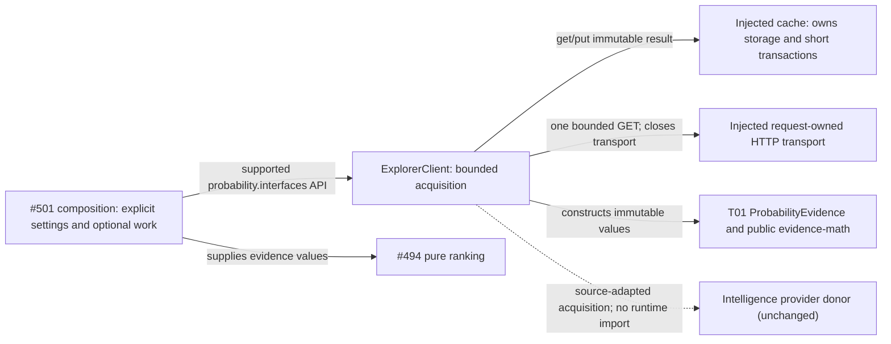

# Standalone Explorer probability evidence

T12 / #493 implemented source, proposed for independent main integration and
deployment-unverified. The supported [public interface](interfaces/__init__.py)
re-exports the existing client, values and capabilities without startup work.
Public operation, all input/output/diagnostic types, examples, limits and reuse are in
[EXPLORER.md](EXPLORER.md). These are the canonical affected architecture views.

## Dependencies and state owners



Sources: [public interface](interfaces/__init__.py), [client](explorer.py), [capabilities](ports.py),
[shared values](../../contracts/product_v02/analysis.py),
[evidence-math public API](../../../../packages/evidence-math/README.md).
The diagram's #501 composition/#494 consumption is an integration seam, not an
implemented root binding. This adapter owns only per-call computation/HTTP
lifetime; the injected cache owns any stored results. It has no Study, Tactics,
engine, queue, database driver or app-root dependency and no state mutation
authority outside its cache capability. The unchanged donor runtime remains
independent. Host scheduling/concurrency limits and actual product isolation
remain integration-owned; component fake proofs do not certify deployment.

## Acquisition and cancellation

```mermaid
sequenceDiagram
  participant Caller as Optional composition
  participant Explorer as ExplorerClient
  participant Cache as Injected cache
  participant HTTP as Request-owned transport
  Caller->>Explorer: fetch(exact context, explicit population, bounds)
  Explorer->>Explorer: validate configuration, history and credential
  opt enabled cache reuse
    Explorer->>Cache: get(all-parameter key)
    Cache-->>Explorer: immutable result; connection released
  end
  opt no usable cached evidence
    Explorer->>HTTP: GET with one request/time/size bound
    HTTP-->>Explorer: source-native counts or safe failure
    Explorer->>HTTP: close response/client/transport
    Explorer->>Explorer: validate legality/counts; retain unknown mass
    opt successful sample and cache enabled
      Explorer->>Cache: put(key, immutable result)
      Cache-->>Explorer: operation complete; connection released
    end
  end
  Explorer-->>Caller: shared evidence or typed unavailable diagnostic
  Note over Caller,Explorer: Cancellation cancels and awaits child work before returning unavailable
```

No resource/transaction scope crosses cache and HTTP work. No retry, process,
queue, application import, live request or automatic job is started by module
import. [Focused fake proofs](../../../tests/test_product_explorer.py) cover the
new boundary and reuse T01's scoped relative-import/cycle check.
