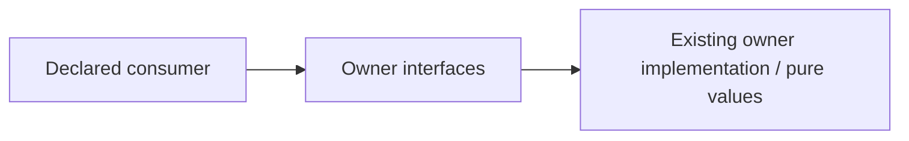

# Explorer probability adapter interface

Restructuring owner: #497 (allocation revision 2). Existing functional ownership
and algorithms are unchanged. Explicit named exports preserve object identities.

Operations: ExplorerRequest/Result/Diagnostic; ExplorerCache/ProbabilityProvider; Cancellation; ExplorerClient.

Dependencies: Same owner ports.py and explorer.py. Existing immutable ProbabilityEvidence/population/count values stay #482/evidence-math-owned; no copied wire models. HTTP/cache/clock are injected; import starts no provider.

Effects/transactions: none on import. This surface grants no learning/content
mutation authority; caller-owned capabilities retain their existing lifetime.

Implemented source seam only; consumer adoption and deployed independence are
not established by the directory. Existing imports of probability.ports/explorer remain private compatibility edges for #501 routing. ExplorerClient is a concrete adapter for designated composition; domain callers use the supplied protocol. Whole-graph/export-bypass checks stay #482-owned.

Focused proof: `backend/tests/test_public_surface_probability.py` covers identity, cold import and the changed neutral
semantic boundary. #501 owns central registration/root routing and #482 owns
whole-declared-graph cycle/private-import/export-bypass negative controls.
