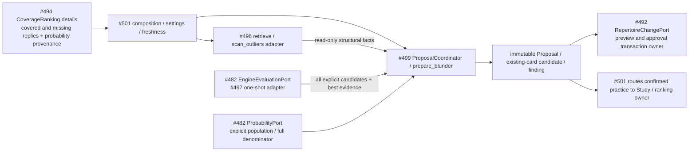

# Bounded proposal policy (#499)

Pure optional Analysis implementation of SPEC v0.2 P01/P02, S03–S05, R05/R07/R10
and A07's policy boundary. Its shared analysis contract is unchanged from
#482/#513 `2db98217` and is now present on main. This component remains unmerged;
normal-product adoption and deployment isolation are unverified.

## Public interface and ownership

- [`coordinator.ProposalCoordinator(similarity, engine, quality_policy=..., limits=...)`](coordinator.py):
  injected read-only capabilities; no concrete sibling implementation import.
- `propose(ProposalTarget) -> ProposalResult`: one actual missing reply, covered
  outlier, or common-blunder response. Results are an approval-required shared
  `Proposal`, actual `ExistingCardCandidate`, or explicit
  `no_sound_candidate`/`inconclusive` finding.
- `scan_covered(tuple[ProposalTarget, ...]) -> ProposalBatch`: supplied covered
  targets/history are deduplicated by repertoire/exact position. It reports the
  target bound and sends each advisory alternative through the same engine and
  displayed-edit policy. The caller supplies the snapshot scope; a partial scan
  is never described as a whole-repertoire audit.
- [`acceptability.assess(EngineContext, EngineEvidence, move, QualityPolicy())`](acceptability.py)
  returns immutable acceptable/rejected/inconclusive `QualityDecision` values.
- [`blunders.prepare_blunder(BlunderRequest, probability=..., opponent_engine=..., coordinator=...)`](blunders.py)
  returns `BlunderResult` with exact frequency evidence, explicit policy,
  opponent-loss finding and response result. It includes already-covered replies.
- `approval_requires_revalidation(proposal, decision, current_source_revision=...,
  current_source_digest=...)` is a read-only display/source guard. Every edit
  requires revalidation. It never forwards or executes an approval; #492 remains
  the final source/integrity/transaction owner.

[`ports.py`](ports.py) lists all local inputs/results and structural retrieval
facts. `ProposalTarget` binds repertoire revision/digest, actual route, full
`EngineContext`, previous selected response and optional actual
`DecisionPresentation`. It can include the owner's exact displayed existing-card
executable changes. These are local policy values, not duplicate shared DTOs.
Shared Proposal, EngineEvidence, ProbabilityEvidence, PopulationSelection,
DecisionPresentation, RepertoireEdit and DisplayedCardChange remain #482's types.

Reuse: public `tempo_evidence_math.opening_position_key` and `move_universe`,
python-chess replay/legality/PGN, #482's supplied engine/probability ports and
display digest. The old `discovery_admission.recommend_missing_continuations`
only considers `report.lines[:5]`; that restriction and its widened familiar
threshold are not used. No legacy job, publication, SQL or scheduler is imported.



This describes source dependencies, not installed integration. #492 alone owns
approved repertoire changes; Study alone owns learning effects. This module owns
no persistent state, process, connection, transaction, retry or background
lifecycle. Cancellation propagates to the caller without policy cleanup. The
adapter owns its bounded resources; #501 owns foreground allocation/isolation.
Study has no import/call/readiness dependency on this optional producer.

## Quality and evidence

The exact repertoire continuation is preferred, then familiar legal candidates.
Every supplied legal candidate is explicitly evaluated along with the engine's
unrestricted best baseline, including candidates absent from its initial top five.
Only the engine-acceptable set is ranked by exact continuation, distinct position
support, feature score and stable UCI order. Source routes, root/history, matching
and differing features remain in the displayed explanation. Repeated line copies
add provenance, never votes. Outliers need at least two distinct *other* source
positions and more support than the current response; a majority never proves
quality. The original response remains selected until owner approval.

`learner-cp-loss-v1` accepts exactly `0 <= best_cp - candidate_cp <= 30` for either
color. The shared engine scores already use learner perspective: no second color
flip, rounding or silent widening occurs. Different context/settings/depth,
missing/bounded scores, or a candidate exceeding its baseline are inconclusive.
Mate remains typed and manual/unsupported, never an invented large CP value.
Version, engine version, actual depth/nodes, requested budget, full context and
both scores are displayed/attached. `QualityPolicy(max_loss_cp=..., adjustment_reason=...)`
requires and displays any nondefault threshold reason.

Common-blunder analysis has a separate explicit parameter set:
`opponent-error-frequency-cp-v1`, default opponent loss >=100 CP, frequency >=.05,
and observed move count >=5 when counts exist. These are initial engineering
analysis parameters, not new user choices or the own-response 30 CP tolerance.
The opponent baseline minimizes the learner's score, so their error loss is
`error_learner_cp - opponent_best_learner_cp`. Its full history must lead to the
effective response's exact context with the same settings. The own response
still must pass the independent 30 CP rule. Frequency retains provider/model,
population, time controls, observation date, sample denominator/counts and unknown
mass. Unknown moves never receive renormalized probabilities or fabricated zeros;
raw counts can use their full denominator when supplied probabilities are unknown.

`BlunderResult.frequency` retains the shared factual evidence. Every emitted
proposal/existing-card explanation displays the frequency provenance/parameters,
and both engine contexts accompany it. #494's supplied covered/missing reply
details can select the target; its population reach/personal tie-breaking remains
owned by #494 and is not reimplemented here.

## Display and approval

A new gap displays the exact route prefix plus the selected response as PGN and
an explicit one-decision card addition rooted at the target. Existing-card edits
require the owner's supplied executable/identity/revision; absent information
returns `exact_displayed_existing_card_edit_required`. The proposed route and
card must describe the same legal response. Nothing creates cards automatically.

An available approved existing response returns its actual presentation and an
`introduction_candidate` (explicitly unintroduced) or `practice_candidate`
(introduced with matching current content). When a mapping declares `route_id`
and `route_ply`, both must match this target's actual route and replay depth;
same-position mappings for another occurrence cannot be reused or updated.
Unscoped mappings retain the existing exact-position contract. Unknown/stale
mappings remain inconclusive. This output is no game lapse, Study Again, admission, completed
introduction or review. Only #501 may route a confirmed action to Study or the
ranking path; a displayed preparation is not a recorded recall failure.

Every Proposal digest binds source revision/digest, edits, displayed card changes,
explanation and attached engine evidence. Edit decisions, changed displays and
stale sources cannot reuse prior approval. The receiving #492 owner rechecks
legality, exact source, one-own-response integrity and all card revisions before
its atomic publication. This policy neither calls preview nor mutates content.

```mermaid
sequenceDiagram
  participant C as #501 composition
  participant P as #499 pure policy
  participant E as Injected #497 port
  participant UI as #500 display
  participant O as #492 approval owner
  C->>P: source-bound target + similarity capability
  P->>E: actual context and every explicit familiar candidate
  E-->>P: best + exact candidate evidence or unavailable
  P-->>C: Proposal / existing-card candidate / finding
  C->>O: preview exact Proposal (owner validation)
  O-->>UI: displayed validated preview + digest
  UI->>O: explicit accept / edit / dismiss with digest
  Note over O: Edit revalidates and repreviews; accept binds every displayed addition
  Note over P: No owner command, scheduler or content write is executed here
```

## Bounds, errors and composition

Default candidate cap 16 fits #497's published adapter; default target cap is 8
(hard maximum 32). Generic candidate/support limits are 256, source provenance
64 per support and supplied history 1000 plies. The current #497 adapter further
limits history to 512, depth to 32, nodes to 1,000,000, time to 1000ms, Threads=1
and Hash<=64 MiB. Composition selects compatible limits before calling it; other
injected evaluators may have different finite ceilings. Every returned candidate
within the bound is evaluated; exceeded/incomplete scope remains explicit.

Malformed/illegal target history, unsupported variants, missing selected outlier
responses or invalid limits raise `ValueError` before optional work. Retrieval
revision/digest/context mismatches, missing evidence, conflicts, insufficient
support, stale card mappings and uncertainty become explicit findings.
Composition translates expected provider/engine startup failures to
`CapabilityUnavailable`; these become inconclusive. Cancellation/programming
errors propagate, with no retry or hidden recovery. A finding leaves existing
content and normal Study usable.

Minimal similarity adapter belongs to #501 (these implementation imports are not
in the policy):

```python
class SimilarityAdapter:
    def __init__(self, index):
        self.index = index

    def retrieve(self, **request):
        return retrieve(self.index, RetrievalRequest(**request))

policy = ProposalCoordinator(SimilarityAdapter(index), stockfish_port)
result = policy.propose(target)
# #501 alone passes result.proposal to RepertoireChangePort.preview, or renders
# an existing-card candidate for a separately confirmed owning action.
```

The Stockfish transport maps its one-shot JSON result to the existing shared
EngineEvidence, with correlation/cancellation/bounds owned by #497/#501. No new
worker, endpoint or scheduler is introduced. #500 renders the shared Proposal;
#501 preserves local result/frequency provenance for preparation/finding displays.

## Synthetic examples and focused validation

The regular owning suite contains these reviewable examples:

| Scenario | Supplied evidence | Result |
| --- | --- | --- |
| Missing reply | Familiar `a2a3`, best 50 CP, candidate 20 CP | PGN `1. a3 *`, displayed card `add` at target; 30 CP accepted |
| Covered outlier | Selected `e2e4`, `d2d4` supported by two distinct other positions; both engine-acceptable | Advisory displayed replacement retaining previous response; existing card update requires exact displayed revision/executable |
| Already-covered common blunder | Synthetic `e2e4 d7d5`, frequency .2 with 20/100 observations, opponent loss 150 CP and effective `e4d5` | Actual existing presentation returned as preparation candidate; no lapse/review/introduction or content diff |

The CP/frequency examples are fake evidence, not chess-quality claims about the
named moves. No private game/content data is used.

`make python-file FILE=backend/tests/test_product_proposals.py` owns all eleven
named #499 acceptance cases plus unknowns, bounded scans, optional failure,
source/display/card coherence and both learner colors. It reuses #482's scoped
dependency/cycle guard for the changed directory and proves complete policy
imports with concrete sibling/database/provider implementations denied.

Use existing Python/chess/Pydantic/pytest and this checkout's source paths for
`packages/{chess-core,evidence-math,game-review-contracts}/src` and
`contracts/{game-evidence,analysis-jobs}/src`. No install is needed. Run serially
under the existing nontruncating advisory validation lock, then release it.
Central runtime/regression registration is #501-owned. Retained #482/#494/#496/
#497/#492 evidence is reused; real engine/provider/database/browser/product A07
acceptance remains with those owners and #501, not this fake-port policy proof.
