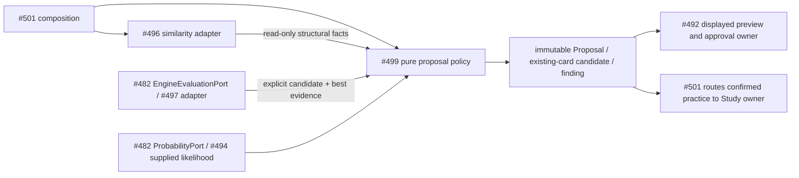

# Bounded proposal policy (#499)

Pure optional Analysis policy, consuming #482/#513 `2db98217` unchanged.
`acceptability.assess(context, evidence, move, QualityPolicy())` is usable now.
It compares exact learner-perspective CP scores at the same context and depth,
including equality at 30 CP; mate, bounded, missing or incompatible evidence is
inconclusive. Overrides need a displayed reason. No database, engine process,
provider, scheduler, card creation, content publication or Study action occurs.

`ports.py` defines the structural read-only subset of #496 retrieval and bounded
local target/result values. Shared Proposal, EngineEvidence, ProbabilityEvidence,
DecisionPresentation and displayed edits remain their existing contracts. Outer
composition adapts #496's `retrieve(index, RetrievalRequest(...))`; policy never
imports that implementation. Coordinator/blunder orchestration is in progress.

This is a source dependency view, not deployment evidence. #492 alone owns
approved repertoire writes; Study alone owns learning effects. The coordinator
owns no persistent state, process, connection, transaction, retry or lifecycle.
Caller cancellation needs no policy cleanup. Product adoption belongs to #501.

Focused proof: `make python-file FILE=backend/tests/test_product_proposals.py`.
All source data is synthetic; real engine/provider/database/browser evidence is
outside this pure policy's acceptance. Central registration remains #501-owned.
