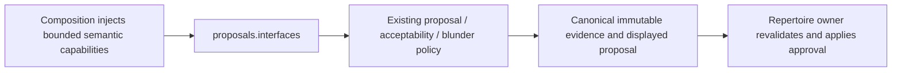

# Proposal policy interface

Owner: Analysis proposals (functional #499; this interface batch #494).
[__init__.py](__init__.py) explicitly exports existing `ProposalCoordinator`,
target/result/limit values, injected retrieval capability, quality policy/decision,
`assess`, `prepare_blunder` and `approval_requires_revalidation`.
Objects retain identity and signatures; shared `Proposal`/engine/probability/card
DTOs stay with `app.contracts.product_v02` and are not copied or re-exported.

Inputs: approved source-bound `ProposalTarget`, actual engine context, supplied
probabilities and typed similarity/engine capabilities. Outputs: an immutable
proposal, existing-card candidate, quality/blunder evidence or an explicit
inconclusive/no-sound-candidate finding. Default 30 CP semantics, uncertainty,
source/display digest and approval requirement are unchanged.
See [the existing policy contract](../README.md).

Dependencies: canonical shared wire values, pure evidence-math and python-chess.
Composition alone selects implementations behind `SimilarityPort` and the shared
engine/probability ports. `CapabilityUnavailable` preserves the existing optional
failure finding; invalid input raises `ValueError`; cancellation/programming
errors propagate. This policy owns no DB, connection, worker, retry, transaction,
approval, content/card creation, Study schedule or queue write.

Remaining edges: `product_composition/analysis.py` imports the old coordinator and
ports modules; #501 owns routing it through this surface. Internal proposal files
retain their canonical wire/math imports until #482/#503 surfaces and exact caller
leases are ready. The structural retrieval facts do not import Similarity's
implementation. Old paths are compatibility inputs until caller migration and
negative controls permit removal. [Legacy Intelligence's surface](../../../../../services/intelligence/src/tempo_intelligence/interfaces/README.md)
is a separate retained contract, not a replacement runtime or another coordinator.

Checks: `backend/tests/test_public_surface_proposals.py` covers explicit owner
exports, cold import, class identity, serialization and existing quality semantics;
retained semantic suite `backend/tests/test_product_proposals.py`. #501 owns
registry/packaging/root changes and #482 owns whole-graph guards. Interface source
delivery does not prove deployment or complete decoupling.
