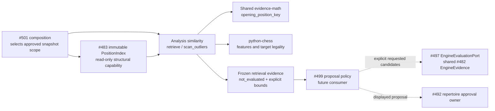

# Explainable familiar-response retrieval

Source implementation for #496 / T15, SPEC v0.2 P01, S03/S05 and R05/R07.
This optional pure policy reads an approved immutable #483 index supplied by
composition. It does not acquire a snapshot, run an engine, decide correctness,
approve content, or change Study. Product wiring belongs to #501; acceptable
repair proposals belong to #499, engine evidence to #497, approval to #492.

## Public interface and ownership

Import from [retrieval.py](retrieval.py):

- `RetrievalRequest(repertoire_id, target_fen, learner_color, ...)`: full target
  FEN, variant and explicit finite search/output bounds.
- `retrieve(index: IndexFacts, request) -> RetrievalResult`: scoped exact
  continuation first, approximate neighbours separately, legal familiar candidates.
- `scan_outliers(index, request, *, max_targets=8, max_outliers=8,
  min_support=2, max_comparison_nodes=16384) -> OutlierScanResult`: examines
  already-covered positions of the requested repertoire/learner. The request's
  target FEN is unused here; its scope, feature and resource settings apply.
- Frozen `SupportingPosition`, `SourceOccurrence`, `FamiliarCandidate` and
  `OutlierCandidate` explain local retrieval results. `IndexFacts` and its four
  smaller Protocols describe only read-only #483 capabilities, not new snapshot,
  Proposal, EngineEvidence or physical-card DTOs.

Every result binds the supplied snapshot ID, revision, digest, source revision,
scope and completeness. Each supporting exact position retains its selected UCI
response, source SAN/full FEN, feature comparison and bounded route provenance
(repertoire/policy, route, ply, revision, original root, full FEN and actual
history). Multiple routes/import copies/transpositions add provenance, not votes.
Even a repeated source position in different repertoires is one support per move.
Conflicting nodes have no selected winner and contribute no candidate.



The diagram records implemented source reads and future consumers, not deployed
isolation. No state, process, connection, transaction, cursor, retry or background
lifecycle is owned here. Caller cancellation needs no cleanup. Study has no call,
import, readiness or lifecycle dependency on similarity.

## Feature definition and selection

[features.py](features.py) uses standard chess only. Same side to move, learner
color, exact colored material counts and identical learner pawn squares are
required. At least 75% of opposing pawns and 50% of non-pawns must occupy the
same colored piece squares. Empty pawn inventories count as full overlap.
The deterministic integer overlap score is `floor(600 * matching_pawns / pawns)
+ floor(400 * matching_nonpawns / nonpawns)`, out of 1000; each empty denominator
contributes its whole term. Default minimum is 800. These conservative initial
engineering defaults are feature overlap, not probability, tactical evaluation,
or a claim of improved learning.

Differences enumerate every changed square (source and target piece), castling
rights, raw/legal en passant, and king check/attacker context. Full FEN and route
history remain intact. Exact identity uses shared evidence-math's board, turn,
castling, **legal** EP and variant rules, ignoring clocks. The requested
repertoire scopes exact lookup; an exact position is never returned as an
approximate neighbour, including through another repertoire. Similarity never
identifies a card, merges histories, establishes reentry, or approves a move.

Only legal, selected learner responses from complete source routes contribute.
Unavailable indices return `source_unavailable`; incomplete indices can supply
unaffected complete routes, with `source_complete=False`. A terminal-only node,
wrong turn, unsupported variant, material mismatch, conflict or uncertain analogy
cannot fabricate support. Incomplete index scope is not a whole-repertoire audit.
The caller must supply a whole-catalogue snapshot for that claim.

Moves transfer by UCI and matching moving piece, then are checked against the
actual target's legal moves. Source SAN is explanatory; target SAN is computed
independently. A move can be legal and lose a queen: every candidate explicitly
says `evaluation_status='not_evaluated'`. #499 must obtain #482 EngineEvidence
using the actual target/history and #497 explicit-candidate evaluation; the
30 CP policy remains outside retrieval. The legacy donor's top-five restriction
and 100 CP familiar-move widening are not reused.

Neighbours sort by descending feature score, exact position key and source move.
Candidates put the requested repertoire's exact continuation first, then prefer
more distinct supporting positions, higher best overlap and UCI lexical order.
All selected legal moves are returned up to the candidate bound; no engine list
is an input. Counts describe the scanned/selected neighbourhood, not the entire
repertoire. Outliers require an alternative supported at two distinct other
positions (configurable) and more neighbours than the current response. They are
advisory unusual responses, not majority-correct judgments or recommended edits.

## Resource bounds, errors and example

Defaults / hard maxima: scanned index nodes 2048 / 10000; selected neighbours
32 / 256; candidates 32 / 256; inspected occurrences per node 32 / 256; returned
provenance per position 8 / 64. The minimum-score range is 0..1000. Outlier targets
and output are capped at 32 each, with at most 50000 total neighbour-node visits
(default 16384). Node/occurrence traversal uses #483's deterministic exact-key,
route and ply order; no entire-catalogue sorting or allocation precedes the cap.
Only eligible bounded neighbours are sorted. One retrieval costs
`O(N * O * (64 + H) + N log N)` time and `O(N * P * H)` retained space, where
N/O/P are its node/occurrence/provenance bounds and H <= 1000 supplied route plies.
Outlier retrieval shares one total node budget and retains bounded results.

`truncation` names nodes, neighbours, candidates or provenance limits even if
they prevent finding a move. Each support also flags truncated provenance.
Outlier results additionally expose target-node/target/output/comparison limits
and truncated neighbourhoods. Empty/partial results are valid evidence, not proof
that no other familiar move exists. Unsupported variants and non-learner targets
have explicit statuses. Invalid target FEN or invalid bounds raise `ValueError`;
approved immutable index structure is a caller precondition, not silently repaired.

```python
from app.analysis.similarity.retrieval import RetrievalRequest, retrieve, scan_outliers

result = retrieve(index, RetrievalRequest("white", target_fen, "white", max_candidates=20))
explicit_candidates = tuple(candidate.move_uci for candidate in result.candidates)
# #499 requests engine evidence for every explicit candidate in the actual target.
outliers = scan_outliers(index, RetrievalRequest("white", target_fen, "white"))
```

## Focused validation and regular regression ownership

`make python-file FILE=backend/tests/test_product_similarity.py` owns all eleven
named issue acceptance cases plus tactical, partial-source and bounded-output cases.
It uses actual shared snapshots/#483 build_index with task-owned legal fixtures,
reuses #482's scoped import/cycle guard on this new directory, and verifies import
with database/HTTP/engine/Study/repertoire implementations denied. Unchanged #483
index and #482 contracts evidence is retained, not rerun as a new broad gate.

Existing Python 3.14/chess/Pydantic/pytest and source paths for
`packages/{chess-core,evidence-math,game-review-contracts}/src`,
`contracts/{game-evidence,analysis-jobs}/src` are sufficient. No install needed.
The task wrapper sets these paths and holds/releases the existing nontruncating
advisory Mac validation lock. #501 owns central runtime/test registration and
product adoption; #482 owns the requested addition of analysis to its shared
guard discovery. No central/shared source is edited in this PR. Actual engine,
proposal approval, browser, native database and live acceptance are not claimed.
