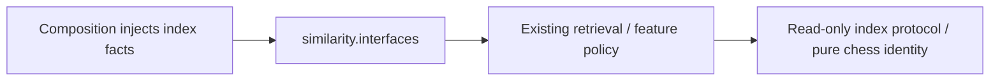

# Similarity interface

Owner: Analysis similarity (functional #496; this interface batch #494).
The explicit exports in [__init__.py](__init__.py) retain the exact existing
classes/functions from [features.py](../features.py) and
[retrieval.py](../retrieval.py); no wrappers, copied DTOs or policy changes.

Inputs: read-only `IndexFacts`, bounded `RetrievalRequest` and ordinary chess
boards for explanatory feature comparison. Operations: `retrieve`,
`scan_outliers`, `features` and `compare`. Outputs: frozen retrieval/outlier
results, familiar candidates and distinct-position/source-route explanations.
Similarity never establishes card identity, soundness, approval or a lapse.

Dependencies: python-chess and the canonical evidence-math position-key helper.
The index is a structural capability supplied by composition, not an imported
Repertoire implementation. No engine, provider, DB, Study, process or transaction
is owned here. Invalid bounds/FEN retain existing `ValueError`; unavailable,
incomplete and truncated sources retain their explicit result statuses.
See [the semantic contract](../README.md).

Remaining edges: `product_composition/analysis.py` imports the old retrieval path;
#501 migrates that caller. Existing `retrieval.py` imports canonical evidence-math
directly; #503 owns its public math surface and the future caller change needs
an explicit lease. No sibling implementation is re-exported here. Old imports
remain compatibility paths until their callers migrate and #482's negative
controls pass. A new folder alone is not a whole-graph decoupling claim.

Checks: `backend/tests/test_public_surface_similarity.py`; retained semantic
suite `backend/tests/test_product_similarity.py`. #501 owns registration and root
routing; #482 owns the full dependency/export-bypass checker. Deployment unverified.
