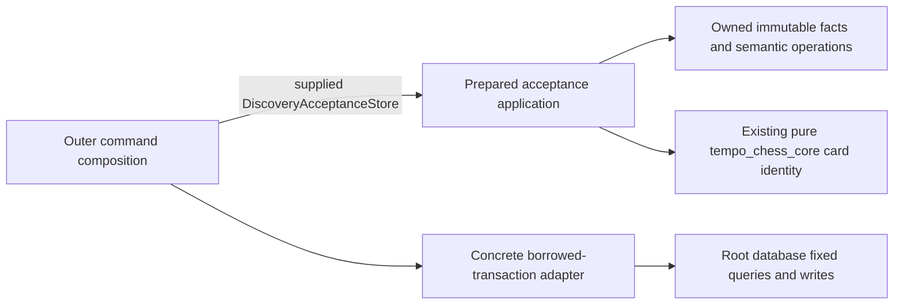

# Discovery acceptance

**Current unmerged source; deployment unverified.** These are intact moves of the
existing prepared acceptance policy and its owned contracts, with only the local
contract import path adjusted. They introduce no schema, admission, replay,
transaction, priority, retry or queue behavior changes.

- [acceptance.py](acceptance.py) validates a prepared opportunity choice, checks
  source/evidence freshness, decides existing-intent replay/readmission, computes
  the existing stable line identity, and invokes the supplied store capability.
- [contracts.py](contracts.py) owns the immutable choice, opportunity, observed and
  current scope, intent DTOs, semantic failure enum, and the existing
  `DiscoveryAcceptanceStore` Protocol. Default values and field order are unchanged.

The application imports only its own contracts, standard-library helpers and the
existing external pure Chess library. It imports no database, HTTP, worker,
composition root, Study or Games implementation. The package initializer performs
no re-exports or lifecycle work. Global consumers are updated separately by the
integration owner; there is one policy implementation.

The supplied adapter borrows one caller-owned transaction. Existing replay lookup,
source/game-scope/opportunity locks, locked duplicate recheck, intent/marker/task
writes and receipt atomicity retain their documented order. Requeueing preparation
is not admission or issuance of a Study card. No internal commit or second queue
writer is introduced. Scope generation fields are supplied facts, not permission
to inspect another domain's tables.

The concrete legacy adapter/composition remains outside this policy directory;
its root query implementation is
[discovery_acceptance_store.py](../../../../database/tempo_legacy_database/adapters/discovery_acceptance_store.py).
This slice does not establish process, resource, serving or optional-feature
failure isolation for those legacy consumers. It does not move or consolidate
`discovery_admission.py` recommendation/materialization workflows.

Existing proof lives in
[test_discovery_acceptance_boundary.py](../../../tests/test_discovery_acceptance_boundary.py)
and the pure semantic-fake selection of
[test_postgres_discovery_acceptance.py](../../../tests/test_postgres_discovery_acceptance.py).
Their source/import boundary paths must follow this move. Route, command,
preparation and currentness-composition cases are distinct from the pure selection;
no native database or service startup is needed to exercise this policy.
