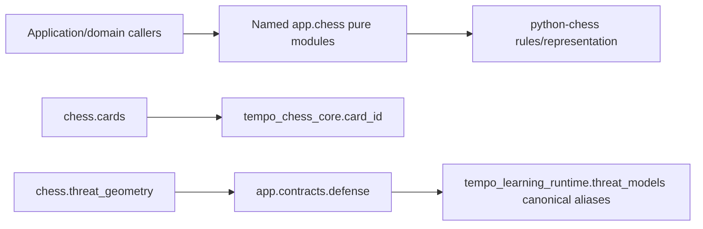

# Pure chess support

This neutral library contains existing pure chess rules, representations and deterministic calculations shared by application owners. It is not a domain implementation behind a public-index workaround. Callers import the concrete named module they use; this package initializer does not assemble or re-export sibling domains. There are no database, HTTP/provider, worker or engine-process operations here.

| Module | Existing responsibility | Preserved identity/contract |
| --- | --- | --- |
| [position_identity.py](position_identity.py) | Supplied-FEN position key with the original `chess.Board(...).fen()` normalization. | Preserved function text; not substituted with a similarly named helper. |
| [cards.py](cards.py) | Persisted chess-card identity export. | `card_id` remains the installed `tempo_chess_core.card_id` function itself. |
| [evaluation.py](evaluation.py) | Classify already supplied evaluation swings. | User/starting color and threshold defaults are unchanged; it invokes no engine. |
| [pgn.py](pgn.py) | Parse supplied PGN lines/annotations and derive legal trained-turn prefixes. | Existing data classes, variation order, annotation representation and legality handling remain intact. |
| [motifs.py](motifs.py) | Deterministic tactical geometry/evidence for supplied candidate lines. | Existing evidence classes, motif precedence, scoring constants and replay/selection rules remain intact. |
| [opening_segments.py](opening_segments.py) | Opening identities, bounded presentation traversal and advisory segment calculations. | Hash/version constants, caller data, limits and algorithms remain intact. |
| [threat_geometry.py](threat_geometry.py) | Legal defensive knight-fork geometry, actual-piece route tracing and exercise anchors. | Imports explicit [defense contracts](../contracts/defense.py); algorithms are unchanged. |

[Defense contracts](../contracts/defense.py) retain the original installed Learning class/type aliases by identity, including the previously available `dataclass`/`Literal` names. The contract move does not copy or unify Learning models. The existing separate defensive geometry implementation is preserved; possible deduplication with Learning is a proposal only. External packages remain dependencies, not sibling application domains.

The seven complete source modules moved from `app.services`; only the defensive geometry import changes within their bodies. No compatibility implementation copies or runtime forwarding modules remain at those old locations. Repository consumer/test import rewrites are coordinated separately by the integration owner. This move neither establishes deployment/resource independence nor changes Study's serving lifecycle.

Focused source/AST/import checks preserve function/class bodies, globals/defaults and canonical alias identities. The proposed existing regression selection is motif parity, defensive geometry, opening segmentation and the three named PGN-prefix/card-ID/evaluation cases in `backend/tests/test_regressions.py`; all 40 selected existing cases passed after the coordinated import rewrite under connection/process guards. No native database, services, canonical-model redesign or full-system campaign is part of this move.
