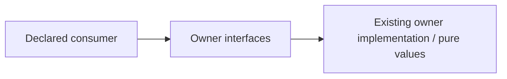

# Neutral backend chess interface

Restructuring owner: #497 (allocation revision 2). Existing functional ownership
and algorithms are unchanged. Explicit named exports preserve object identities.

Operations: card_id; ParsedAnnotation/ParsedLine; parse_pgn; prefix_through_user_moves; ends_on_trained_move; position_key.

Dependencies: Existing cards.py/pgn.py/position_identity.py, python-chess and the pure chess-core identity library. No HTTP, provider, engine, database or application startup.

Effects/transactions: none on import. This surface grants no learning/content
mutation authority; caller-owned capabilities retain their existing lifetime.

Implemented source seam only; consumer adoption and deployed independence are
not established by the directory. Contract-bound threat_geometry, engine-candidate motif classification, opening presentation/segmentation policy and evaluation policy are deliberately excluded. Existing direct imports remain exact compatibility edges until #501 migrates callers and #482 validates the declared graph. This is a neutral surface, not a way to re-export those policies.

Focused proof: `backend/tests/test_public_surface_chess.py` covers identity, cold import and the changed neutral
semantic boundary. #501 owns central registration/root routing and #482 owns
whole-declared-graph cycle/private-import/export-bypass negative controls.
