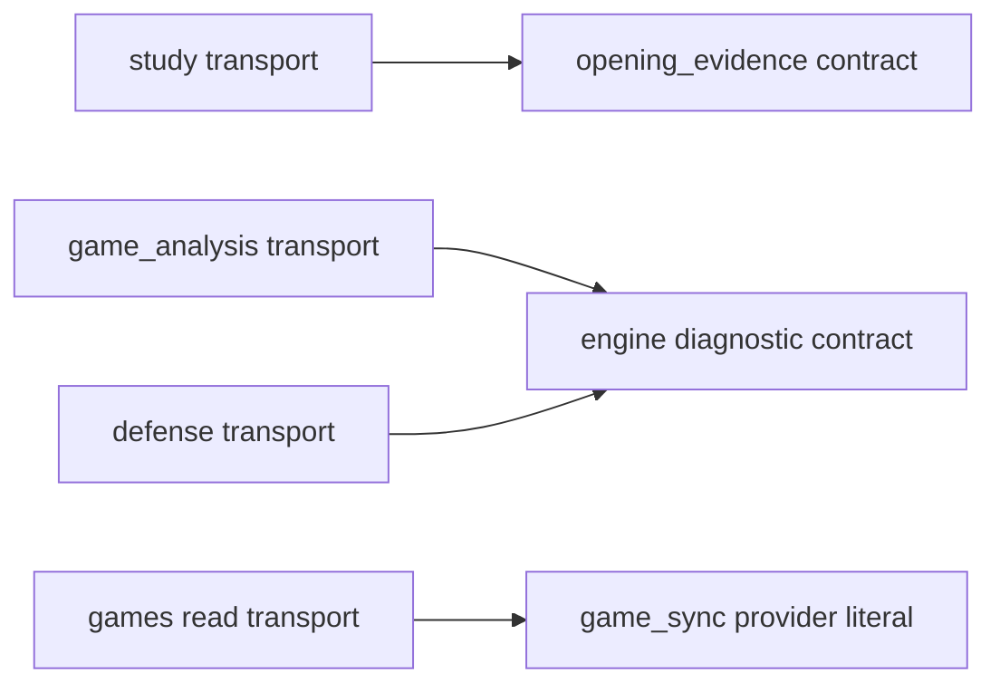

# Owner-specific transport contracts

These modules contain the existing request/response models moved intact from
[`app.models`](../../models.py). They validate transport facts; they do not own
HTTP routing, persistence, queues, providers, scheduling, clocks or lifecycle.
Import the specific module in new domain code. The old module is a temporary
explicit compatibility export facade for unmoved composition/test callers; it
defines no classes and is not a new shared domain implementation.

| Owner | Contract module | Existing classes |
| --- | --- | --- |
| Product settings contract | [`settings.py`](settings.py) | `Settings` |
| Study queue/review/teaching contracts | [`study.py`](study.py) | `QueueAttemptFailureRequest`, `PreparedNextIdentity`, `ReviewRequest`, `TeachingStateRequest` |
| Authored line/paste contracts | [`authored_lines.py`](authored_lines.py) | `BranchRequest`, `AnalysisPastePreviewRequest`, `AnalysisPasteSelection`, `AnalysisPasteCommitRequest`, `RemoveBranchRequest` |
| Authored integrity/coverage contracts | [`authored_integrity.py`](authored_integrity.py) | `IntegrityResolutionRequest`, `CoverageMaiaMove`, `CoverageMaiaSubmission` |
| Content card definition/prefix split contracts | [`content.py`](content.py) | `CardRevisionRequest`, `PrefixSplitRequest`, `PrefixSplitCard`, `PrefixSplitResponse` |
| Authored repertoire settings/annotation contracts | [`authored_repertoire.py`](authored_repertoire.py) | `RepertoireSettingsRequest`, `RepertoireSettingsResponse`, `RepertoireRenameRequest`, `AnnotationArrow`, `AnnotationSquare`, `PositionAnnotationRequest` |
| Tactics contracts | [`tactics.py`](tactics.py) | `TacticCaptureRequest`, `TacticCaptureResponse`, `TacticAttemptRequest`, `TacticActivationRequest` |
| Endgames contracts | [`endgames.py`](endgames.py) | `EndgameTemplateRequest`, `EndgameProbeRequest` |
| Games engine evidence contracts | [`game_analysis.py`](game_analysis.py) | `GameAnalysisCandidate`, `GameAnalysisEvaluation`, `GameAnalysisRequest`, `GameAnalysisFailureRequest`, `GameAnalysisPositionClaimRequest`, `GameAnalysisLeaseRequest` |
| Shared engine attempt diagnostic contract | [`engine.py`](engine.py) | `EngineAttemptDiagnostics` |
| Defense analysis/practice contracts | [`defense.py`](defense.py) | `ThreatAnalysisSubmission`, `ThreatAnalysisFailureRequest`, `DefenseAttemptRequest`, `DefenseRecognitionRequest` |
| Authored discovery contracts | [`discovery.py`](discovery.py) | `DiscoveryAcceptanceRequest` (optional direct-training DTO retired) |
| Games finding/adaptation contracts | [`game_findings.py`](game_findings.py) | `GameFindingDecisionRequest`, `GameExclusionRequest`, `GameFindingCardRequest`, `GameFindingCurationRequest` |
| Games provider/sync contracts | [`game_sync.py`](game_sync.py) | `AccountSettings`, `GameSyncRequest`, `ProviderSyncResult`, `ProviderSyncStatus`, `CompletedProviderSyncResult`, `CompletedGameSyncResult`, `GameSyncJob`, `GameSyncEnqueueResponse`, `ActiveGameFilters`, `GameSyncStatusResponse` |
| Games read contracts | [`games.py`](games.py) | `GameTimelineEvent`, `GamePublicRecord`, `GamesSummaryResponse`, `GameSummaryRecord` |
| Authored PGN import response contract | [`authored_import.py`](authored_import.py) | `ImportResult` |
| Retired Games guided review contract | [Last server source](https://github.com/aaweaver-actuary/tempo/tree/1a0fd5c582c13f9d0de428d2f66d7e7cb358c4bf/backend/app/contracts/transport/guided_review.py) | Unsupported server routes and DTO removed; ordinary Study contracts remain. |

The three existing provider/sync literal aliases (`GameProvider`,
`ProviderSyncState`, `GameSyncJobState`) live in `game_sync.py`. The same class
objects are re-exported by the compatibility facade; no duplicate models are
created. Existing fields, inheritance, defaults/default factories, aliases,
constraints, validators and `ReviewRequest.durable_payload()` remain unchanged.
`GamesSummaryResponse` keeps its existing forward reference to
`GameSummaryRecord` in the same module.

These arrows are explicit contract dependencies only. Study has no Games import,
call, wait or lifecycle dependency. Each transport module otherwise imports only
Pydantic and its required standard-library helpers. Aggregate product settings
remain one unchanged envelope; their primitive fields do not import the runtime
owners of those settings. This organization does not claim that the legacy HTTP
composition has already achieved independent feature lifecycles.

The other eight public contract modules now have explicit homes one level up:
[`next_opponent`](../next_opponent.py),
[`opening_evidence`](../opening_evidence.py),
[`opening_move_probability`](../opening_move_probability.py),
[`prefix_diagnostics`](../prefix_diagnostics.py),
[`prefix_evaluation`](../prefix_evaluation.py),
[`prefix_transition`](../prefix_transition.py),
[`studies`](../studies.py) and
[`review_conflicts`](../review_conflicts.py).
The existing move-probability contract uses the shared pure
[`position_key`](../../chess/position_identity.py), and the existing transition
contract uses the same [`GraphStep`](../opening_graph.py) class as its producers.
Executable authored-study exercise/answer aliases remain the exact Learning
runtime contract objects. `ReviewConflict` deliberately retains its existing
FastAPI `HTTPException` transport inheritance; it is not framework-free domain
policy. No proposed canonical schema or new model behavior is implemented.

Validation for this mechanical move compares the original class bodies, all
62 model validation/serialization JSON schemas with both alias modes, explicit
facade identities, field/default properties and selected pure request behavior.
After the coordinated import update,125selected existing pure contract cases pass with connection/process guards. Source/schema/fake validation does not establish live runtime,
resource or full-system qualification.
