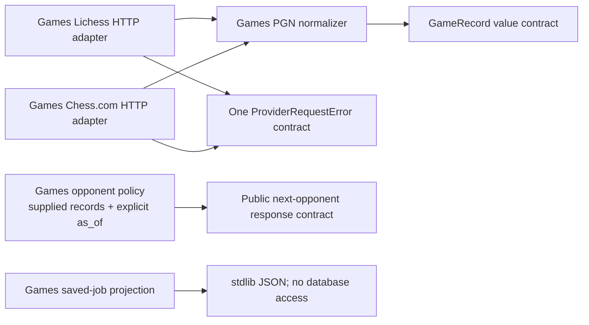

# Games records, ingestion and opponent policy

This package contains six existing cohesive modules moved from `app.services`.
Their function bodies, DTO fields, defaults, validation, request parameters,
normalization, counters and error behavior are retained. The existing
`ProviderRequestError` class has one implementation in [contracts.py](contracts.py);
both provider modules import and expose that same class. No provider abstraction,
new feature, storage implementation or shared worker lifecycle was added.

| Source | Responsibility and existing entry points |
| --- | --- |
| [records.py](records.py) | Public `GameRecord` value contract: provider/account/game identity, time/speed/rated/color/result, starting FEN and UCI moves, opening/URL/hash and optional ratings/change/time control. The frozen dataclass and separate default move lists are unchanged. |
| [ingestion/normalizer.py](ingestion/normalizer.py) | PGN validation and deterministic record/hash construction; `normalize_provider_pgn` and `RejectedGame`. No provider or database I/O. |
| [ingestion/serialization.py](ingestion/serialization.py) | `serialize_job`: existing read-only saved-job response projection. Only completed jobs expose parsed result JSON. This function does not read a database. |
| [providers/lichess.py](providers/lichess.py) | Existing `fetch_lichess_games` and bounded `fetch_lichess_games_window` HTTP adapter. The caller supplies `httpx.AsyncClient`; window/page validation, request ordering and rejected-game accounting remain unchanged. |
| [providers/chesscom.py](providers/chesscom.py) | Existing monthly-archive HTTP adapter: `fetch_chesscom_games`, `fetch_chesscom_archive_urls`, `fetch_chesscom_archive_month`. Account path casefolding, time windows, JSON validation and counters are unchanged. |
| [opponents/profile.py](opponents/profile.py) | Pure `build_profile`, `utc_time` and `semantic_digest` from supplied records and explicit `as_of`. Current eligibility remains **Lichess-only**, with the existing bounded sample, speed cohorts, stale rating facts, prior, flags and semantic version. No wall-clock, provider or database reads. |
| [contracts.py](contracts.py) | Public `ProviderRequestError` value: original `RuntimeError` body, `status_code=502` and `retry_after=None` defaults. Provider modules retain the imported class name for existing callers. |

The opponent response values remain the explicit public
[`app.contracts.next_opponent`](../contracts/next_opponent.py) contract. `GameRecord`
and `ProviderRequestError` are explicit pure value contracts; the provider,
normalizer and profile functions are Games implementation. Other domain
implementations must not import those functions, including through a public
facade. Outer composition wires the needed capabilities. Package `__init__.py`
files contain no imports or wildcard exports.

This is a bounded package-organization stage. The mixed
[`game_sync_coordinator`](../services/game_sync_coordinator.py), persistence,
workers, task registration and HTTP composition have not been moved here. Their
remaining responsibility splits are tracked in the backend checklist; this stage updates callers of the moved leaves. Do not infer
whole-backend independence from these leaf moves: ordinary Study must continue
without importing, calling or waiting for Games, and deployment/resource isolation
has not been established by source relocation.

## Focused validation

Task-local checks compare all six source snapshots and the extracted exception:
complete function/class source text and non-import module AST remain unchanged
apart from the named class relocation. New imports are limited to this Games
owner, the explicit opponent contract, standard libraries, `python-chess` and
`httpx`. Cold leaf imports and exception/DTO/projection checks use synthetic data;
no provider request, live database, service or private material is involved.

After the integration import update, focused validation reused the existing
`backend/tests/test_game_sync.py` fake provider-window, normalization/accounting
and saved-job projection cases; `backend/tests/test_next_opponent_profile.py`
owns deterministic profile/cohort/timezone behavior: all15regular cases pass. Eleven byte-exact existing provider/normalization/projection/DTO scenarios pass in a task-only pure wrapper, avoiding import of the mixed coordinator/Main workflow. Explicit MockTransport and connection/process guards remain active. No native, provider-network or full-system qualification is claimed.
