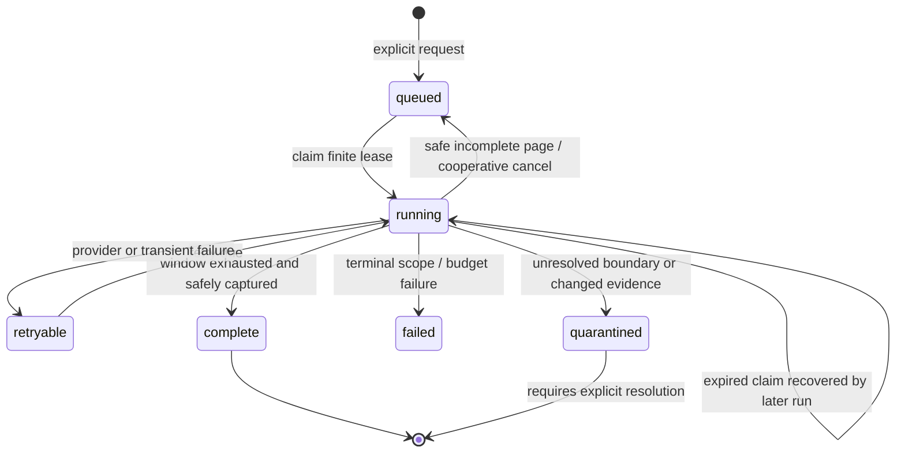
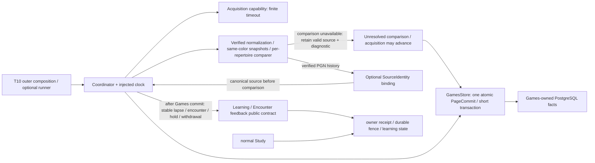
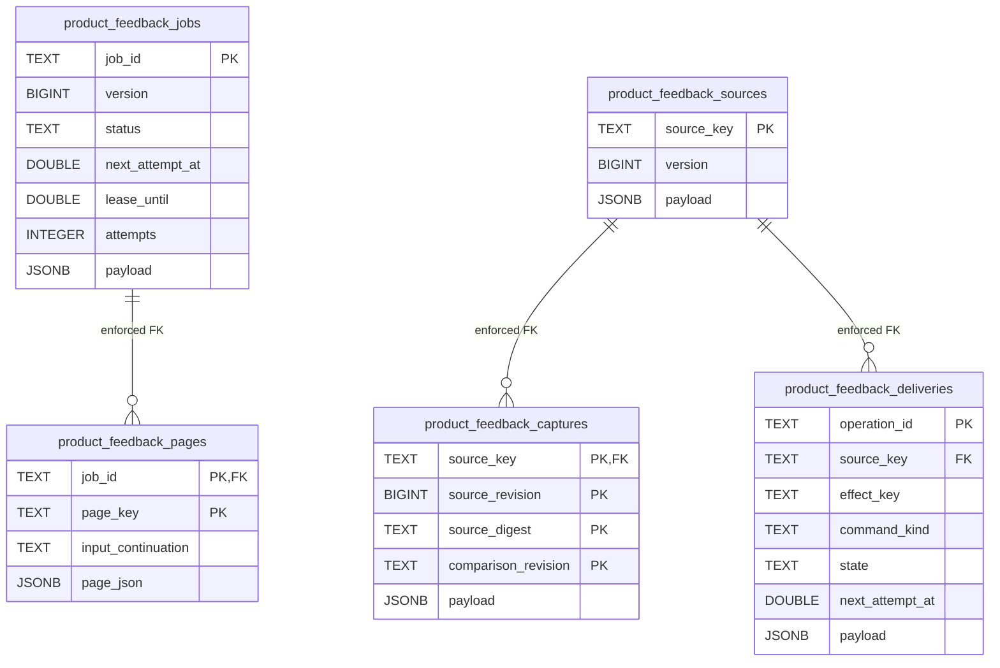
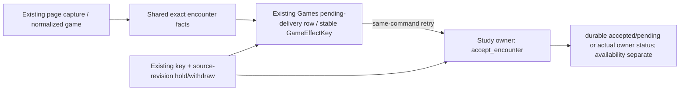

# Bounded game-feedback workflow — #489 / T08

Source implementation against product interface **0.2.0**, pinned #482 checkpoint
`50dd8220b2f2e8b27d52631cbf1ab4f01564be25` (PR #506). This is optional workflow
source, not continuous product synchronization or deployed isolation. #488 owns
the first-game composition; #491/T10 owns provider/process/runtime integration.

## Public entry and ownership

[`FeedbackRunner`](jobs.py) exposes `run_once()`, `request_stop()`, and `close()`.
One call handles one page or one delivery and returns `page`, `delivery`, `idle`,
`busy`, or `stopped`. Default is one unit at a time. `close()` is idempotent and
closes only explicitly supplied `owned_resources`, in reverse ownership order.
It never closes borrowed providers, a caller's pool, or Study's resources.

[`Coordinator`](coordinator.py) accepts injected acquisition, normalizer,
comparer, immutable-snapshot, Games store, clock, and **LearningFeedbackPort**
capabilities. [`ports.py`](ports.py) contains only workflow-owned facts and local
capabilities; `GamePage`, `CanonicalGame`, `Finding`, snapshot, lapse/control,
`EvidenceWithdrawal`, and actual Learning receipts come from public contracts.
The local adapter protocols bridge independently published provider/comparison
APIs; no concrete sibling implementation is imported. #486's `normalize_record`
implements normalization through a composition wrapper. Its `compare_record`
accepts the original record/provider/account/workspace/snapshot and supplied
reentry lookup; that wrapper receives the same record and can reuse that public
entry without inferring precision from CanonicalGame. #484/#485 expose async
one-page functions; composition owns awaiting/cancellation, error translation to
`AcquisitionFailure`, provider Retry-After and the dedicated HTTP client's close.

```python
# Outer composition owns every concrete adapter and its finite timeout.
store.enqueue(JobSpec(job_id="stable-request-id", workspace_id="workspace",
    provider="lichess", account="Learner", window=requested_window,
    repertoire_ids=("repertoire",)))
coordinator = Coordinator(providers=provider_adapters, normalizer=normalizer,
    comparer=comparer, snapshots=snapshots, store=store, learning=learning,
    clock=clock)
runner = FeedbackRunner(coordinator, owned_resources=())
runner.run_once()  # caller chooses when another bounded unit may run
runner.request_stop()
runner.close()
```

The normalizer accepts `(GameRecord, JobSpec)` and returns existing
`CanonicalGame`; the comparer accepts `(CanonicalGame, RepertoireSnapshot)` and
returns shared `Finding` values, with keyword-only original `record` and `spec`
context so provider time precision and provenance are never lost. Composition may wrap async provider APIs with a
bounded execution adapter. No event bus, polling loop, Celery registration,
HTTP route, or application-root change is included here.

An optional [`SourceIdentity`](ports.py) capability binds **already verified PGN
history** to the canonical library source before comparison. Its returned
`CanonicalGame` uses the retained row's ID, revision, source digest and exact
stored occurrence spelling; the coordinator checks that history/player/time
were not changed. `Capture.record` and `provider_record_json` keep the original
PGN digest, acquisition revision and precision unchanged. Without this capability
the existing standalone PGN behavior remains. Recomparison never rewrites an
existing command. Canonical source changes preserve captures and hold the original
effect; date-only encounters keep `occurred_at=null`.

Games alone owns import/comparison facts, source quarantine, checkpoints, retry
state, and pending-delivery records. Learning alone owns receipt/fence validation,
schedules, admission, review settlement and availability deadlines. A persisted
`pending` owner receipt is reported as pending; it is never called applied or
available. Source normalization/comparison happens before a short Games commit;
owner delivery happens after that transaction has released its connection.

## Checkpoint and correction behavior

- A fully captured, parsed page commits captures, normalized games, findings,
  pending commands, and the safe cursor **atomically**, even when the requested
  window is incomplete. `window_complete` is explicit. A saturated page with a
  fresh continuation remains queued and incomplete.
- Only the provider-specific explicit exclusions below permit checkpoint progress.
  Unknown rejection reasons and unresolved acquisition/integrity boundaries retain
  the raw evidence and old cursor and quarantine the job. Incomplete acquisition
  without a fresh continuation is quarantined, never reported complete. Provider
  page values are revalidated while preserving their concrete subtype provenance.
- Snapshot/read/comparer unavailability retains the valid normalized source and
  successful comparisons from other repertoires. It does not quarantine that
  source or manufacture correction holds. A safe acquisition checkpoint can
  advance independently; comparison remains explicitly unresolved.
- Source identity is a hash of workspace/provider/provider-game ID. Account,
  original raw PGN, supplied source revision/digest/time precision and comparison
  revision remain captured. The versioned `comparison-facts-v1` identity hashes
  compatible material snapshots and unresolved repertoire IDs, excludes
  `membership.captured_at`, and sorts unordered collections without reordering
  authored moves. Actual source versions, routes, boundaries, target mappings and
  introduction facts remain material; their changes preserve a new capture.
  Full provider page and per-record JSON preserve
  provider-local metadata/filter extension fields through base-type projection. Overlapping imports preserve one logical
  workspace/provider/game/decision/ply effect. Recomparison preserves its
  original detected-at timestamp and command, rather than moving the deadline. A
  new source revision label with otherwise identical payload does not create a correction.
- Changed payload/provenance fingerprint preserves original and new captures and enters D08
  quarantine. Every existing effect gets a durable **hold**, including when the
  new classification has no miss. Atomic commit supersedes unsent lapse commands.
  Controls take delivery priority. A hold retries the same key/revision after an
  uncertain acknowledgment. The receiving owner must durably fence delayed
  original delivery, including when no original was delivered yet.
- `Coordinator.withdraw_source(claimed_job, source_key)` persists explicit source
  withdrawal, quarantine and withdrawal commands together. Pre-admission controls require only key, source
  revision, action and reason; Games never derives an owner obligation ID. The
  shared contract preserves an optional existing v2 `EvidenceWithdrawal`; the shared Learning contract also retains v3's existing
  withdrawal-only envelope adapter when a transport needs it. No new correction
  framework, replacement UUID/lapse or history reversal is introduced.
- `Delivery.receipt` stores the receiving owner's actual typed status/receipt.
  A lost acknowledgment leaves the same command pending with bounded exponential
  backoff. Conflicting/stale owner receipts are explicit failures. D08 quarantine
  remains until an explicit policy is supplied; there is no automatic release.



A window can be completely acquired while its changed evidence is quarantined;
`window_complete=true, status=quarantined` expresses those distinct facts.
Delivery completion and owner application are separate from window completeness.



Study has no new Games import/call/wait/lifecycle dependency. Shared host/database
contention remains a deployment limit, not proven isolation. Provider adapters
must enforce finite I/O and bounded pages; cooperative cancellation cannot
interrupt a provider that violates that contract. A 120-second reclaim lease
(default; 1–300 configurable) requires one configured runner whose adapter timeout
and page work fit that lease. Multi-process scheduling is outside this slice.

## Durable factual comparison and consumer handoff — Task B

The existing `compare_game` entry compares every scoped repertoire independently,
with one `RouteFrontier` and departure state per repertoire. Coordinator selects
all successfully loaded same-color snapshots; the comparer still rejects a direct
color mismatch. Multiple applicable repertoires are separate evidence, not a
reason to guess one winner. Within one repertoire, authored-response conflicts
and target-mapping ambiguity remain distinct and do not authorize a delivery.

A uniquely supported expected move differing from Andy's actual move remains a
factual observation with missing cards or introduction/lapse proof. `membership`
describes authored support, not physical readiness: an ambiguous card mapping can
have `membership='present'`, while incomplete/unavailable authored evidence is
`unknown`. Correct covered moves advance despite learning/card availability;
reportable mapping uncertainty does not invent a move departure. The existing
exact authored-anchor/index/card reentry checks remain, and retain earlier findings.

`project_encounters` preserves #570's unknown-introduction behavior and admits
these existing `known_unavailable` diagnostics only with a unique available exact
current target and all alias facts agreeing:
`introduction_evidence_unavailable`, `game_occurrence_time_not_exact`,
`chronology_requires_timezone`, `conflicting_introduction_chronology`, and
`introduced_content_identity_unproved`. All mappings at the exact repertoire
position are checked before the finding's claimed card; conflicting card/revision/
decision/response alternatives cannot be filtered away. Duplicate identical logical
occurrences emit once; conflicting commands for the same key emit none. Findings
remain retained. This neither fabricates chronology nor relaxes lapse eligibility;
Study owns all current disposition, admission, priority and settlement.

Existing workflow fields carry unresolved comparison evidence without a DTO or
schema change:

- `SourceState.diagnostic` and `Capture.diagnostic` use
  `comparison_unavailable:<compact JSON array of sorted repertoire IDs>`, for
  example `comparison_unavailable:["black","white"]`, or
  `no_compatible_repertoire` when all loaded snapshots are opposite-color.
- `JobState.status='complete'` and `window_complete=true` describe acquisition
  only. `JobState.error='comparison_unavailable'` may coexist with them. A final
  page's job error is not an aggregate comparison census; read retained source/
  capture diagnostics, including earlier pages. No findings never means all-correct.
- Invalid returned source/repertoire provenance retains
  `unresolved_parsing_or_comparison_boundary`, blocks the cursor, and quarantines.
  Changed source facts retain the existing D08 controls/history. Temporary missing
  comparison proof alone does not hold an original immutable command.

Agent C owns retrying unresolved retained comparisons and native transaction proof.
Agent D owns acquisition/continuous scheduling; the known exclusions are:

| Provider | Safe rejection reasons |
| --- | --- |
| Lichess | `filtered_speed`, `filtered_rated`, `unsupported_variant`, `duplicate_source_id` |
| Chess.com | `outside_window`, `time_control_filtered`, `rated_filtered`, `unsupported_variant`, `duplicate_source_id` |

Both adapters emit `duplicate_source_id` only after verifying identical source
payloads. Rejections and their counts remain in the full persisted page and job.
Unknown reasons (including newly introduced adapter values) require explicit owner
reconciliation; malformed/account/identity failures and unsafe continuations cannot
silently become complete. No adapter implementation is imported by the coordinator.

Agent F derives summaries **per repertoire**, using the canonical game's side to
move and retained findings ordered by one-based ply. Ignore a matched covered
encounter for first departure; retain the earliest factual departure or unresolved
boundary with its original kind/diagnostic. First own-response miss is the earliest
learner-turn finding with `membership='present'`, exactly one expected move
*different* from played, and neither `conflict` nor `coverage_end`. Card existence,
introduction history and lapse eligibility are not prerequisites. Correct mapping
ambiguity is unresolved target evidence, not a played-move departure. Later
validated reentry may support another own miss without replacing first departure.
A source-level unresolved diagnostic must remain visible even with no findings.

Focused cases stay in the existing product game-findings, encounter-projection and
feedback-jobs suites. The boundary guard permits only the existing pure public
`app.study.interfaces.game_priority` value/port exports; the separate public-import
purity case proves that surface starts no Study implementation. No ordinary Study
runtime, native server, provider request, UI change or deployment is exercised by
these synthetic cases. Shared regression registration is handed to Agent G.

## Narrow PostgreSQL integration contract

[`PostgresGamesStore`](../../../../database/tempo_legacy_database/adapters/games/product_feedback.py)
accepts a dedicated `connections()` context factory yielding raw tuple-row
PostgreSQL connections. It opens no pool, reads no environment/settings and has
no production schema initializer. Each method commits/rolls back and releases its
connection before returning. Lock and statement timeouts are 100 ms / 250 ms.
Failures remain retryable without losing a checkpoint. Page sizes default to
100 records / 8 MiB total raw PGN / 10,000 replay positions; snapshots are limited to eight requested
repertoires. Integration must supply a bounded snapshot implementation and
connection acquisition timeout, and preserve Study's resource allocation. Explicit
record/position limits may increase up to 1,000 / 100,000 when the optional worker's
budget supports that page. An oversized provider month/page fails visibly without
advancing its cursor; T10 must configure an appropriate bounded acquisition/page
policy before claiming continuous imports. Full serialized page provenance is
limited to twice the raw-PGN byte budget.

`SCHEMA_SQL` in that new adapter is the exact disposable/source schema contract.
**T10 must reserve an additive migration number, place this DDL in the owning
migration path, and update its schema navigation before runtime activation.** No
numbered migration, existing owner README, schema index or live schema is changed
by T08. Existing legacy sync tables lack atomic source-revision/fence-command
facts and are deliberately not overloaded with a second job format.



`payload` is the JSON serialization of the corresponding typed workflow value:
JobState, SourceState, Capture or Delivery. The page row preserves the returned
provider JSON and input continuation under a deterministic page hash. Capture's composite key preserves
conflicting payloads even under the same supplied source revision. The job has
no FK to source facts: overlapping jobs share source identities. A Delivery's
stable operation ID hashes command kind/logical effect key/source revision;
Learning's effect key excludes source/comparison/delivery revisions. Optimistic
job/source versions reject stale calculations and roll back the whole page.

## Focused evidence and integration handoff

Named policy checks live in `backend/tests/test_product_feedback_jobs.py`.
The explicit disposable contract is
`backend/tests/test_product_feedback_jobs_postgres.py`: server-side failure rolls
back checkpoint/source/capture/pending delivery together; a verified task-owned
PostgreSQL server restart and new store read them back; overlap and changed-source
hold publication remain idempotent. Neither suite calls a provider API or runs
ordinary Study. Actual concrete provider/comparer/receiver product behavior,
continuous scheduling and resource isolation remain T10 acceptance.

Run the two issue-named `make python-file FILE=...` commands using an existing
Python with dependencies and this checkout's public contract source paths. The
PostgreSQL test requires explicit `TEMPO_489_TEST_DSN` (loopback database name
`tempo_489_*`) and `TEMPO_489_TEST_CONTAINER` (`tempo-489-pg-*`, verified
`tempo.task=issue-489-disposable` label). It never guesses a live URL and fails if
the fixture is absent; a missing fixture is not a pass. Acquire the shared
nontruncating advisory validation lock before either command; do not unlink it.

## Immediately next release: encounter-priority delivery (#489 addendum)

With `encounter_feedback=True`, every newly emitted mapped encounter, including
a confirmed introduced miss, is an immutable `GameEncounter` sent through the
public `EncounterFeedbackPort.accept_encounter`. Expected/played/source/chronology
facts remain intact; Study owns current disposition and scheduling. Accepted
`pending` receipts finish Games delivery without queue access or availability
polling; Study refresh proceeds independently. Lost acknowledgments replay the
same command. Existing frozen legacy lapse commands are neither relabeled nor
duplicated; the separately selected legacy port remains their compatibility path.
The owning regressions are
`test_confirmed_introduced_miss_uses_immutable_pending_intake_without_lapse_or_queue`
and `test_encounter_mode_does_not_relabel_or_duplicate_frozen_legacy_lapse` in
[`test_product_feedback_jobs.py`](../../../tests/test_product_feedback_jobs.py).

**Next-release source**, consuming #482/#533 approved-policy checkpoint
`092b574d954e767c74e77248643be25282e85c47` (interface 0.2.1). The first-release branch and its qualified installed path
remain unchanged. This extension uses the same captured page, normalized game,
exact repertoire occurrence, original detection time, GameEffectKey, pending
command row, retry and hold/withdraw operations. There is no second ingestion
workflow, live backfill, UI/synchronization prerequisite or producer scheduler.

The existing #486 comparison boundary (`b2a9b903`) supplies `Finding` facts.
With `encounter_feedback=True`, the Coordinator combines those facts with one
exact available `DecisionPresentation` from the supplied snapshot and preserves correct versus different play, original provider/account/source
revision/digest/time precision, exact mapped decision/presentation/route and
one-based occurrence ply. `known_unintroduced` alone cannot authorize a fresh
introduction: that finding can also describe a card introduced after the game.
The producer consumes the shared encounter value, never fabricates lapse proof.

Study's semantic owner revalidates source, chronology, mapping/content and
admission, then chooses the actual lapse, priority or genuine first introduction.
A proven introduced-before-game miss retains genuine lapse semantics; the
producer does not decide or apply it. Historical
misses remain relevance even when introduction or later learning makes an FSRS
lapse inappropriate; correctly played encounters remain frequency facts, never
fabricated recall failures. The approved next-release policy is a targeted
Study-owned exception: encounter first introductions bypass ordinary new-card
caps and Study-only without changing either global setting. Explicit full Study
pause, foreground/maintenance safety and current source/identity/legality/conflict
guards still apply. Games chooses no admission policy and writes no settings.
The actual owner disposition/reason must
be persisted verbatim, including paused/deferred pending receipts.

The first persisted semantic effect for a logical GameEffectKey remains the
original event across subsequent admission, overlaps and recomparison. An
unintroduced encounter can never later be converted into a new GameLapse or a
second first-introduction charge. Changed/withdrawn evidence fences either
pending disposition; a delayed original cannot reactivate it or reverse history.



The Games database layout needs no new table or column: the existing typed JSON
source/capture/delivery payloads gain shared `GameEncounter` values and the exact
`EncounterReceipt` subtype;
`command_kind` is a text fact. Production schema ownership remains #491's current
Games migration. Only the existing workflow/native files gain focused regression
cases for uncertain acknowledgment, later admission/recomparison, restart,
pre-admission correction, and explicit paused/deferred readback. A fake receiver
proves producer semantics; actual Study first-introduction atomicity belongs to
#487 and the next-release normal-Study integration owner.


Enable the source extension with `encounter_feedback=True` on the existing
Coordinator and an `EncounterFeedbackPort` receiver. The default `False` preserves
the first-release comparer/receiver path. Composition consumes #486's existing
`compare_game` / `compare_record` entry; no concrete comparer, Study or Analysis implementation is imported.
#494's published importance projection remains its owner: Games does not copy its
scoring or turn an old priority observation into lapse authority. The shared
transport keeps source, observation and disposition inspectable for that owner.

`Delivery` now validates exactly one of `lapse`, `encounter` or `control`.
The existing pending row uses `command_kind='encounter'`; control publication
supersedes either pending disposition. `SourceState.effects` retains the original
`GameLapse | GameEncounter` value once per logical occurrence. Later current
admission/repertoire metadata does not reconstruct an old encounter as a lapse;
changed source/expected-play facts quarantine and control its original identity.
The original command/detection remains frozen while each new factual comparison
is retained separately in `SourceState.encounters` / `Capture.encounters`.

An actual encounter acknowledgment must be a shared `EncounterReceipt` for the
same key/source revision/digest/observation. Receipt serialization/readback retains
`disposition`, `admission_status`, `deferred_reason`, original detection and
observation fields. `Delivery.state='acknowledged'` means Study accepted the
command, not that a pending/paused introduction completed. Study owns resumption;
Games does not spin retries for a durably accepted deferred receipt. A lost
acknowledgment still retries the exact original command through the existing
backoff path. No paused-control exception or scheduling decision is made here.

The native workflow contract checks Games transactions and JSON readback using
an injected semantic receiver, including lost acknowledgment plus actual server
restart. It does not certify Study's fresh-introduction transaction. #487 owns
that separate real receiving-owner proof, and normal-Study next-release product
acceptance remains unverified until composition consumes both checkpoints.

Later comparison lacking a fresh eligible finding does not erase an original
encounter or its historical relevance. The original typed command remains in the
source ledger. Raw-source correction or a positively contradictory observation
still quarantines/fences it; current Study admission and authority checks remain
with the receiving owner.


### Approved targeted admission exception

For this separate next release, genuine real-game encounter first introductions
are exempt from ordinary exhausted/zero new-card allowance and Study-only. This
is an operation-specific Study admission rule, not a global cap increase or a
setting toggle. Unrelated introductions retain their ordinary controls. Explicit
full pause and foreground/maintenance/source/identity/legality/conflict safety
remain effective; duplicate or racing ordinary admission cannot reset a card,
charge another introduction, fabricate Again, or rewrite learning history.

The producer already delegates every encounter to the semantic owner; it neither
reads nor rewrites ordinary controls. Its focused transport cases grant the owner
fake's exception under zero/exhausted allowance and Study-only, and accept an
owner's priority-only receipt when ordinary admission wins a race. Actual
canonical admission/control/race proofs belong to #487/#495. Games receipt-readback cases preserve legitimate full-pause and active-attempt
safety deferrals. The shared EncounterReceipt now rejects ordinary cap/zero
allowance/Study-only deferral for first introduction. Owner full-pause/safety
deferrals remain pending and must never be reported available by the producer.


### Pure canonical-history projection

`coordinator.project_encounters(game: CanonicalGame, *, findings, snapshots,
source: IntroductionGameScope, detected_at, occurred_at, payload_digest=None)`
returns immutable shared `GameEncounter` values. `capture_page` calls this same
implementation. Already-imported-history callers can reuse it without constructing
a GameRecord/PGN, running acquisition, opening storage or copying conversion.

Supply exact current snapshots/findings and the original source scope, detection,
occurrence and payload-digest claim. Source game/revision/digest, workspace and
finding scope must agree; wrong input is refused. Missing/ambiguous mappings
produce no command and remain the caller's unresolved findings. The helper does
not infer occurrence precision, invent a timestamp or interpret an empty output
as all-correct/complete coverage. It does not select admission, apply a lapse,
score importance or write history; Study retains those decisions/guards.
