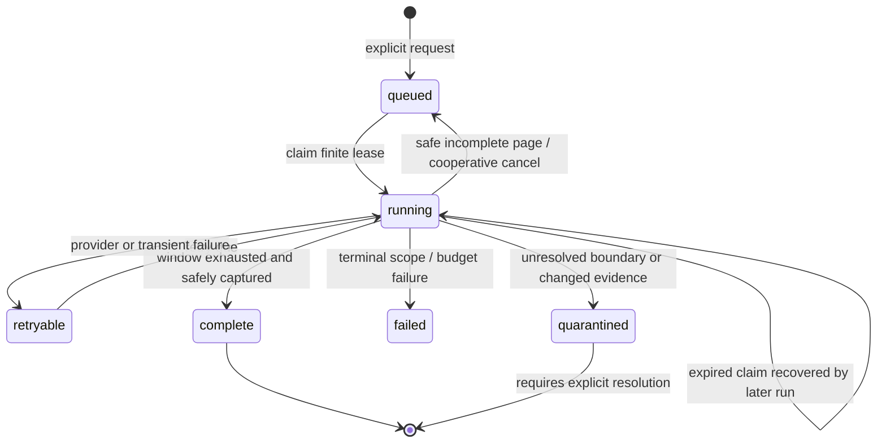
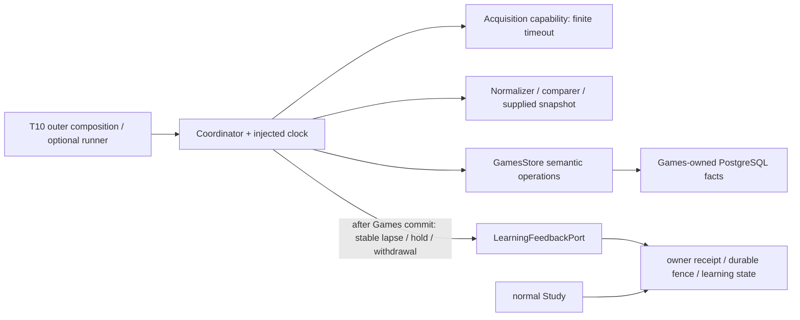
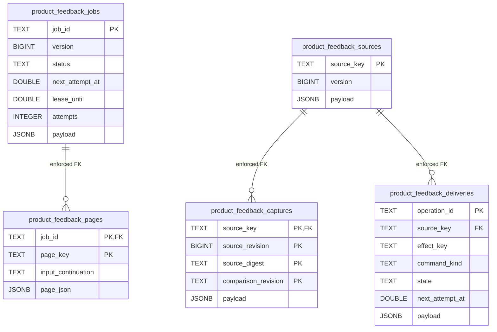

# Bounded game-feedback workflow — #489 / T08

Source implementation against product interface **0.2.0**, pinned #482 checkpoint
`50dd8220b2f2e8b27d52631cbf1ab4f01564be25` (PR #506). This is optional workflow
source, not continuous product synchronization or deployed isolation. #488 owns
the first-game composition; #491/T10 owns provider/process/runtime integration.

## Public entry and ownership

[`FeedbackRunner`](jobs.py) exposes `run_once()`, `request_stop()`, and `close()`.
One call handles one page or one delivery and returns `page`, `delivery`, `idle`,
`busy`, or `stopped`. Default is one unit at a time. `close()` is idempotent and
closes only explicitly supplied `owned_resources`, in reverse ownership order.
It never closes borrowed providers, a caller's pool, or Study's resources.

[`Coordinator`](coordinator.py) accepts injected acquisition, normalizer,
comparer, immutable-snapshot, Games store, clock, and **LearningFeedbackPort**
capabilities. [`ports.py`](ports.py) contains only workflow-owned facts and local
capabilities; `GamePage`, `CanonicalGame`, `Finding`, snapshot, lapse/control,
`EvidenceWithdrawal`, and actual Learning receipts come from public contracts.
The local adapter protocols bridge independently published provider/comparison
APIs; no concrete sibling implementation is imported. #486's `normalize_record`
implements normalization through a composition wrapper. Its `compare_record`
accepts the original record/provider/account/workspace/snapshot and supplied
reentry lookup; that wrapper receives the same record and can reuse that public
entry without inferring precision from CanonicalGame. #484/#485 expose async
one-page functions; composition owns awaiting/cancellation, error translation to
`AcquisitionFailure`, provider Retry-After and the dedicated HTTP client's close.

```python
# Outer composition owns every concrete adapter and its finite timeout.
store.enqueue(JobSpec(job_id="stable-request-id", workspace_id="workspace",
    provider="lichess", account="Learner", window=requested_window,
    repertoire_ids=("repertoire",)))
coordinator = Coordinator(providers=provider_adapters, normalizer=normalizer,
    comparer=comparer, snapshots=snapshots, store=store, learning=learning,
    clock=clock)
runner = FeedbackRunner(coordinator, owned_resources=())
runner.run_once()  # caller chooses when another bounded unit may run
runner.request_stop()
runner.close()
```

The normalizer accepts `(GameRecord, JobSpec)` and returns existing
`CanonicalGame`; the comparer accepts `(CanonicalGame, RepertoireSnapshot)` and
returns shared `Finding` values, with keyword-only original `record` and `spec`
context so provider time precision and provenance are never lost. Composition may wrap async provider APIs with a
bounded execution adapter. No event bus, polling loop, Celery registration,
HTTP route, or application-root change is included here.

Games alone owns import/comparison facts, source quarantine, checkpoints, retry
state, and pending-delivery records. Learning alone owns receipt/fence validation,
schedules, admission, review settlement and availability deadlines. A persisted
`pending` owner receipt is reported as pending; it is never called applied or
available. Source normalization/comparison happens before a short Games commit;
owner delivery happens after that transaction has released its connection.

## Checkpoint and correction behavior

- A fully captured, parsed page commits captures, normalized games, findings,
  pending commands, and the safe cursor **atomically**, even when the requested
  window is incomplete. `window_complete` is explicit. A saturated page with a
  fresh continuation remains queued and incomplete.
- Any rejection or unresolved parsing/comparison boundary preserves the raw
  captured evidence, findings/errors and old cursor; it quarantines the job.
  There is no cursor advance past an unconsumed record. Incomplete acquisition
  without a fresh continuation is quarantined, never reported complete.
- Source identity is a hash of workspace/provider/provider-game ID. Account,
  original raw PGN, supplied source revision/digest/time precision and comparison
  revision remain captured. Full provider page and per-record JSON preserve
  provider-local metadata/filter extension fields through base-type projection. Overlapping imports preserve one logical
  workspace/provider/game/decision/ply effect. Recomparison preserves its
  original detected-at timestamp and command, rather than moving the deadline. A
  new source revision label with otherwise identical payload does not create a correction.
- Changed payload/provenance fingerprint preserves original and new captures and enters D08
  quarantine. Every existing effect gets a durable **hold**, including when the
  new classification has no miss. Atomic commit supersedes unsent lapse commands.
  Controls take delivery priority. A hold retries the same key/revision after an
  uncertain acknowledgment. The receiving owner must durably fence delayed
  original delivery, including when no original was delivered yet.
- `Coordinator.withdraw_source(claimed_job, source_key)` persists explicit source
  withdrawal, quarantine and withdrawal commands together. Pre-admission controls require only key, source
  revision, action and reason; Games never derives an owner obligation ID. The
  shared contract preserves an optional existing v2 `EvidenceWithdrawal`; the shared Learning contract also retains v3's existing
  withdrawal-only envelope adapter when a transport needs it. No new correction
  framework, replacement UUID/lapse or history reversal is introduced.
- `Delivery.receipt` stores the receiving owner's actual typed status/receipt.
  A lost acknowledgment leaves the same command pending with bounded exponential
  backoff. Conflicting/stale owner receipts are explicit failures. D08 quarantine
  remains until an explicit policy is supplied; there is no automatic release.



A window can be completely acquired while its changed evidence is quarantined;
`window_complete=true, status=quarantined` expresses those distinct facts.
Delivery completion and owner application are separate from window completeness.



Study has no new Games import/call/wait/lifecycle dependency. Shared host/database
contention remains a deployment limit, not proven isolation. Provider adapters
must enforce finite I/O and bounded pages; cooperative cancellation cannot
interrupt a provider that violates that contract. A 120-second reclaim lease
(default; 1–300 configurable) requires one configured runner whose adapter timeout
and page work fit that lease. Multi-process scheduling is outside this slice.

## Narrow PostgreSQL integration contract

[`PostgresGamesStore`](../../../../database/tempo_legacy_database/adapters/games/product_feedback.py)
accepts a dedicated `connections()` context factory yielding raw tuple-row
PostgreSQL connections. It opens no pool, reads no environment/settings and has
no production schema initializer. Each method commits/rolls back and releases its
connection before returning. Lock and statement timeouts are 100 ms / 250 ms.
Failures remain retryable without losing a checkpoint. Page sizes default to
100 records / 8 MiB total raw PGN / 10,000 replay positions; snapshots are limited to eight requested
repertoires. Integration must supply a bounded snapshot implementation and
connection acquisition timeout, and preserve Study's resource allocation. Explicit
record/position limits may increase up to 1,000 / 100,000 when the optional worker's
budget supports that page. An oversized provider month/page fails visibly without
advancing its cursor; T10 must configure an appropriate bounded acquisition/page
policy before claiming continuous imports. Full serialized page provenance is
limited to twice the raw-PGN byte budget.

`SCHEMA_SQL` in that new adapter is the exact disposable/source schema contract.
**T10 must reserve an additive migration number, place this DDL in the owning
migration path, and update its schema navigation before runtime activation.** No
numbered migration, existing owner README, schema index or live schema is changed
by T08. Existing legacy sync tables lack atomic source-revision/fence-command
facts and are deliberately not overloaded with a second job format.



`payload` is the JSON serialization of the corresponding typed workflow value:
JobState, SourceState, Capture or Delivery. The page row preserves the returned
provider JSON and input continuation under a deterministic page hash. Capture's composite key preserves
conflicting payloads even under the same supplied source revision. The job has
no FK to source facts: overlapping jobs share source identities. A Delivery's
stable operation ID hashes command kind/logical effect key/source revision;
Learning's effect key excludes source/comparison/delivery revisions. Optimistic
job/source versions reject stale calculations and roll back the whole page.

## Focused evidence and integration handoff

Named policy checks live in `backend/tests/test_product_feedback_jobs.py`.
The explicit disposable contract is
`backend/tests/test_product_feedback_jobs_postgres.py`: server-side failure rolls
back checkpoint/source/capture/pending delivery together; a verified task-owned
PostgreSQL server restart and new store read them back; overlap and changed-source
hold publication remain idempotent. Neither suite calls a provider API or runs
ordinary Study. Actual concrete provider/comparer/receiver product behavior,
continuous scheduling and resource isolation remain T10 acceptance.

Run the two issue-named `make python-file FILE=...` commands using an existing
Python with dependencies and this checkout's public contract source paths. The
PostgreSQL test requires explicit `TEMPO_489_TEST_DSN` (loopback database name
`tempo_489_*`) and `TEMPO_489_TEST_CONTAINER` (`tempo-489-pg-*`, verified
`tempo.task=issue-489-disposable` label). It never guesses a live URL and fails if
the fixture is absent; a missing fixture is not a pass. Acquire the shared
nontruncating advisory validation lock before either command; do not unlink it.
