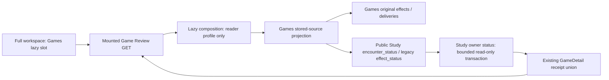

# Games feedback workflow interface

Owner: #491, `game-ingestion` in allocation revision 2. The original producer
checkpoint is #489 `65881c5c`; #619 adds the pure global first-boundary policy.

`Coordinator` captures bounded pages and delivers immutable original commands
through injected ports. `FeedbackRunner` owns finite units, stop and borrowed
resource lifetime. `ContinuousSync`/`ForwardWindow` compute bounded explicit
recurrence; `GameReview` exposes saved facts/configuration. Named state values,
ports, failures and identity/projection operations retain class/function identity.
There is no connection, provider, process, root assembly or timer on import.

`JobSpec.purpose` also accepts `history` for finite manual acquisition and saved-page
comparison. These jobs require exact-job claims; ordinary collectors and Refresh
checkpoints exclude them. The [operator composition](../../../product_composition/README.md#one-time-historical-games-scripts)
owns the two phases without changing the public command or receipt types.
`Coordinator` can preserve an existing comparison when a caller explicitly
defers every selected snapshot; source changes and integrity failures still take
the ordinary quarantine and control path.

The canonical source owner can additionally prove that a Lichess provider's
millisecond instant belongs to the exact second recorded by legacy PGN
`UTCDate`/`UTCTime`. The coordinator rejects an occurrence-time change unless
that explicitly injected owner capability proves compatibility; the original
provider timestamp and capture stay unchanged.

`HistoryProviderLimitRecovery` records an explicit historical Lichess
response-limit retry: the prior job version, attempts, page count, original
checkpoint time, failed-cursor digest and recovery time. `JobState` retains these
receipts through later checkpoints; ordinary jobs omit an empty receipt list.

`select_first_boundary(game, snapshots=..., source=...,
selected_repertoire_ids=..., unavailable_repertoire_ids=...)` consumes only
supplied canonical history and authored snapshots, returning the shared
`FirstDepartureSelection`. Supply the complete configured selection and every
failed read. Known opposite-color snapshots are excluded from relevant scope;
a missing selection cannot be assumed opposite-color. Positive authored coverage
is separate from exact action authority. `project_encounters` uses that election
to emit at most one missed command, never a matched or later encounter. The
Study owner must validate the prepared witness against current owner facts.

Composition supplies acquisition, canonical source identity, published repertoire
facts, Games storage and the receiving owner's public priority intake. Games
storage owns atomic source/capture/outbox/cursor writes. Intake owns durable
acceptance; accepted/pending is distinct from availability. Study owns independent
refresh and all learning/queue effects. Games never reads private queue state.

Existing product wire values remain in `app.contracts.product_v02`; the public
ports reference those canonical types, without duplicating or re-exporting them.
The receiving capability is consumed through the published, pure
`app.study.interfaces.game_priority` surface. Its implementation stays private.
The pure comparison resolver is an existing library dependency; #497/#482 own
its/wire surface migration. No comparer, Study, provider or database implementation
is re-exported here. Old import paths remain until #501 integrates external/root
callers and #482 validates the final DAG. Source identity/cold import checks are
in `backend/tests/test_public_surface_game_ingestion.py`; producer acceptance and
failure/replay proofs remain `test_product_priority_intake_boundary.py`.

## Game Review receipt reads

[`GameReview.game_detail`](../review.py) uses public `encounter_status` for an
original encounter, including its later hold/withdraw delivery. Legacy lapse
deliveries retain `effect_status` and their original JSON. The Python `GameDetail`
uses #536's exact encounter-first receipt union, retaining actual disposition,
admission, deferral, source and detection fields through the GET response.
Accepted/pending does not become available. An owner read error remains an error;
the read does not substitute an older available receipt or start optional work.

The six `test_product_game_review_receipts.py` cases use typed owner facts and
in-process HTTP; mutations/acquisition/queue calls are forbidden. No database,
provider or user browser is started. The current composition lazily binds the
public status operation to the actual Study owner using the existing reader
credential and a read-only connection. Configure, sync and legacy feedback retry
dispatch through the existing durable command gateway; only its command worker
borrows a writer transaction. See the [command and recovery view](../../../product_composition/README.md#durable-game-review-commands-and-settings-recovery-590).
Reading does not construct a provider coordinator. The owning
`test_product_game_review_composition.py` case traverses actual application
registration/middleware and scripted owner SQL; it proves current pending status,
contained 503 failure and pending command dispatch without an API writer profile.

The paired receipt-only #490 view and #536 TypeScript fragment retain their
captured-API-to-view proof. The current full-workspace navigation mounts this
view lazily; `product-game-review-composition.test.tsx` preserves the existing
browser attempt token through successful and failed optional reads. Independent
Study does not import the legacy optional workspace. Actual PostgreSQL role,
packaged/browser and full provider-sync acceptance remain separate.

`FirstBoundaryPreparation` is an optional outer-composition capability receiving
the already selected prospective boundary and complete immutable snapshots. It
returns `PreparedFirstBoundaryScope`; Games then runs the ordinary pure selector
again. It does not authorize Study or change authored scope. The current root
resolves only explicit boundary candidates through Study's current-presentation
owner outside any writer. Collection-only construction strips this capability
and requires no Study receiver or additional Study readiness.

## Saved historical replay

An optional job replay cursor retains the exact saved page selected by the
Games owner for daily-game recovery, including across transient retries. It is
not a provider checkpoint and never authorizes Study writes.
