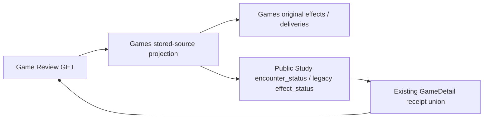

# Games feedback workflow interface

Owner: #491, `game-ingestion` in allocation revision 2. Producer implementation
is the published #489 `65881c5c` checkpoint; this surface does not change it.

`Coordinator` captures bounded pages and delivers immutable original commands
through injected ports. `FeedbackRunner` owns finite units, stop and borrowed
resource lifetime. `ContinuousSync`/`ForwardWindow` compute bounded explicit
recurrence; `GameReview` exposes saved facts/configuration. Named state values,
ports, failures and identity/projection operations retain class/function identity.
There is no connection, provider, process, root assembly or timer on import.

Composition supplies acquisition, canonical source identity, published repertoire
facts, Games storage and the receiving owner's public priority intake. Games
storage owns atomic source/capture/outbox/cursor writes. Intake owns durable
acceptance; accepted/pending is distinct from availability. Study owns independent
refresh and all learning/queue effects. Games never reads private queue state.

Existing product wire values remain in `app.contracts.product_v02`; the public
ports reference those canonical types, without duplicating or re-exporting them.
The receiving capability is consumed through the published, pure
`app.study.interfaces.game_priority` surface. Its implementation stays private.
The pure comparison resolver is an existing library dependency; #497/#482 own
its/wire surface migration. No comparer, Study, provider or database implementation
is re-exported here. Old import paths remain until #501 integrates external/root
callers and #482 validates the final DAG. Source identity/cold import checks are
in `backend/tests/test_public_surface_game_ingestion.py`; producer acceptance and
failure/replay proofs remain `test_product_priority_intake_boundary.py`.

## Game Review receipt reads

[`GameReview.game_detail`](../review.py) uses public `encounter_status` for an
original encounter, including its later hold/withdraw delivery. Legacy lapse
deliveries retain `effect_status` and their original JSON. The Python `GameDetail`
uses #536's exact encounter-first receipt union, retaining actual disposition,
admission, deferral, source and detection fields through the GET response.
Accepted/pending does not become available. An owner read error remains an error;
the read does not substitute an older available receipt or start optional work.

The six `test_product_game_review_receipts.py` cases use typed owner facts and
in-process HTTP; mutations/acquisition/queue calls are forbidden. No database,
provider, user browser or root mount is started. #501 must supply the rich public
status capability when wiring encounter data. UI adoption still needs #536's
published TypeScript receipt schema and #490's renderer; this backend checkpoint
does not claim a mounted browser or full provider-sync acceptance.
