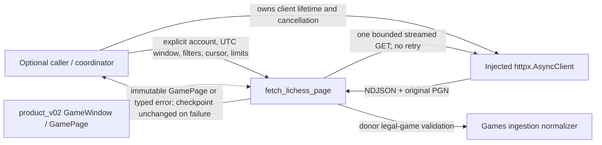
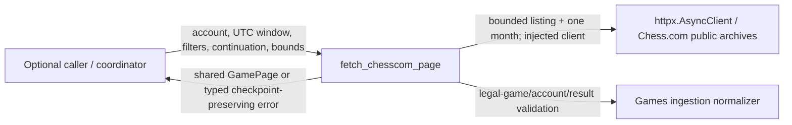

# Provider acquisition

The new [Lichess acquisition operation](lichess_acquisition.py) implements #484
against #482's product v0.2 values. This source is unmerged; product wiring and
deployment resource isolation remain unverified. [LICHESS.md](LICHESS.md) owns its
public API, exact continuation semantics, limitations and fake-transport proof.

State owner: the caller owns durable checkpoints, retries and revision allocation;
the adapter owns only request-local buffers and boundary facts. There is no
storage, learning, UI, application-root or worker dependency. Stream contexts
close on success, cancellation and failure; this operation creates no child
tasks. The injected client's lifetime remains with its caller. Actual hosting
and process resource allocation are outside this component proof.

The existing [lichess.py](lichess.py) and [chesscom.py](chesscom.py) are unchanged
legacy entry points with their existing consumers. This drawing covers only the
new operation; it does not certify the legacy orchestration's isolation.

## Chess.com acquisition (#485)

[CHESSCOM.md](https://github.com/aaweaver-actuary/tempo/blob/52e671e45abbccb8bf7120421a3e9163d910912b/backend/app/games/providers/CHESSCOM.md)
and [chesscom_acquisition.py](https://github.com/aaweaver-actuary/tempo/blob/52e671e45abbccb8bf7120421a3e9163d910912b/backend/app/games/providers/chesscom_acquisition.py)
are supplied by the separate #485 checkpoint. The following is the canonical drawing
for that prepared source; it is not a claim that #485 is merged into this branch
or wired into the product.

The caller owns client lifetime, durable checkpoint/revision allocation, retry
policy and scheduling. The adapter owns request-local acquisition/validation;
it creates no storage or Study dependency. The exact limits, cancellation behavior,
mutable-month semantics and focused evidence belong to #485's owner document.
