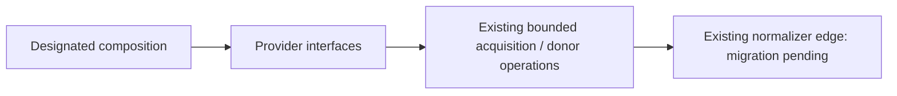

# Lichess adapter interface

Restructuring owner #497 (allocation revision 2); functional provider ownership
and behavior remain unchanged. Named re-exports preserve original identities.

Preferred bounded operation: `fetch_lichess_page` with the existing shared
GameWindow/GamePage and provider record subtype. Existing acquisition errors,
source metadata and opaque continuation retain their semantics and signatures.
Retained donor operations: fetch_lichess_games, fetch_lichess_games_window. No DTO is copied.

Dependencies: existing same-owner acquisition/donor code, canonical wire values,
HTTPX and the existing Games normalizer. The normalizer import is a retained
private Games edge, not completed decoupling; #501/#491 must route that edge
through the actual public ingestion seam. Interface import opens no HTTP client,
connection, provider request, worker or application. Only designated composition
chooses a concrete adapter; domain callers receive typed capabilities.

Caller owns HTTP client and continuation persistence; provider invocation owns
its existing bounded response/cancellation lifetime. No database, Study, queue,
scheduling or content mutation authority is added. Existing provider/private
caller imports remain exact compatibility edges until #501 routes them and
#482's graph/private-import/export-bypass negative controls pass.

`backend/tests/test_public_surface_lichess.py` checks identity, signatures and
inert cold import without invoking acquisition. Prior published fake-HTTP
semantic evidence is reused because implementation source is unchanged.
No live provider request, account import, install or engine/model execution.
