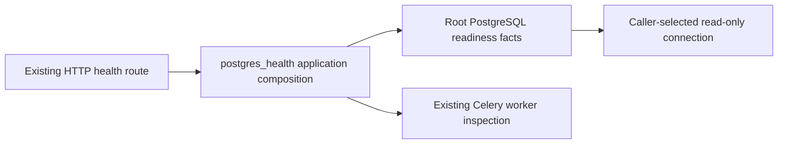

# Backend operational health

Current source; native/live deployment unverified. This composition folder holds operational decisions rather than domain implementation. [postgres_readiness.py](postgres_readiness.py) exposes the existing `postgres_health()` entry point used by the HTTP health route. It retains schema/settings/queue progress evaluation, HTTP error messages, two date reads at their original points and Celery worker-queue inspection. It does not change worker or Study lifecycle.

The [fixed database operation](../../../database/tempo_legacy_database/adapters/postgres_readiness.py) owns the original four bound queries and connection scope. It invokes the supplied date capability for the third query after the first two reads, preserving timing. The application receives facts after the same scope closes. No SQL text is exposed to application code.

This is a split of existing readiness behavior, not a redesigned health or availability policy. Existing shared Celery/queue readiness coupling is preserved; native connectivity and deployment isolation remain unverified. Three existing fake-health cases pass without startup/lifespan, native reader or worker inspection. The existing startup case was not run.
