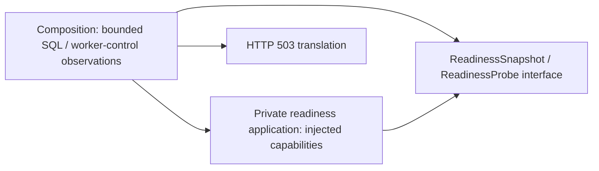

# Operational readiness interface

Owner: #501. `ReadinessSnapshot` contains immutable schema/settings/queue task
observations. `ReadinessProbe` is the typed read-only `() -> dict[str, object]`
capability; `ReadinessUnavailable` carries a safe operational explanation.
`evaluate_readiness` exposes the existing decision application with typed injected
observations. No interface imports HTTP, Celery, a database, environment or runtime startup.
These facts grant no queue/content/learning mutation authority.

The private readiness application uses supplied snapshot, worker-queue and clock
capabilities. It selects no client, connection, schema source or framework.
`product_composition/readiness.py` alone binds the existing bounded storage
projection and one-second Celery observation, and translates failure to HTTP503.
Existing storage/schema/settings/worker/queue decision order and messages remain;
there is no Study write, refresh, startup or provider dependency in the check.

The owning infrastructure suite proves cold import, immutable facts and failure
ordering with fake capabilities. The existing health cases exercise the actual
composition with fake read/control transports. Native resource/deployed isolation
remain separate claims; no server or live health probe is started by these tests.
