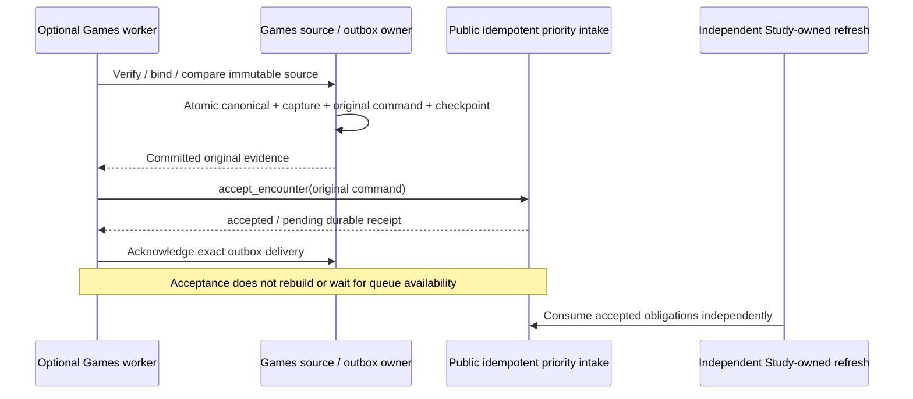
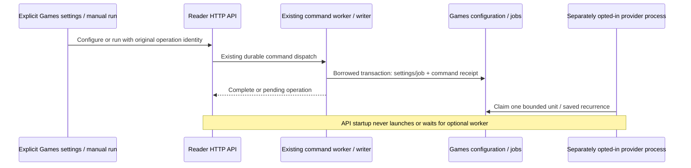
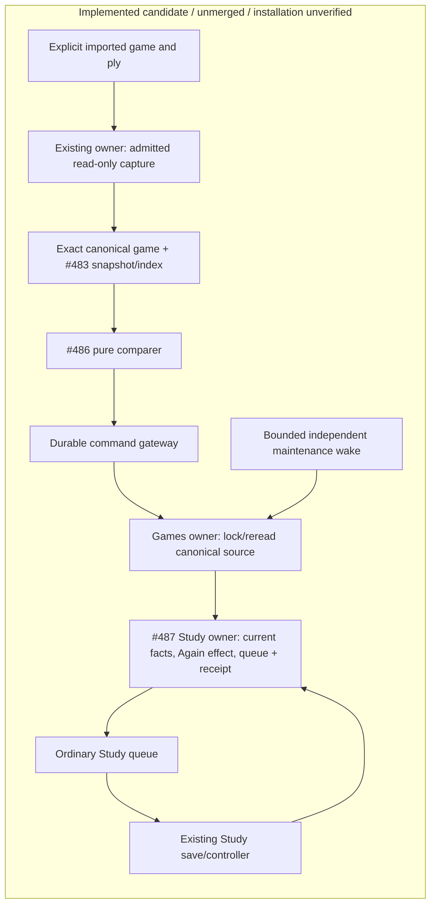
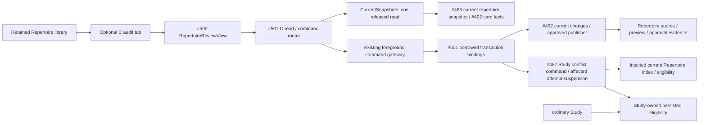

# One imported game to ordinary Study (#488)

## Continuous-provider public priority intake (#489 / #491)

The optional Games process receives an `EncounterFeedbackPort` from the
composition root. `create_current_provider_worker(priority_intake=...)` requires
that public capability before any source read/claim. It does not construct a
Study receiver, borrow a Study writer, or promote/rebuild a queue. Accepted/pending
means immutable evidence was accepted; actual availability belongs to Study's
independent refresh and public receipt status.

The shared public contract is
[`EncounterFeedbackPort`](../contracts/product_v02/learning.py), owned by the
receiving contract/Study owners. Games' coordinator uses only its semantic
accept/control/status methods. No replacement DTO or compatibility export is
introduced. `provider_priority.py` now binds the published durable intake in
the optional process: bounded source capture closes before the writer opens,
then existing source fences and Study's intake share its short transaction.
The returned receipt is acknowledged only after commit. This path does not
request a queue refresh or wait for availability.

`PostgresCanonicalGamesStore` implements #489's `SourceIdentity` port. Strict PGN
normalization verifies raw proof first; Games then binds the retained canonical
ID/revision/fingerprint before comparison. Source publication, captures, original
outbox and cursor commit atomically. Raw PGN/acquisition provenance stays separate.
Changed source or an identity race is quarantined/rolled back, never relabeled.

The full workspace's explicit configure/run/legacy-retry commands use the
existing Celery command gateway. The API retains its reader credential; bounded
Games mutations borrow the command owner's transaction and commit with the
durable command receipt. Provider HTTP is confined to the optional process.

Changed-boundary qualification is recorded in #491; earlier donor evidence
alone does not qualify this assembly. The CLI requires the explicit opt-in and
configured scopes. See the
[bounded commands and coverage](../../../docs/product-v02/game-sync/README.md).
The frozen qualified retained-history release remains unchanged.

## First-release evidence

This unmerged integration under [#481](https://github.com/aaweaver-actuary/tempo/issues/481)
implements the first game-feedback slice of [SPEC v0.2](https://github.com/aaweaver-actuary/tempo/blob/5d5673e43c722786a101c12d26a214649a909502/SPEC.md).
It has not been installed by this lane. The focused native and ordinary-Study
browser proof passes; actual private-game correspondence remains required
release-owned acceptance evidence.

## Published dependencies

| Owner | Integrated checkpoint |
| --- | --- |
| #482 contracts, including route/game-scoped introductions | #516 `e73c7beb` |
| #483 capture projection, position index and retained provider alias | #511 `7290f052` + exact repair `668d3af5` |
| #486 canonical-game comparer | #510 `3bce27fd` |
| #487 Study receiver, current-owner fencer and source-scoped day-only facts | #515 `c59b93a8` + exact repair `1446cd67` |
| Adopted specification and repository guidance | main `5d5673e4` |

Unchanged leaf suites are reused. Later analysis, workflow, recombination and
conflict features are excluded from this first-release candidate.

## Implemented ownership and transactions

[`feedback.py`](feedback.py) composes the shared game/finding values, real
index/comparer and `LearningFeedbackPort`; it owns no scheduling policy.
[`retained_game.py`](retained_game.py) projects retained canonical moves and their
exact source fingerprint without reconstructing original PGN. The provider is
the canonical source namespace; the original provider/game IDs remain unchanged
in the retained capture. Revision 1 is this slice's initial retained source;
changed bytes under that identity are quarantined, not treated as another lapse.

[`feedback_commands.py`](feedback_commands.py) prepares one explicit game/ply
through the existing read-only capture owner, then passes that exact canonical
game to `project_capture`. Day-only introduction evidence stays a scoped boolean;
it never becomes an invented timestamp. Partial/UTC-midnight retained game times
remain unknown precision and lapse-ineligible. Intake uses the existing durable
command gateway and caller transaction: the Games owner locks/rereads the
canonical source first, then the Study owner fences current repertoire/card
facts and owns all schedule, queue, history and receipt mutations.

The explicit transport is POST `/api/game-evidence/product/feedback` with a
repertoire ID, existing game ID, one-based occurrence ply and Idempotency-Key.
GET `/api/game-evidence/product/effect` reads the logical owner receipt. Both
routes use background request classification, and the exact explicit command is
Study-compatible while still yielding to foreground admission. A 202 operation
response does not establish an admitted Study effect. Resolve uncertain outcomes
through the original operation and receipt, using the same payload/identity.

[`feedback_maintenance.py`](feedback_maintenance.py) performs one durable cursor
slice per invocation, closes read/capture work before the writer, fences the
current task lease and source, and borrows the Study receiver transaction.
Pending effects retry current owner facts; changed source is held. Applied
effects use ordinary queue recovery. The bounded `maintain_game_feedback` wake
runs on the existing foreground worker every 60 seconds, independently of the
optional Games worker. No ordinary Study controller imports/calls/waits for Games.
The current retained backend still shares process packaging, broker and database;
these source/native checks do not establish deployment/resource isolation.

## Focused integrated evidence

Exact tested executable candidate: `673e3d690c136e98dfb1a38b5479bd8ad1e1d44c`.
It contains the source checkpoint `9ef6b2a3`, the two exact owner repairs listed
above and the adopted documentation baseline. Later feature implementations are
excluded. Source validation did not change during the browser build/run.

| Selected boundary | Command/selection | Result |
| --- | --- | --- |
| Source + actual PostgreSQL integration | `make python-file FILE=backend/tests/test_product_feedback_integration.py` | 14 passed, 3.31s |
| Ordinary Study browser | `make ui-file FILE=product-game-feedback.spec.ts` | 1 Chromium case passed, 8.5s |
| Exact Study-compatible command + foreground race | `make python-file FILE=backend/tests/test_legacy_intake_study_mode.py` | 7 passed at `bd8c275d`, unchanged evidence reused |
| HTTP admission/query-only classification | `test_legacy_study_remediation.py -k http_cutover_matching_background_admission_and_query_only_guard_are_preserved` | 6 passed, 17 deselected at `2b841de8`, unchanged evidence reused |
| Scoped dependency guard | `test_product_contracts.py -k new_product_boundaries_do_not_import_composition_or_private_siblings` | 1 passed, 31 deselected; unchanged boundary evidence reused |

The native file covers real receipt/replay, ordinary controller completion,
no-Study-day/new-connection queue recovery with the original deadline, unrelated
issued-attempt preservation, canonical source correction rejection and durable
pending maintenance. The ordinary date-only fixture re-captures actual fixture
rows and carries the exact source-scoped before-game boolean without inventing
a timestamp. The cold-import case uses a fresh interpreter that refuses any
optional `app.games` implementation import. All fixtures are task-owned and
synthetic; they do not establish actual private-game correspondence.

The browser used the supported disposable PostgreSQL/API/worker product stack.
It preserved the unrelated issued head, admitted exactly one lapse with stable
receipt/deadline on replay, completed the protected card, presented the exact
target FEN/e2e4 move, disabled optional producer transport, saved a genuine
ordinary Study review, reloaded and verified settled status. Final readback
asserted one lapse, two Study reviews including the retained prior review, and
one saved-review receipt. Image build 194.7s, startup 19.34s, service health0.09s,
browser stage9.19s and cleanup4.03s all exited0. Its labeled containers, volumes
and network were independently verified absent, and the advisory validation lock
was released promptly.

Earlier failed runs exposed the synthetic timestamp/date shape mismatch and
missing optional-route HTTP classification. A later date-only native run
reported 11 passed/2 failed at the exact owner fencing seam. Both concrete source
repairs are now consumed and the 14-case file plus browser pass supersedes those
failures for this candidate. A known-invalid intermediate build was canceled
with zero browser cases; its owned builder/project journals were reconciled
through supported ownership APIs. No failed, canceled or missing check is counted
as a pass. Passing logs, timing, source fingerprints and the exact integration
receipt are preserved outside the checkout. Unchanged leaf suites were reused.

## Genuine-data and release handoff

A prior candidate failed closed with `legacy_repertoire_authority_missing`.
That failure is candidate-specific. Bounded read-only alternatives found three
current ready authorities among ten repertoires; small recent summaries gave no
usable candidate, historical materialized positions returned zero under all
three, and one naturally admitted ready-authority summary reported total zero.
No genuine capture, delivery or review has succeeded. This does not establish
that all imported games are unusable. The sole release owner continues the
smallest supported imported-game selection; do not rebuild authority or resume
the held graph migration.

Supported foreground status changed naturally between active and inactive;
Study-only mode remained true, policy generation 11. Some authority reads
succeeded; another bounded read deferred before summaries. These observations do
not prove active human Study or a persistent pause. Never clear a gate/lease to
obtain evidence. Store raw private captures and receipt/source digests outside
tracked source, and publish no private game payloads or machine paths.

Installation requires additive migration
[`051_study_game_feedback.sql`](../../../database/tempo_legacy_database/ddl/migrations/051_study_game_feedback.sql)
and schema readiness 51, the five local pure-library backend dependencies
already registered in `pyproject.toml`, `uv.lock` and Dockerfile, root command and
router wiring, and the bounded Celery wake. The offline lock check previously
passed without installations or changes to prior registry records. Retain the
normal API/foreground worker/broker and existing command machinery. Intake needs
the existing background command worker; ordinary Study and pending maintenance
do not require the optional Games producer runtime.

Only the release owner may install or coordinate a brief controlled Study pause.
Use a schema-51-compatible known Study fallback; schema50 images reject51.
Rollback stops new optional intake/wakes and uses that compatible fallback,
preserving additive tables, durable obligations/receipts and all review history.
Never drop migration051, reset data or fabricate a live review. Stopping an
optional producer must leave normal Study usable. Live installation, fallback
smoke and actual-data correspondence are not claimed by this source checkpoint.
The focused browser pass qualifies the synthetic local product boundary only.

## C repertoire conflict audit — #501

C is an independently reviewable continuation through the retained Repertoire
workspace. The [mount](../../../app/features/product-api/RepertoireAuditMount.tsx)
keeps its supplied existing library available and lazily opens #500 after an
explicit repertoire choice. It does not query an optional provider or engine.
[The client](../../../app/features/product-api/repertoire-review-api.ts) preserves
shared proposals/receipts; a 202 is pending, never approval success. Its session
retains exact retry identity across tab changes.

[repertoire.py](repertoire.py) adapts #492's exact conflict report and complete
manual alternatives to #500. GETs and choice generation are inert. Actual Study
block facts must come from the current Study owner under the exact source fence;
without those facts the UI says unknown. The explicit audit POST requires the
owning scoped block/suspend/restore operation and fails unavailable when absent.
No detector success is described as a persisted block.

[repertoire_commands.py](repertoire_commands.py) supplies `CurrentSnapshots`,
`DispatchedChanges`, `create_current_repertoire_http` and explicit command
registration. Snapshot reads release the borrowed reader before returning.
Writes use the existing durable foreground gateway and its borrowed writer
transaction; #492's injected current changes factory alone publishes content and
approval receipts. Stable payload-bound command identities preserve uncertain
acknowledgments across retry/remount. No SQL, second writer, conflict decision,
queue policy or automatic job is owned by composition.

[repertoire_runtime.py](repertoire_runtime.py) binds #492 `09548df7` retained
changes and complete current-card definitions to #483's sole current snapshot
reader, with the existing read connection and durable dispatch resources. The
display rereads its source fence after the card facts; changed source refuses the
display. Every proposed physical-card update comes from Repertoire's policy.

[repertoire_study.py](repertoire_study.py) injects the actual shared reader/index
and #492 eligibility into #487's `SnapshotConflictAuthority` and
`current_study_conflicts`. Commands contain at most 16 exact route/ply/card/revision
targets. Unmapped targets remain pending. Persisted block reads require the
displayed source fence to remain current. Accepted content and current Study
reconciliation enlist in the same borrowed transaction; failure propagates to
the gateway rollback. Missing reconciliation refuses acceptance with 503.

Solid edges describe implemented C1 source. The current main HTTP router, durable
foreground command worker and retained Repertoire mount are registered here.
Migration054 registers only the existing approval and conflict owner DDL after
R11/schema053. #560's Study guard and due restoration/admission projections keep
holds local to Study; the Study path calls no optional producer. Existing
repertoire moves require no engine reevaluation. Content publication, the approval
receipt and current Study reconciliation enlist in the same borrowed transaction.

C1 is existing-content audit/resolution; pending imports (C2), introductions,
engine-backed repairs and Maia are excluded. Full A05 requires C2 as well. The
focused source commands remain `make python-file
FILE=backend/tests/test_product_repertoire_integration.py` and `make unit-file
FILE=tests/unit/product-repertoire-integration.test.ts`. The assembled selection
is `make view VIEW="C exact conflict is enforced"`, using the normal disposable
PostgreSQL browser runner. Its task-only legacy fixture verifies the database
marker and exact project/service identity, then seeds through the write-owning
foreground worker; API readback retains reader credentials. Actual browser
acceptance is reported in the current PR at its tested revision. No live data,
settings, service operation, installation, deployment or merge occurs here.
