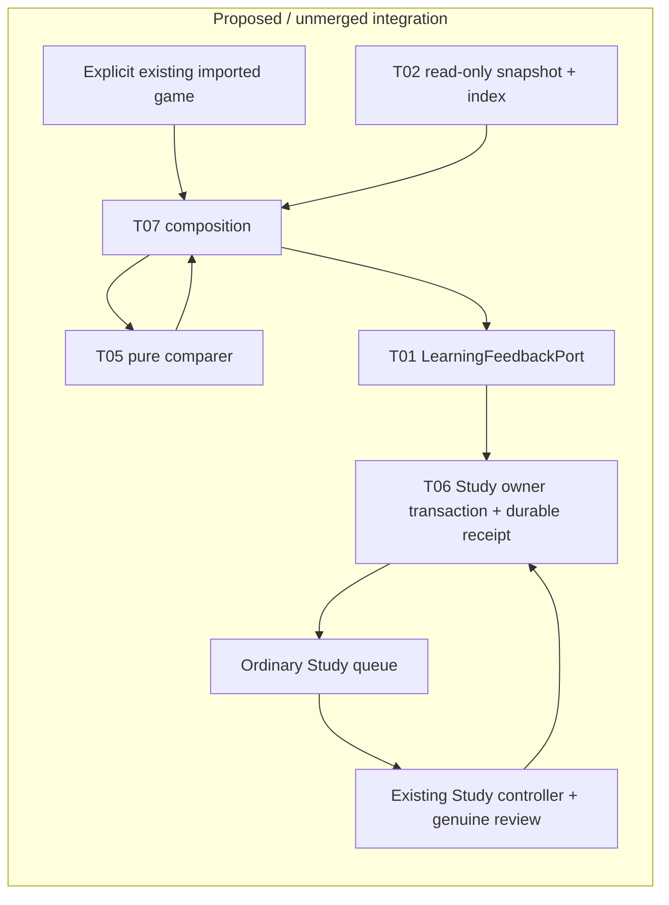

# One imported game to ordinary Study (#488)

This is the T07 integration lane under [#481](https://github.com/aaweaver-actuary/tempo/issues/481),
against [SPEC v0.2](https://github.com/aaweaver-actuary/tempo/blob/6885b9420320517ac74df47e631ed796da96c94a/SPEC.md).
Baseline: `24ec4c06f666f50104c979840c403826fb1ce280`.

## Checkpoint status

Preparation checkpoint only. The four leaf implementations are not integrated
yet; no product acceptance, live capture, delivery, queue admission or review is
claimed. This README is the canonical bounded integration/fixture plan, not a
description of a deployed feature. A successful HTTP response alone will never
be recorded as an admitted or settled obligation.

## Smallest composition

Use one explicitly selected already-imported game, one repertoire snapshot and
one exact introduced-card miss. Prefer an explicit local operator entry point
over a new screen or background service. Composition injects these public
capabilities as they become available:

| Capability | Owner | Required evidence |
| --- | --- | --- |
| Immutable game/snapshot/finding/feedback values | #482 | Published branch/SHA, version and JSON fixtures |
| Consistent repertoire snapshot and exact index | #483 | Public snapshot/build/lookup API; explicit decision/presentation/introduction mapping |
| PGN normalization and pure findings | #486 | Public comparer; stable logical effect identity; no storage/provider effects |
| Lapse, deadline, hold/status and settlement | #487 | LearningFeedbackPort implementation and durable owner receipt; actual Study hooks |

Do not copy their DTOs or policy into composition. A changed source under a
logical identity goes through the owner's hold/withdraw operation, including
when the new finding is not a miss. Retry the retained operation identity and
payload. An uncertain accepted write is resolved by owner status; it never
triggers another writer or legacy fallback.



Study owns schedules, queue state, review history, receipt persistence and
settlement. It imports no optional producer. Stopping the producer after
admission must leave ordinary issuance, save, retry and settlement usable.
Composition owns selection/wiring and the short operator lifecycle only. Shared
host/database resource isolation remains deployment-unverified.

## Current source and capture boundary

The retained API registers `game_evidence_routes` in `backend/app/main.py` and
explicitly requires the configured PostgreSQL legacy owner. This source fact is
not proof of a particular host installation. Do not install or activate an
independent Learning service to satisfy this slice.

Reuse `app.legacy_game_observation.capture_game` only as a read donor when it
meets the new public snapshot contract. Its default owner reads use
`background_read_connection`: short, read-only sections admitted while foreground
work is idle, with before/after source and graph fencing. Preserve that admission
and fail closed on unavailable admission, changing content, incomplete traversal,
unsupported mappings or exhausted bounds. Do not substitute an unfenced direct
database export. `observe_capture` / `comparison_snapshot` and
`preview_legacy_observation` are mapping/comparison donors, not permission to
restore their retired orchestration or bypass the T06 scheduling effect.

## Private genuine example and disposable fixtures

1. Prefer an existing authorized capture with its original source digest,
   complete scoped catalogue proof, capture time and source revisions. Otherwise
   take one narrow read-only capture only after the exact configured live target
   and foreground admission path are established. Never print credentials or
   commit raw games, names, repertoire content or private snapshot data.
2. Treat any candidate game/ply/move lead as unverified until the capture proves
   legal exact position/history, the expected and played moves, unique route and
   decision/current physical presentation identity, current source revision, and
   introduction before the game's precise occurrence time. A matching FEN or SAN
   alone is insufficient. Capture plies are zero-based; product Finding plies
   are one-based and the conversion must be explicit.
3. Retain raw private capture and reproduction receipt outside tracked source.
   Record its SHA-256 and source/fixture revision in the private receipt. Public
   regressions use sanitized legal equivalents, labeled as synthetic and never
   presented as proof of the genuine mapping.
4. Reproduce the retained game, content, physical mapping, introduction and prior
   review history in a task-owned disposable PostgreSQL fixture. Verify the
   disposable target before any fixture mutation. Production remains read-only.
   Use explicit clocks and initial FSRS state, not sleeps or fake live reviews.
5. Drive the composed command, replay its exact identity, inspect the owner's
   receipt/deadline and ordinary queue, then disable the producer. Complete the
   expected move through the existing Study controller and genuine review/save
   path in the disposable product. Reload and read settled status. Do not settle
   by direct SQL or a test-only queue. Preserve a separately active unrelated
   attempt and its history.
6. Advance the disposable clock across two days without Study, rebuild/restart
   only task-owned resources, and show the original deadline/obligation survives.
   No live settings, queue issuance or review mutation is part of this proof.

## Focused verification and integrated receipt

The #488 suite owns these cases:
`test_imported_game_maps_to_existing_card`,
`test_duplicate_pipeline_has_one_lapse`,
`test_normal_study_review_settles_obligation`,
`test_no_study_day_and_restart_preserve_deadline`,
`test_producer_absence_does_not_block_study`, and
`test_unrelated_active_attempt_unchanged`.

Required commands after implementations and fixtures are available:

```sh
make python-file FILE=backend/tests/test_product_feedback_integration.py
make ui-file FILE=product-game-feedback.spec.ts
```

The browser spec must assert the exact expected move/position, delivery status,
same-identity replay, ordinary review completion, reload and owner settlement.
Run only the small Study/Tactics preservation selection published by #504 (or
name the existing focused checks if it is unavailable). Reuse leaf results when
their source, contracts, fixtures, commands and toolchain inputs are unchanged;
do not rerun every leaf suite. Acquire the existing advisory validation lock in
append mode without truncating/unlinking it, hold it only for validation and
release it promptly.

The final integrated receipt records every consumed branch/SHA, tested SHA,
capture and fixture digests, exact commands/counts, decision/presentation mapping,
original deadline, lapse receipt, retry/settlement identities, history and
protected-attempt outcomes, resource cleanup, and any unavailable native/browser
or actual-data proof. Missing, skipped and zero-selected checks are unverified.
Source integration is not installation, merge or deployment.
