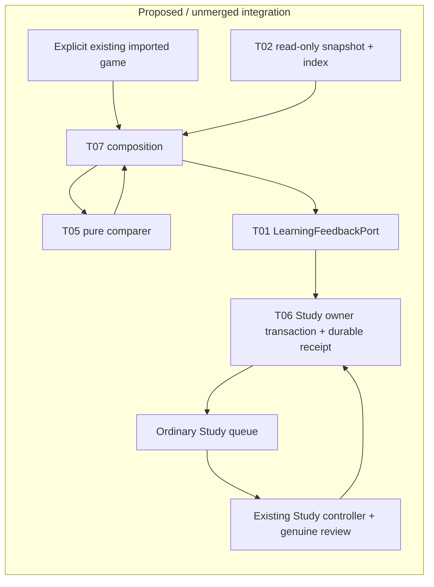
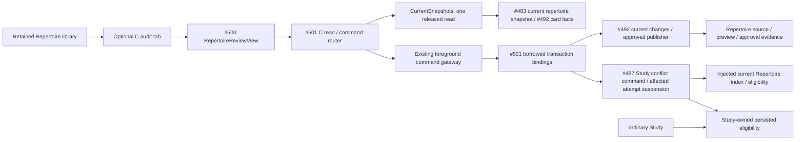

# One imported game to ordinary Study (#488)

This is the T07 integration lane under [#481](https://github.com/aaweaver-actuary/tempo/issues/481),
against [SPEC v0.2](https://github.com/aaweaver-actuary/tempo/blob/6885b9420320517ac74df47e631ed796da96c94a/SPEC.md).
Baseline: `24ec4c06f666f50104c979840c403826fb1ce280`.

## Checkpoint status

Source composition checkpoint. Integrated inputs are #482 corrected contracts
`50dd8220`, #483 typed snapshot/index `7b16e25e`, #486 qualified comparer
`49995ad2`, and #487 first owner checkpoint `16446623`. Their unchanged leaf
suites were not rerun. Four focused source integration cases pass: the real
index/comparer and Study policy execute against synthetic supplied mappings and
a fake owner store. No native product acceptance, successful live capture,
durable delivery, ordinary queue admission or review is claimed. This README is the canonical bounded integration/fixture plan, not a
description of a deployed feature. A successful HTTP response alone will never
be recorded as an admitted or settled obligation.

One narrowly scoped capture attempt through the retained read-only owner failed
closed with `legacy_repertoire_authority_missing`. No capture document was
produced and no delivery, queue admission or review was attempted. The previous
game/ply lead remains unverified. Do not repair live metadata, switch writers or
resume a held migration to turn this into a passing example. Actual-data
correspondence remains a separate unverified acceptance item.

A bounded alternative lookup read 10 repertoire authority records, of which
three were ready/current. Their small recent-game selections yielded no usable
departure candidate, so no further capture/delivery/review was attempted. The
original authority error is candidate-specific; it does not establish that all
live mappings are unavailable. The missing actual-data fact is one genuine game
with a unique introduced decision/current physical-card mapping under a
currently verifiable repertoire source.

## Executable source checkpoint

[`feedback.py`](feedback.py) exposes `prepare_record_feedback(...)` and
`submit_feedback(prepared, LearningFeedbackPort)`. It reuses `build_index`,
`compare_record`, `effect_key`, shared `GameLapse` and Study's existing pure
`semantic_digest`; it contains no classification, hash or scheduling policy.
The prepared result retains the exact logical identity/payload for retries.
`submit_feedback` returns a provisional owner receipt; only the caller's commit
can make it durable. Concrete current-authority fencing and transport composition
are still pending the owner handoff. A retained snapshot alone grants no write.

The file operator prepares a private preview and has no delivery mode:

```sh
python -m app.product_composition.feedback \
  --record private-record.json --snapshot private-snapshot.json \
  --provider chesscom --account supplied-player --workspace-id supplied-workspace \
  --detected-at 2026-10-26T12:00:00Z --occurrence-ply 1 --output private-preview.json
```

Supply actual provider PGN when using this record entry point. Existing imported
games retain canonical moves rather than original PGN, so they need the
normalization-independent comparer entry requested from #486; never reconstruct
PGN and label it as the original source. Input files are bounded at 32 MiB;
preview creation is exclusive and mode 0600. This is not a live review command.

The backend project/Docker registrations include only the five local libraries
used by this boundary. `uv lock --check --offline --no-build --directory backend`
passes; all prior registry package records are unchanged. No software was
installed and no image build or service activation is claimed.

## Smallest composition

Use one explicitly selected already-imported game, one repertoire snapshot and
one exact introduced-card miss. Prefer an explicit local operator entry point
over a new screen or background service. Composition injects these public
capabilities as they become available:

| Capability | Owner | Required evidence |
| --- | --- | --- |
| Immutable game/snapshot/finding/feedback values | #482 | Published branch/SHA, version and JSON fixtures |
| Consistent repertoire snapshot and exact index | #483 | Public snapshot/build/lookup API; explicit decision/presentation/introduction mapping |
| PGN normalization and pure findings | #486 | Public comparer; stable logical effect identity; no storage/provider effects |
| Lapse, deadline, hold/status and settlement | #487 | LearningFeedbackPort implementation and durable owner receipt; actual Study hooks |

Do not copy their DTOs or policy into composition. A changed source under a
logical identity goes through the owner's hold/withdraw operation, including
when the new finding is not a miss. Retry the retained operation identity and
payload. An uncertain accepted write is resolved by owner status; it never
triggers another writer or legacy fallback.



Study owns schedules, queue state, review history, receipt persistence and
settlement. It imports no optional producer. Stopping the producer after
admission must leave ordinary issuance, save, retry and settlement usable.
Composition owns selection/wiring and the short operator lifecycle only. Shared
host/database resource isolation remains deployment-unverified.

## Current source and capture boundary

The retained API registers `game_evidence_routes` in `backend/app/main.py` and
explicitly requires the configured PostgreSQL legacy owner. This source fact is
not proof of a particular host installation. Do not install or activate an
independent Learning service to satisfy this slice.

Reuse `app.legacy_game_observation.capture_game` only as a read donor when it
meets the new public snapshot contract. Its default owner reads use
`background_read_connection`: short, read-only sections admitted while foreground
work is idle, with before/after source and graph fencing. Preserve that admission
and fail closed on unavailable admission, changing content, incomplete traversal,
unsupported mappings or exhausted bounds. Do not substitute an unfenced direct
database export. `observe_capture` / `comparison_snapshot` and
`preview_legacy_observation` are mapping/comparison donors, not permission to
restore their retired orchestration or bypass the T06 scheduling effect.

## Private genuine example and disposable fixtures

1. Prefer an existing authorized capture with its original source digest,
   complete scoped catalogue proof, capture time and source revisions. Otherwise
   take one narrow read-only capture only after the exact configured live target
   and foreground admission path are established. Never print credentials or
   commit raw games, names, repertoire content or private snapshot data.
2. Treat any candidate game/ply/move lead as unverified until the capture proves
   legal exact position/history, the expected and played moves, unique route and
   decision/current physical presentation identity, current source revision, and
   introduction before the game's precise occurrence time. A matching FEN or SAN
   alone is insufficient. Capture plies are zero-based; product Finding plies
   are one-based and the conversion must be explicit.
3. Retain raw private capture and reproduction receipt outside tracked source.
   Record its SHA-256 and source/fixture revision in the private receipt. Public
   regressions use sanitized legal equivalents, labeled as synthetic and never
   presented as proof of the genuine mapping.
4. Reproduce the retained game, content, physical mapping, introduction and prior
   review history in a task-owned disposable PostgreSQL fixture. Verify the
   disposable target before any fixture mutation. Production remains read-only.
   Use explicit clocks and initial FSRS state, not sleeps or fake live reviews.
5. Drive the composed command, replay its exact identity, inspect the owner's
   receipt/deadline and ordinary queue, then disable the producer. Complete the
   expected move through the existing Study controller and genuine review/save
   path in the disposable product. Reload and read settled status. Do not settle
   by direct SQL or a test-only queue. Preserve a separately active unrelated
   attempt and its history.
6. Advance the disposable clock across two days without Study, rebuild/restart
   only task-owned resources, and show the original deadline/obligation survives.
   No live settings, queue issuance or review mutation is part of this proof.

## Focused verification and integrated receipt

The #488 suite owns these cases:
`test_imported_game_maps_to_existing_card`,
`test_duplicate_pipeline_has_one_lapse`,
`test_normal_study_review_settles_obligation`,
`test_no_study_day_and_restart_preserve_deadline`,
`test_producer_absence_does_not_block_study`, and
`test_unrelated_active_attempt_unchanged`.

Required commands after implementations and fixtures are available:

```sh
make python-file FILE=backend/tests/test_product_feedback_integration.py
make ui-file FILE=product-game-feedback.spec.ts
```

The browser spec must assert the exact expected move/position, delivery status,
same-identity replay, ordinary review completion, reload and owner settlement.
Run only the small Study/Tactics preservation selection published by #504 (or
name the existing focused checks if it is unavailable). Reuse leaf results when
their source, contracts, fixtures, commands and toolchain inputs are unchanged;
do not rerun every leaf suite. Acquire the existing advisory validation lock in
append mode without truncating/unlinking it, hold it only for validation and
release it promptly.

The published #504 selection at `27dc7fa1`,
[`docs/product-v02/PRESERVATION.md`](https://github.com/aaweaver-actuary/tempo/blob/27dc7fa179d01a2fadd1ffe874fd6ed377528c61/docs/product-v02/PRESERVATION.md),
provides exact uncertain-save/reload and unrelated-active-attempt unit titles.
Those are affected-boundary source checks, not substitutes for native
game-feedback receipt, deadline or settlement proof.

The final integrated receipt records every consumed branch/SHA, tested SHA,
capture and fixture digests, exact commands/counts, decision/presentation mapping,
original deadline, lapse receipt, retry/settlement identities, history and
protected-attempt outcomes, resource cleanup, and any unavailable native/browser
or actual-data proof. Missing, skipped and zero-selected checks are unverified.
Source integration is not installation, merge or deployment.

## C repertoire conflict audit — #501

C is an independently reviewable continuation through the retained Repertoire
workspace. The [mount](../../../app/features/product-api/RepertoireAuditMount.tsx)
keeps its supplied existing library available and lazily opens #500 after an
explicit repertoire choice. It does not query an optional provider or engine.
[The client](../../../app/features/product-api/repertoire-review-api.ts) preserves
shared proposals/receipts; a 202 is pending, never approval success. Its session
retains exact retry identity across tab changes.

[repertoire.py](repertoire.py) adapts #492's exact conflict report and complete
manual alternatives to #500. GETs and choice generation are inert. Actual Study
block facts must come from the current Study owner under the exact source fence;
without those facts the UI says unknown. The explicit audit POST requires the
owning scoped block/suspend/restore operation and fails unavailable when absent.
No detector success is described as a persisted block.

[repertoire_commands.py](repertoire_commands.py) supplies `CurrentSnapshots`,
`DispatchedChanges`, `create_current_repertoire_http` and explicit command
registration. Snapshot reads release the borrowed reader before returning.
Writes use the existing durable foreground gateway and its borrowed writer
transaction; #492's injected current changes factory alone publishes content and
approval receipts. Stable payload-bound command identities preserve uncertain
acknowledgments across retry/remount. No SQL, second writer, conflict decision,
queue policy or automatic job is owned by composition.

[repertoire_runtime.py](repertoire_runtime.py) binds #492 `09548df7` retained
changes and complete current-card definitions to #483's sole current snapshot
reader, with the existing read connection and durable dispatch resources. The
display rereads its source fence after the card facts; changed source refuses the
display. Every proposed physical-card update comes from Repertoire's policy.

[repertoire_study.py](repertoire_study.py) injects the actual shared reader/index
and #492 eligibility into #487's `SnapshotConflictAuthority` and
`current_study_conflicts`. Commands contain at most 16 exact route/ply/card/revision
targets. Unmapped targets remain pending. Persisted block reads require the
displayed source fence to remain current. Accepted content and current Study
reconciliation enlist in the same borrowed transaction; failure propagates to
the gateway rollback. Missing reconciliation refuses acceptance with 503.



Solid edges describe implemented source; final HTTP/worker registration is still
pending. **No fake callback is registered as product acceptance**. #492's current
publication enlists displayed source/card effects
and receipt in the same transaction and preserve unrelated history/memberships.
Study owns affected attempt suspension without Again and valid eligibility
restoration; its local serving path must not call this optional HTTP producer.
#503/#495 own serving/recovery/rebuild and admission guard adoption. Until those
hooks are published and the product check passes, continuous Study enforcement
is unverified. Shared host/database contention and actual browser/PG behavior
remain unverified. Existing repertoire moves require no engine reevaluation.

C's exact source checks are `make python-file
FILE=backend/tests/test_product_repertoire_integration.py` and `make unit-file
FILE=tests/unit/product-repertoire-integration.test.ts`. Its named actual product
command is `make ui-file FILE=product-repertoire-review.spec.ts`; the new fixture
requires the disposable health/database marker and verified Compose labels before
seeding one synthetic legacy conflict. Source checks and a prepared/typechecked
browser fixture are not A05. Runtime/root registration and owner migration054
stay on this C branch; D/E implementations and the first release candidate are
separate. No live data/settings, service restart, install, deploy or merge occurs.
