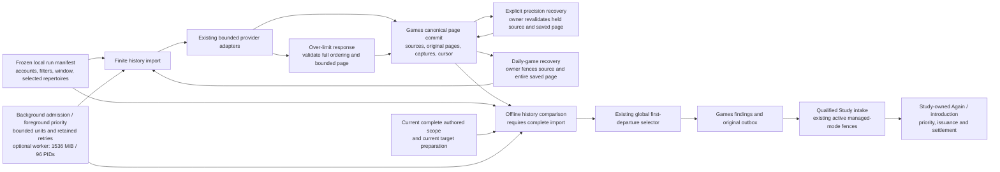
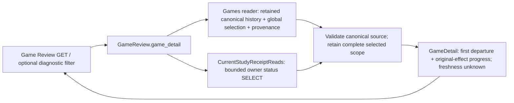
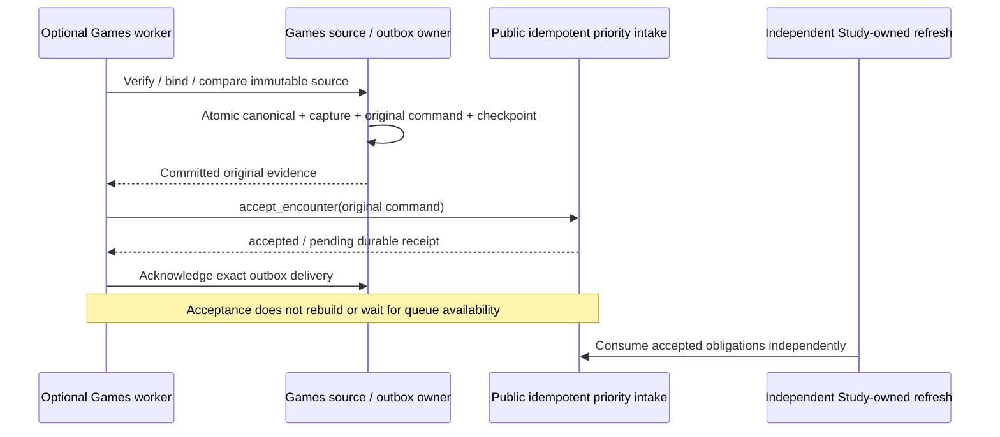
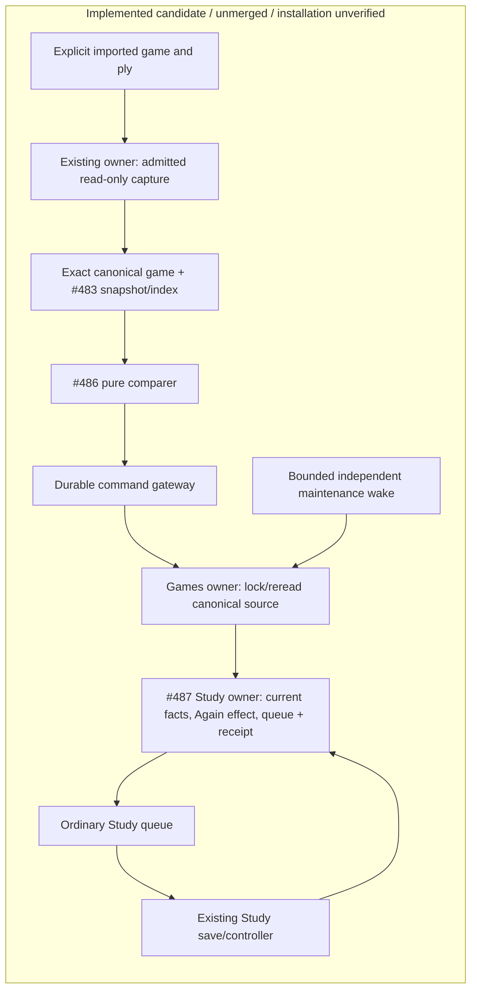
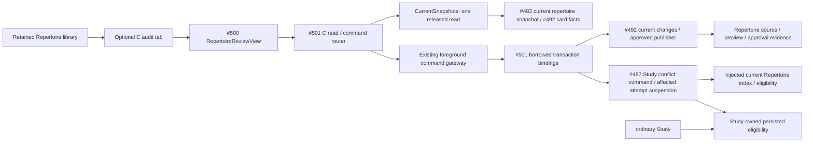

# One imported game to ordinary Study (#488)

## One-time historical Games scripts

`game_history_scripts.py` composes finite manual history import and offline
first-departure processing. Its two [script entry points](../../../scripts/README.md#one-time-historical-import-and-repertoire-checks)
share a private immutable local manifest containing saved scope and a frozen
three-calendar-month window. Database jobs own checkpoints and retry delays;
the manifest owns neither credentials nor executable Study commands.



Historical jobs use `purpose=history`, exact-job claims and manual provenance.
They cannot become automatic network jobs or Refresh-now checkpoints. Import
defers repertoire reads and own-miss command generation; existing correction
quarantine/control behavior remains. Unchanged previously compared sources retain
their existing findings and first departure during collection. Replay reads the exact original provider
page subtype and cursor, preserving metadata and canonical source identity.
It commits comparisons through the existing Games page transaction, then delivers
only outbox entries attached to the imported source set after the full traversal.
Original commands, owner receipts and determination clocks survive retries.

Missing scope remains unresolved; a later invocation can revisit a completed
unresolved traversal. Opponent-first games produce no own-miss consequence.
An explicit precision recovery handles only a quarantined first Lichess history
page whose legacy PGN UTC-second matches the provider millisecond instant. Games
storage locks and revalidates the original page, source version, sole capture,
canonical game and absence of deliveries for each source before recording a new
resolution capture. It preserves the original quarantine capture. The original
page is replayed once with the same page key before provider pagination resumes;
unproved or changed sources remain quarantined.
An explicit provider-limit retry fences the same saved configuration, failed
job, exact prior checkpoint and absence of a committed page at the failed
cursor. It retains a typed failure receipt on the job before requeueing. A
saved-page replay may increment the commit counter without adding a page;
status treats a missing pending cursor as incomplete and still rejects an
ambiguous page or a missing page for a completed job.
Provider I/O/replay never enters Study's short writer. Background admission,
full pause, source quarantine, configuration fences and active managed feedback
identity retain their existing owners. These scripts do not activate a service,
modify recurrence, migrate storage or change ordinary Study startup. Their
reports distinguish saved acknowledgment receipts from current Study progress.

## Durable Game Review commands and Settings recovery (#590)

The goal is to compare retained/provider games with the user's repertoire and
move the matching card forward in Study when its repertoire move was missed.
That miss establishes importance whether the card was learned, needs introduction,
or has unknown introduction chronology. The label and could-have-known history
are not reinforcement prerequisites. Preserve actual timestamps and returned
dispositions; use the existing Study-owned priority and ordinary consumption
behavior. These commands durably request that work. Engines, coaching and
explanations are outside this slice.

The reader-profile API dispatches configure, manual sync and legacy feedback
retry through the existing command gateway. `game_review_commands.py` registers
those three handlers on the existing foreground command worker. Games borrows
the command transaction; its configuration/job or legacy delivery mutation and
the operation receipt commit together. Configure uses `Idempotency-Key`; sync
and feedback retry retain the request's `operation_id`. Reads acquire no writer
credential. Provider HTTP and Study queue refresh do not run in these handlers.

```mermaid
sequenceDiagram
  participant Settings as Games settings / Game Review
  participant Journal as Games browser pending record
  participant API as Reader HTTP API
  participant Gateway as Existing durable command gateway
  participant Command as Foreground command worker / writer
  participant Games as Games configuration / job / legacy delivery
  Settings->>Journal: Persist original save bytes or manual-run identity
  Settings->>API: Configure / sync / legacy retry with original operation ID
  API->>Gateway: Dispatch bounded command
  Gateway->>Command: Execute or replay original operation
  Note over Command,Games: Validate new ongoing seed before configuration write; invalid seed fails with 422
  Command->>Games: Borrow caller transaction; fence current facts
  Note over Command,Games: Games mutation and operation receipt commit atomically
  Command-->>API: Completed result or pending operation
  API-->>Settings: Actual result / pending / failure
  Settings->>API: Resolve original operation at Games API origin
  Note over Settings,API: Selected Learning origin does not redirect Games receipt reads
  Settings->>Journal: Clear matching terminal save/run only
```

`GameSyncSettings` is mounted only in the existing Games Settings tab. Its
endpoint/workspace-scoped browser record survives unmount/reload, retains the
original configuration bytes or manual-run ID after an uncertain response, and
locks edits until that operation is resolved. Loading saved settings does not
prove a pending save succeeded. A sync result of `pending` means a durable job
request, not completed acquisition or an available Study card. Legacy lapse
retry keeps its existing current-finding/source fences; encounter redelivery
is not exposed through that legacy command.

Games save and recovery explicitly query receipts at the Games API origin. The
shared status reader retains its selected Learning origin by default for Study;
Game Review derives its override from the actual command endpoint. Legacy account
and automatic-sync controls/browser mirroring are removed, while global settings
retain loaded compatibility values for Next Opponent and the old sync consumers.
The still-used finding threshold remains separate and uses the global save.

Settings explicitly distinguishes **Historical/manual import** from **Ongoing
collection**. The existing `interval_seconds` field remains the wire choice:
`null` disables recurrence and preserves arbitrary-width fixed historical ranges;
ongoing collection requires an explicit integer interval of 60–86400 seconds.
Both require increasing UTC dates and explicit account, repertoires, speeds and
supported rated policy. Ongoing seeds must span 60–86400 seconds inclusive.
Settings preserves existing UTC seconds/milliseconds and never shortens dates.
`GameReview.configure` enforces seed width before the store write; the stored
`SyncConfiguration` parser remains unchanged so an old incompatible range can
still be read and corrected. A new incompatible ongoing write fails with an
actionable 422 explaining how to adjust the seed or choose historical/manual
import. Durable dispatch can initially return 202 before recording that failure.

The selected ongoing worker advances acquisition windows from the saved seed;
Settings does not start it or establish that it is active. Overlap and
reconciliation cadence remain operator/process inputs checked by launch
preflight, without Settings fields or a schema migration. A manual run requests
the saved range or seed once, independently of ongoing process activation.
An unconfirmed command, an accepted request with acquisition pending, acquisition
complete, and actual Study effects are different facts. This collection-only
release promises no Study reprioritization. The original save bytes, revision,
operation ID and Games-origin recovery are retained, even if loading current
settings displays another revision or an incompatible old range.

This slice requires only the command gateway and schema already on main. It
does not package or activate an optional provider worker, alter Study
maintenance, or solve #581. The owning HTTP, native command and UI cases are
`test_product_game_review_commands.py`,
`test_product_game_review_commands_postgres.py`, and
`product-game-sync-settings.test.tsx`. They are extracted from #558; prior
evidence is retained there. Current focused qualification and exact tested
revisions are recorded in PR #591; they do not establish installation or the
complete Games-to-Study journey.

### Retained Game Review selection and progress (#624)

`GameReview.game_detail` returns the persisted global `first_departure`, original
`determined_at` and opaque `comparison_revision` from Games' `SourceState`.
The optional `repertoire_id` filters diagnostic findings only. It never narrows
the retained selected scope or chooses a primary result from those findings.
The selection's workspace, canonical source revision/digest and game must match
the retained normalized source; mismatches refuse the read. The outer
`source_revision` remains raw provider provenance and may differ legitimately.

`comparison_freshness` is `unknown`: retained publication generations alone do
not prove that the complete source digest, which includes card/learning facts,
is current. No bounded complete-current witness is persisted for this read.
GET performs no snapshot projection, provider request, recomparison or write.
Absent selection remains null, including for empty findings.

`CurrentStudyReceiptReads` uses the existing bounded reader transaction and owner
status methods. Current or cached original receipts correlate by original effect
key and command source revision, plus the source digest for encounter receipts.
A changed physical presentation is retained in the owner's progress; it is not
used to guess effect identity. Unproved associations are omitted. Existing
pending, legacy, Again, canonical-introduction, issuance and settlement evidence
keeps its wire subtype and meaning; cached priority is never upgraded to Again.
Reader-role and unavailable-owner behavior use the existing read path.



## Continuous-provider public priority intake (#489 / #491)

The optional Games process receives an `EncounterFeedbackPort` from the
composition root. `create_current_provider_worker(priority_intake=...)` requires
that public capability before any source read/claim. It does not construct a
Study receiver, borrow a Study writer, or promote/rebuild a queue. Accepted/pending
means immutable evidence was accepted; actual availability belongs to Study's
independent refresh and public receipt status.

The shared public contract is
[`EncounterFeedbackPort`](../contracts/product_v02/learning.py), owned by the
receiving contract/Study owners. Games' coordinator uses only its semantic
accept/control/status methods. No replacement DTO or compatibility export is
introduced. #487 supplies the durable intake implementation and refresh; root
composition alone will wire that implementation after its public checkpoint.

`PostgresCanonicalGamesStore` implements #489's `SourceIdentity` port. Strict PGN
normalization verifies raw proof first; Games then binds the retained canonical
ID/revision/fingerprint before comparison. Source publication, captures, original
outbox and cursor commit atomically. Raw PGN/acquisition provenance stays separate.
Changed source or an identity race is quarantined/rolled back, never relabeled.



The earlier unqualified inline adapter/native fixture were removed from the
follow-on branch. Their earlier passing preparation checks do not qualify this
boundary. The default CLI stays blocked. Six public-port failure/replay cases,
two factory-injection cases and the focused import/DAG guard cover the producer
boundary. Receiver obligation durability/refresh and packaged profile/readiness
qualification remain owner dependencies. See the
[bounded commands and coverage](../../../docs/product-v02/game-sync/README.md).
The frozen qualified retained-history release remains unchanged.

## First-release evidence

This unmerged integration under [#481](https://github.com/aaweaver-actuary/tempo/issues/481)
implements the first game-feedback slice of [SPEC v0.2](https://github.com/aaweaver-actuary/tempo/blob/5d5673e43c722786a101c12d26a214649a909502/SPEC.md).
It has not been installed by this lane. The focused native and ordinary-Study
browser proof passes; actual private-game correspondence remains required
release-owned acceptance evidence.

## Published dependencies

| Owner | Integrated checkpoint |
| --- | --- |
| #482 contracts, including route/game-scoped introductions | #516 `e73c7beb` |
| #483 capture projection, position index and retained provider alias | #511 `7290f052` + exact repair `668d3af5` |
| #486 canonical-game comparer | #510 `3bce27fd` |
| #487 Study receiver, current-owner fencer and source-scoped day-only facts | #515 `c59b93a8` + exact repair `1446cd67` |
| Adopted specification and repository guidance | main `5d5673e4` |

Unchanged leaf suites are reused. Later analysis, workflow, recombination and
conflict features are excluded from this first-release candidate.

## Implemented ownership and transactions

[`feedback.py`](feedback.py) composes the shared game/finding values, real
index/comparer and `LearningFeedbackPort`; it owns no scheduling policy.
[`retained_game.py`](retained_game.py) projects retained canonical moves and their
exact source fingerprint without reconstructing original PGN. The provider is
the canonical source namespace; the original provider/game IDs remain unchanged
in the retained capture. Revision 1 is this slice's initial retained source;
changed bytes under that identity are quarantined, not treated as another lapse.

[`feedback_commands.py`](feedback_commands.py) prepares one explicit game/ply
through the existing read-only capture owner, then passes that exact canonical
game to `project_capture`. Day-only introduction evidence stays a scoped boolean;
it never becomes an invented timestamp. Partial/UTC-midnight retained game times
remain unknown precision and lapse-ineligible. Intake uses the existing durable
command gateway and caller transaction: the Games owner locks/rereads the
canonical source first, then the Study owner fences current repertoire/card
facts and owns all schedule, queue, history and receipt mutations.

The explicit transport is POST `/api/game-evidence/product/feedback` with a
repertoire ID, existing game ID, one-based occurrence ply and Idempotency-Key.
GET `/api/game-evidence/product/effect` reads the logical owner receipt. Both
routes use background request classification, and the exact explicit command is
Study-compatible while still yielding to foreground admission. A 202 operation
response does not establish an admitted Study effect. Resolve uncertain outcomes
through the original operation and receipt, using the same payload/identity.

[`feedback_maintenance.py`](feedback_maintenance.py) performs one durable cursor
slice per invocation, closes read/capture work before the writer, fences the
current task lease and source, and borrows the Study receiver transaction.
Pending effects retry current owner facts; changed source is held. Applied
effects use ordinary queue recovery. The bounded `maintain_game_feedback` wake
runs on the existing foreground worker every 60 seconds, independently of the
optional Games worker. No ordinary Study controller imports/calls/waits for Games.
The current retained backend still shares process packaging, broker and database;
these source/native checks do not establish deployment/resource isolation.



## Focused integrated evidence

Exact tested executable candidate: `673e3d690c136e98dfb1a38b5479bd8ad1e1d44c`.
It contains the source checkpoint `9ef6b2a3`, the two exact owner repairs listed
above and the adopted documentation baseline. Later feature implementations are
excluded. Source validation did not change during the browser build/run.

| Selected boundary | Command/selection | Result |
| --- | --- | --- |
| Source + actual PostgreSQL integration | `make python-file FILE=backend/tests/test_product_feedback_integration.py` | 14 passed, 3.31s |
| Ordinary Study browser | `make ui-file FILE=product-game-feedback.spec.ts` | 1 Chromium case passed, 8.5s |
| Exact Study-compatible command + foreground race | `make python-file FILE=backend/tests/test_legacy_intake_study_mode.py` | 7 passed at `bd8c275d`, unchanged evidence reused |
| HTTP admission/query-only classification | `test_legacy_study_remediation.py -k http_cutover_matching_background_admission_and_query_only_guard_are_preserved` | 6 passed, 17 deselected at `2b841de8`, unchanged evidence reused |
| Scoped dependency guard | `test_product_contracts.py -k new_product_boundaries_do_not_import_composition_or_private_siblings` | 1 passed, 31 deselected; unchanged boundary evidence reused |

The native file covers real receipt/replay, ordinary controller completion,
no-Study-day/new-connection queue recovery with the original deadline, unrelated
issued-attempt preservation, canonical source correction rejection and durable
pending maintenance. The ordinary date-only fixture re-captures actual fixture
rows and carries the exact source-scoped before-game boolean without inventing
a timestamp. The cold-import case uses a fresh interpreter that refuses any
optional `app.games` implementation import. All fixtures are task-owned and
synthetic; they do not establish actual private-game correspondence.

The browser used the supported disposable PostgreSQL/API/worker product stack.
It preserved the unrelated issued head, admitted exactly one lapse with stable
receipt/deadline on replay, completed the protected card, presented the exact
target FEN/e2e4 move, disabled optional producer transport, saved a genuine
ordinary Study review, reloaded and verified settled status. Final readback
asserted one lapse, two Study reviews including the retained prior review, and
one saved-review receipt. Image build 194.7s, startup 19.34s, service health0.09s,
browser stage9.19s and cleanup4.03s all exited0. Its labeled containers, volumes
and network were independently verified absent, and the advisory validation lock
was released promptly.

Earlier failed runs exposed the synthetic timestamp/date shape mismatch and
missing optional-route HTTP classification. A later date-only native run
reported 11 passed/2 failed at the exact owner fencing seam. Both concrete source
repairs are now consumed and the 14-case file plus browser pass supersedes those
failures for this candidate. A known-invalid intermediate build was canceled
with zero browser cases; its owned builder/project journals were reconciled
through supported ownership APIs. No failed, canceled or missing check is counted
as a pass. Passing logs, timing, source fingerprints and the exact integration
receipt are preserved outside the checkout. Unchanged leaf suites were reused.

## Genuine-data and release handoff

A prior candidate failed closed with `legacy_repertoire_authority_missing`.
That failure is candidate-specific. Bounded read-only alternatives found three
current ready authorities among ten repertoires; small recent summaries gave no
usable candidate, historical materialized positions returned zero under all
three, and one naturally admitted ready-authority summary reported total zero.
No genuine capture, delivery or review has succeeded. This does not establish
that all imported games are unusable. The sole release owner continues the
smallest supported imported-game selection; do not rebuild authority or resume
the held graph migration.

Supported foreground status changed naturally between active and inactive;
Study-only mode remained true, policy generation 11. Some authority reads
succeeded; another bounded read deferred before summaries. These observations do
not prove active human Study or a persistent pause. Never clear a gate/lease to
obtain evidence. Store raw private captures and receipt/source digests outside
tracked source, and publish no private game payloads or machine paths.

Installation requires additive migration
[`051_study_game_feedback.sql`](../../../database/tempo_legacy_database/ddl/migrations/051_study_game_feedback.sql)
and schema readiness 51, the five local pure-library backend dependencies
already registered in `pyproject.toml`, `uv.lock` and Dockerfile, root command and
router wiring, and the bounded Celery wake. The offline lock check previously
passed without installations or changes to prior registry records. Retain the
normal API/foreground worker/broker and existing command machinery. Intake needs
the existing background command worker; ordinary Study and pending maintenance
do not require the optional Games producer runtime.

Only the release owner may install or coordinate a brief controlled Study pause.
Use a schema-51-compatible known Study fallback; schema50 images reject51.
Rollback stops new optional intake/wakes and uses that compatible fallback,
preserving additive tables, durable obligations/receipts and all review history.
Never drop migration051, reset data or fabricate a live review. Stopping an
optional producer must leave normal Study usable. Live installation, fallback
smoke and actual-data correspondence are not claimed by this source checkpoint.
The focused browser pass qualifies the synthetic local product boundary only.

## C repertoire conflict audit — #501

C is an independently reviewable continuation through the retained Repertoire
workspace. The [mount](../../../app/features/product-api/RepertoireAuditMount.tsx)
keeps its supplied existing library available and lazily opens #500 after an
explicit repertoire choice. It does not query an optional provider or engine.
[The client](../../../app/features/product-api/repertoire-review-api.ts) preserves
shared proposals/receipts; a 202 is pending, never approval success. Its session
retains exact retry identity across tab changes.

[repertoire.py](repertoire.py) adapts #492's exact conflict report and complete
manual alternatives to #500. GETs and choice generation are inert. Actual Study
block facts must come from the current Study owner under the exact source fence;
without those facts the UI says unknown. The explicit audit POST requires the
owning scoped block/suspend/restore operation and fails unavailable when absent.
No detector success is described as a persisted block.

[repertoire_commands.py](repertoire_commands.py) supplies `CurrentSnapshots`,
`DispatchedChanges`, `create_current_repertoire_http` and explicit command
registration. Snapshot reads release the borrowed reader before returning.
Writes use the existing durable foreground gateway and its borrowed writer
transaction; #492's injected current changes factory alone publishes content and
approval receipts. Stable payload-bound command identities preserve uncertain
acknowledgments across retry/remount. No SQL, second writer, conflict decision,
queue policy or automatic job is owned by composition.

[repertoire_runtime.py](repertoire_runtime.py) binds #492 `09548df7` retained
changes and complete current-card definitions to #483's sole current snapshot
reader, with the existing read connection and durable dispatch resources. The
display rereads its source fence after the card facts; changed source refuses the
display. Every proposed physical-card update comes from Repertoire's policy.

[repertoire_study.py](repertoire_study.py) injects the actual shared reader/index
and #492 eligibility into #487's `SnapshotConflictAuthority` and
`current_study_conflicts`. Commands contain at most 16 exact route/ply/card/revision
targets. Unmapped targets remain pending. Persisted block reads require the
displayed source fence to remain current. Accepted content and current Study
reconciliation enlist in the same borrowed transaction; failure propagates to
the gateway rollback. Missing reconciliation refuses acceptance with 503.



Solid edges describe implemented C1 source. The current main HTTP router, durable
foreground command worker and retained Repertoire mount are registered here.
Migration054 registers only the existing approval and conflict owner DDL after
R11/schema053. #560's Study guard and due restoration/admission projections keep
holds local to Study; the Study path calls no optional producer. Existing
repertoire moves require no engine reevaluation. Content publication, the approval
receipt and current Study reconciliation enlist in the same borrowed transaction.

C1 is existing-content audit/resolution; pending imports (C2), introductions,
engine-backed repairs and Maia are excluded. Full A05 requires C2 as well. The
focused source commands remain `make python-file
FILE=backend/tests/test_product_repertoire_integration.py` and `make unit-file
FILE=tests/unit/product-repertoire-integration.test.ts`. The assembled selection
is `make view VIEW="C exact conflict is enforced"`, using the normal disposable
PostgreSQL browser runner. Its task-only legacy fixture verifies the database
marker and exact project/service identity, then seeds through the write-owning
foreground worker; API readback retains reader credentials. Actual browser
acceptance is reported in the current PR at its tested revision. No live data,
settings, service operation, installation, deployment or merge occurs here.

### #558 Study sweep preparation and recovery repair

Untested extraction of #580 preparation onto the exact #593 recovery source;
runtime integration and deployment remain unverified. The independent feedback sweep uses
the [canonical prepared-introduction sequence](../study/introductions/README.md#prepared-independent-study-sweep--558-repair)
and [claimed-task connection recovery](../study/README.md#feedback-sweep-connection-recovery-558-repair).
Queue due-work requests occur after effect locks close and reuse active Learning
queue generations. Games availability is never a serving prerequisite.

### First-departure foreground handoff (#624)

`feedback_release.register_feedback_next_card_priority` is the explicit API and
foreground-worker root. Construction starts no provider or Games worker and
requires no Games readiness. It captures optional local boot identity outside
writers; absent mode or optional read failure leaves ordinary Study usable.
`feedback_capabilities` describes the concrete released callable bindings only;
verified mode, exact image, selected scope, roles and packaged evidence remain
separate operator gates.

```mermaid
flowchart LR
  Head["Issue head / saved review"] --> Hint["Borrowed read: verified mode + determined source pending"]
  Hint --> Pending["503 or omit new ordinary successor; preserve issued board/save"]
  Pending --> Select["Read accepted Study responsibility and original priority"]
  Select --> Choice["Compare cheap local delivery metadata; controls first"]
  Choice --> Routes["Complete authored-scope reads; close each ordinary bounded reader"]
  Routes --> Proof["Repertoire-owned exact-game legal execution over every applicable route"]
  Proof --> Bindings["Elect first boundary; read complete bindings for every surviving route"]
  Bindings --> Prepare["Repertoire-owned snapshot; current Study target preparation outside writer"]
  Prepare --> Fence["Gateway request hash / attempt token / receipt"]
  Fence --> Apply["Borrowed writer: shared mode + source/current owner fences"]
  Apply --> Accept["Study accept + Games acknowledgment, one transaction"]
  Accept --> Study["Independent accepted Study preparation / issuance / settlement"]
```



The head hint uses the existing transaction, without another connection,
filesystem lookup, projection, row fence or dispatch. A savepoint contains
optional schema failure. Controls precede both accepted Study and new source
FIFO; candidate-aware source observation cannot drain an entire historical
outbox before an already-ready live target. Full preparation finishes before the
command writer, and a fresh trusted boot identity is captured at its end. The
prepared wrapper applies only after the gateway fence. The recovery candidate
selects accepted Study work before invoking optional handoff, passing its original
priority as a cutoff to the local metadata selector. Controls retain precedence;
a later optional delivery is not projected or captured before earlier accepted
work. Retained unqualified work keeps its historical priority fallback. Recoverable
preparation holds report `pending:true` and their owner reason rather than a
false no-work result. Accepted Study preparation uses bounded foreground reads
and continues independently of Games mode/process.

Qualification uses the owning adapter's two finite reads: complete authored
scope first, then complete physical graph/card/membership facts for every
surviving route at the first boundary. Both retain the ordinary statement
deadline, including the independent background sweep's 250ms sections. Every
read closes before legal replay, mapping projection or policy. Stored FEN
discovery hints do not filter physical authority.

Repertoire's public `PreparedFirstBoundaryRepertoire` owns detached source bytes,
complete authored routes and exact-game immutable legal execution. The selector
consumes only [Repertoire's declared first-boundary interface](../repertoire/interfaces/first_boundary.py)
for that capability while independently repeating all
frontier, end, own-response conflict and mapping policy. Applicable route tails
remain validated; proven opposite-color scope remains excluded and fenced.
Current-target substitutions still come from Study's owning prepared target
boundary. Study reconstructs selection from the original cap plus those validated
substitutions and compares the witness; a producer's altered snapshot is not
physical mutation authority.

The short writer retains source/configuration/publication/target fences and
rechecks the exact complete candidate relation after all selected-publication
header/shared-graph fences. Its MVCC read is the candidate freshness point;
subsequent independent changes may order after acceptance. No all-card lock set,
schema change, provider call, cross-command proof cache or alternate writer is
introduced. See the [Repertoire preparation view](../repertoire/README.md#game-bound-first-boundary-preparation)
and [database read contract](../../../database/tempo_legacy_database/adapters/authored_repertoires/README.md#game-bound-publication-reads).

Other full-snapshot consumers retain `read_repertoire`,
`PreparedPublishedRepertoire` and their existing snapshot read profile.
Game-bound preparation adds no graph-count or aggregate-byte ceiling. Existing
source rows/cards/memberships/per-row bytes and authored-move bounds remain.
Long legal traversal accounts work inside 128-node batches and records elapsed
cost; this source change alone does not prove a hard end-to-end time budget or
the assembled 30-transition-per-mode acceptance.

## Explicit on-demand Games refresh

POST `/api/product/game-review/refresh` accepts `provider` (`lichess` or `chesscom`)
and an original `operation_id` (at most 128 characters for command dispatch).
The existing gateway returns either its 202 pending operation envelope/Location,
or a completed command result containing a queued acquisition job. Resolve a
202 at the Games API origin through the original operation. The command finishing
only confirms job admission. GET `/api/product/game-review/refresh/{operation_id}`
returns the current exact requested job, including coalesced aliases, UTC window,
`queued/running/retryable/failed/quarantined/complete`, pages, retry epoch and error.
Missing requests return 404; absent saved provider configuration returns 422.

The first durable command execution freezes the cutoff. It selects the latest
complete continuous-forward or refresh checkpoint for the current configuration
revision, rechecks two days clipped to the saved start, and otherwise begins at
the saved start. Fixed-range manual imports, reconciliation and incomplete jobs
are not refresh checkpoints. Fresh requests coalesce onto an outstanding refresh;
operation replay retains the original cutoff. Configuration/request/job and the
existing durable task/operation receipt share the command transaction.

The `product_game_refresh` task runs one bounded page in the existing background
Celery worker, using the current acquisition/comparison/canonical commit owners.
It targets its job; the continuous worker does not claim refresh jobs. Both claim
paths serialize per provider/account, retain active leases and shared retry delays,
and release database transactions before HTTP. The task retains continuations
across process loss and defers through the existing durable task owner. Repeated
alias requests never replace an active task generation/lease. Task failure is
reported separately from successfully admitted work.

This path does not require `TEMPO_PRODUCT_GAME_SYNC_ENABLED`, change recurrence,
move forward-stream state/next-run time or run Study delivery. Existing foreground,
Study-only and maintenance admission still apply. Default Compose shares the host,
PostgreSQL and Redis; the background service has concurrency 1 and a 448 MiB container cap, while an enabled collector retains its separate 256 MiB/96-PID limits.
There is no new service, CPU reservation or claimed host isolation. Provider pages
retain their 30-second total HTTP budget and existing record/byte/position bounds.
A provider that has not published a game cannot be forced to return it.

```mermaid
sequenceDiagram
  participant UI as Games / debugging client
  participant API as Reader API / command gateway
  participant Command as Existing command worker
  participant Games as Games job and request owner
  participant Tasks as Durable task owner
  participant Worker as Existing background worker
  participant Provider as Chess.com or Lichess
  UI->>API: refresh(provider, original operation ID)
  API->>Command: Durable command
  Command->>Games: Lock configuration; freeze/coalesce job and alias
  Command->>Tasks: Ensure one requested task
  Note over Command,Tasks: Job, alias, task and command receipt commit together
  API-->>UI: Command pending or admitted exact job
  Worker->>Tasks: Claim bounded task; honor foreground and pause
  Worker->>Games: Claim exact job; honor account lease and retry delay
  Worker->>Provider: One bounded page without a DB transaction
  Worker->>Games: Atomic canonical source, capture, pending outbox and checkpoint
  Worker->>Tasks: Complete or retain next page / retry time
  UI->>API: Read original refresh request; poll while visible
  API-->>UI: Exact job progress; completion reloads summaries
```

Focused regressions: `test_product_game_refresh.py`,
`test_product_game_refresh_postgres.py`, `product-game-refresh.test.tsx`, and
`game-refresh.spec.ts`. Native provider transport is synthetic; this is not an
installation or an authorized live provider run.

## Chess.com daily historical recovery

The one-time history operator delegates the daily mapping recovery to Games,
then uses the saved replay cursor to read the immutable page before resuming
provider acquisition. Study queue effects remain with the Study owner.
