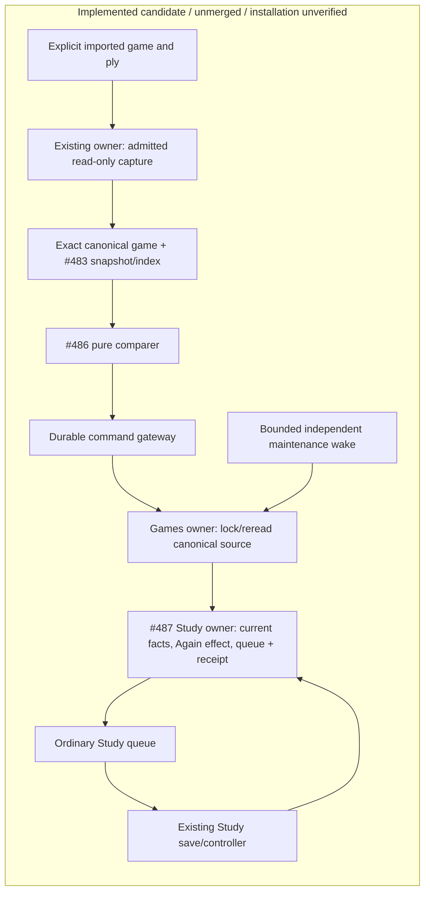
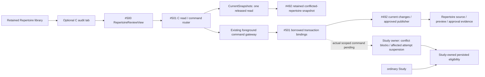

# One imported game to ordinary Study (#488)

This unmerged integration under [#481](https://github.com/aaweaver-actuary/tempo/issues/481)
implements the first game-feedback slice of [SPEC v0.2](https://github.com/aaweaver-actuary/tempo/blob/5d5673e43c722786a101c12d26a214649a909502/SPEC.md).
It has not been installed by this lane. Actual private-game correspondence and a
passing ordinary-Study browser case remain required acceptance evidence.

## Published dependencies

| Owner | Integrated checkpoint |
| --- | --- |
| #482 contracts, including route/game-scoped introductions | #516 `e73c7beb` |
| #483 capture projection and position index | #511 `7290f052` |
| #486 canonical-game comparer | #510 `3bce27fd` |
| #487 Study receiver, current-owner fencer, provider alias | #515 `c59b93a8` |
| Adopted specification and repository guidance | main `5d5673e4` |

Unchanged leaf suites are reused. Later analysis, workflow, recombination and
conflict features are excluded from this first-release candidate.

## Implemented ownership and transactions

[`feedback.py`](feedback.py) composes the shared game/finding values, real
index/comparer and `LearningFeedbackPort`; it owns no scheduling policy.
[`retained_game.py`](retained_game.py) projects retained canonical moves and their
exact source fingerprint without reconstructing original PGN. The provider is
the canonical source namespace; the original provider/game IDs remain unchanged
in the retained capture. Revision 1 is this slice's initial retained source;
changed bytes under that identity are quarantined, not treated as another lapse.

[`feedback_commands.py`](feedback_commands.py) prepares one explicit game/ply
through the existing read-only capture owner, then passes that exact canonical
game to `project_capture`. Day-only introduction evidence stays a scoped boolean;
it never becomes an invented timestamp. Partial/UTC-midnight retained game times
remain unknown precision and lapse-ineligible. Intake uses the existing durable
command gateway and caller transaction: the Games owner locks/rereads the
canonical source first, then the Study owner fences current repertoire/card
facts and owns all schedule, queue, history and receipt mutations.

The explicit transport is POST `/api/game-evidence/product/feedback` with a
repertoire ID, existing game ID, one-based occurrence ply and Idempotency-Key.
GET `/api/game-evidence/product/effect` reads the logical owner receipt. Both
routes use background request classification, and the exact explicit command is
Study-compatible while still yielding to foreground admission. A 202 operation
response does not establish an admitted Study effect. Resolve uncertain outcomes
through the original operation and receipt, using the same payload/identity.

[`feedback_maintenance.py`](feedback_maintenance.py) performs one durable cursor
slice per invocation, closes read/capture work before the writer, fences the
current task lease and source, and borrows the Study receiver transaction.
Pending effects retry current owner facts; changed source is held. Applied
effects use ordinary queue recovery. The bounded `maintain_game_feedback` wake
runs on the existing foreground worker every 60 seconds, independently of the
optional Games worker. No ordinary Study controller imports/calls/waits for Games.
The current retained backend still shares process packaging, broker and database;
these source/native checks do not establish deployment/resource isolation.

## Focused evidence and current blockers

At `05c15bff`, `make python-file FILE=backend/tests/test_product_feedback_integration.py`
passed 12 cases: real PostgreSQL receipt/replay, ordinary controller completion,
o-Study-day/new-connection queue recovery, unrelated issued attempt preservation,
canonical source fencing, pending maintenance and producer absence, plus source
composition cases. The retained-owner fixtures then supplied precise timestamps.
They were not evidence for ordinary date-only introduction storage.

The ordinary date-only fixture now reproduces the actual missing seam. At
`9ef6b2a3`, the changed integration run selected 13 cases: 11 passed and two
failed with `current_owner_exact_introduction_time_unproved`. The projection
successfully carries the exact source-scoped before-game boolean; #487's fencer
still requires timestamp equality. The exact owning repair is requested in
[#487](https://github.com/aaweaver-actuary/tempo/issues/487#issuecomment-6428338319).
The added cold-import case passed separately (1 selected, 13 deselected), proving
maintenance imports no optional `app.games` implementation even in a fresh
interpreter. The current file therefore contains 14 cases, not a claimed 14-case
pass. Chess.com's scope-provider alias normalization is requested from
[#483](https://github.com/aaweaver-actuary/tempo/issues/483#issuecomment-6428299253).

At `bd8c275d`, the exact Study-compatible command/foreground-race file passed
7 cases. At `2b841de8`, the changed HTTP admission/query-only selection passed
6 cases. The middleware prevents the new optional transport from acquiring a
foreground lease that defers its own background command.

`make ui-file FILE=product-game-feedback.spec.ts` is the single normal-Study
Chromium acceptance case, using a task-owned synthetic imported game, authentic
existing-card/graph fixture and real API/worker/database/controller. The first
completed run at `05c15bff` reached applied receipt and duplicate replay, then
failed client validation because fixture introduction used a timestamp rather
than the queue's date shape. The second at `bd8c275d` timed out awaiting receipt;
its missing HTTP background classification is fixed at `2b841de8`. Both completed
runs built, started and cleaned their owned stacks successfully. A subsequent
build was canceled after the concrete scoped-chronology defect was identified;
zero browser cases ran in that attempt, and its owned builder/project journals
were reconciled through the supported ownership cleanup APIs. None is a browser
pass. Consume the owner fixes, rerun the focused integration file, then rerun this
one browser case. No full leaf-suite or unrelated image qualification is needed.

The browser case must preserve the separately issued unrelated card, complete
its actual move, present the exact target FEN/move, disable optional producer
transport, save a genuine ordinary Study review, reload, and verify one lapse,
one receipt and settled owner status with the original deadline.

## Genuine-data and release handoff

A prior candidate failed closed with `legacy_repertoire_authority_missing`.
That failure is candidate-specific. Bounded read-only alternatives found three
current ready authorities among ten repertoires; small recent summaries gave no
usable candidate, historical materialized positions returned zero under all
three, and one naturally admitted ready-authority summary reported total zero.
No genuine capture, delivery or review has succeeded. This does not establish
that all imported games are unusable. The sole release owner continues the
smallest supported imported-game selection; do not rebuild authority or resume
the held graph migration.

Supported foreground status changed naturally between active and inactive;
Study-only mode remained true, policy generation 11. Some authority reads
succeeded; another bounded read deferred before summaries. These observations do
not prove active human Study or a persistent pause. Never clear a gate/lease to
obtain evidence. Store raw private captures and receipt/source digests outside
tracked source, and publish no private game payloads or machine paths.

Installation requires additive migration
[`051_study_game_feedback.sql`](../../../database/tempo_legacy_database/ddl/migrations/051_study_game_feedback.sql)
and schema readiness 51, the five local pure-library backend dependencies
already registered in `pyproject.toml`, `uv.lock` and Dockerfile, root command and
router wiring, and the bounded Celery wake. The offline lock check previously
passed without installations or changes to prior registry records. Retain the
normal API/foreground worker/broker and existing command machinery. Intake needs
the existing background command worker; ordinary Study and pending maintenance
do not require the optional Games producer runtime.

Only the release owner may install or coordinate a brief controlled Study pause.
Use a schema-51-compatible known Study fallback; schema50 images reject51.
Rollback stops new optional intake/wakes and uses that compatible fallback,
preserving additive tables, durable obligations/receipts and all review history.
Never drop migration051, reset data or fabricate a live review. Stopping an
optional producer must leave normal Study usable. Live installation, fallback
smoke, actual-data correspondence and final browser acceptance are not claimed
by this source checkpoint.

The browser spec must assert the exact expected move/position, delivery status,
same-identity replay, ordinary review completion, reload and owner settlement.
Run only the small Study/Tactics preservation selection published by #504 (or
name the existing focused checks if it is unavailable). Reuse leaf results when
their source, contracts, fixtures, commands and toolchain inputs are unchanged;
do not rerun every leaf suite. Acquire the existing advisory validation lock in
append mode without truncating/unlinking it, hold it only for validation and
release it promptly.

The published #504 selection at `27dc7fa1`,
[`docs/product-v02/PRESERVATION.md`](https://github.com/aaweaver-actuary/tempo/blob/27dc7fa179d01a2fadd1ffe874fd6ed377528c61/docs/product-v02/PRESERVATION.md),
provides exact uncertain-save/reload and unrelated-active-attempt unit titles.
Those are affected-boundary source checks, not substitutes for native
game-feedback receipt, deadline or settlement proof.

The final integrated receipt records every consumed branch/SHA, tested SHA,
capture and fixture digests, exact commands/counts, decision/presentation mapping,
original deadline, lapse receipt, retry/settlement identities, history and
protected-attempt outcomes, resource cleanup, and any unavailable native/browser
or actual-data proof. Missing, skipped and zero-selected checks are unverified.
Source integration is not installation, merge or deployment.

## C repertoire conflict audit — #501

C is an independently reviewable continuation through the retained Repertoire
workspace. The [mount](../../../app/features/product-api/RepertoireAuditMount.tsx)
keeps its supplied existing library available and lazily opens #500 after an
explicit repertoire choice. It does not query an optional provider or engine.
[The client](../../../app/features/product-api/repertoire-review-api.ts) preserves
shared proposals/receipts; a 202 is pending, never approval success. Its session
retains exact retry identity across tab changes.

[repertoire.py](repertoire.py) adapts #492's exact conflict report and complete
manual alternatives to #500. GETs and choice generation are inert. Actual Study
block facts must come from the current Study owner under the exact source fence;
without those facts the UI says unknown. The explicit audit POST requires the
owning scoped block/suspend/restore operation and fails unavailable when absent.
No detector success is described as a persisted block.

[repertoire_commands.py](repertoire_commands.py) supplies `CurrentSnapshots`,
`DispatchedChanges`, `create_current_repertoire_http` and explicit command
registration. Snapshot reads release the borrowed reader before returning.
Writes use the existing durable foreground gateway and its borrowed writer
transaction; #492's injected current changes factory alone publishes content and
approval receipts. Stable payload-bound command identities preserve uncertain
acknowledgments across retry/remount. No SQL, second writer, conflict decision,
queue policy or automatic job is owned by composition.

[repertoire_runtime.py](repertoire_runtime.py) now binds the actual #492 retained
`current_snapshot` and `retained_changes` at `e5bc95a0`, with the existing read
connection and durable dispatch resources. After an accepted publication the
actual Study reconciliation must enlist in that same borrowed transaction;
failure propagates to the gateway rollback. Missing reconciliation refuses
acceptance with 503. The scoped Study callback and final main/tasks registration
remain pending, rather than being filled with a fake block/restore operation.

Solid edges describe this source increment; HTTP/worker registration is still
pending. Dotted operations are exact owner handoffs still being implemented;
**no fake callback is registered as product
acceptance**. #492's current publication must enlist displayed source/card effects
and receipt in the same transaction and preserve unrelated history/memberships.
Study owns affected attempt suspension without Again and valid eligibility
restoration; its local serving path must not call this optional HTTP producer.
Shared host/database contention and actual browser/PG behavior remain unverified.

C's exact source checks are `make python-file
FILE=backend/tests/test_product_repertoire_integration.py` and `make unit-file
FILE=tests/unit/product-repertoire-integration.test.ts`. Its named actual product
command is `make ui-file FILE=product-repertoire-review.spec.ts`; the new fixture
requires the disposable health/database marker and verified Compose labels before
seeding one synthetic legacy conflict. Source checks and a prepared/typechecked
browser fixture are not A05. Runtime/root registration and owner migration054
stay on this C branch; D/E implementations and the first release candidate are
separate. No live data/settings, service restart, install, deploy or merge occurs.
