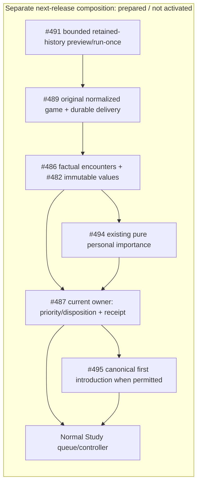

# Encounter importance to normal Study: next practical release

This separate #488 lane starts at qualified first-feedback `ab2e5e6e`. It does
not change that installation. The practical entry is #491's bounded retained
history preview/run-once workflow using #489's durable source/delivery identity;
there is no separate encounter-only endpoint or second historical ingestion.

Published inputs consumed: #533 encounter contracts `46f07e9a`, #486 factual
comparison `ab402547`, #532 typed importance `cc6937aa`, #487 receiver
`d7fccbe8`, #483 current reader `4198bfc8`, and #495 introduction source
`5f87902f`. Shared values are
`GameEncounter`, `EncounterReceipt`, `GameEffectKey`, `IntroductionGameScope` and
`DecisionPresentation`. No substitute DTO or scheduling policy is defined here.

[`importance_from_encounters`](importance.py) reexports #494's frozen
`GameEncounter` consumer directly. No translation/scoring/dedup copy remains. That owner
deduplicates source-game/revision supports and retains historical differing-play
importance separately from correct-play frequency for both current introduction
states. Composition does not filter relevance by old-lapse eligibility or later
learning. A supplied current approved mapping remains subject to Study's current
transaction fence; importance calculation grants no effect/admission authority.

The #487 receiver must own one semantic disposition/receipt per original event:
existing eligible lapse, priority without schedule rewind, or genuine first
introduction with fresh scheduling. #495 supplies only the needed canonical
introduction capability. #489 retains the original observation, detection and
source identity through lost acknowledgments, retries, later admission and
recomparison. A correctly played encounter never becomes an invented failure.

The pure output retains `source_encounters` as the original shared commands;
#489's same durable sender consumes these commands rather than a new aggregate
score DTO. [`receive_captured_encounter`](receiver.py) fences retained canonical
source bytes and borrows #487's actual factory/transaction. Its introduction
capability and policy are explicit arguments, with no live default. Receipts
remain provisional until the existing command transaction commits. #491 retains
root/router/worker ownership; actual bounded-run binding remains pending its
published history and workflow checkpoints.

## Prepared normal-Study fixtures and acceptance

`backend/tests/product_encounter_fixtures.py` reuses the capped disposable
PostgreSQL owner fixture. It creates two honest synthetic retained games, exact
approved routes/current physical cards, and a protected unrelated card with an
ordinary issued queue origin. An unintroduced target has no introduction, FSRS
state or prior Study review. The later-learning target has actual introduction
and a saved review after the old game. Captures use the existing bounded owner,
current integrity facts and #483 projection, never original-PGN reconstruction.

| Required result | Prepared scenario |
| --- | --- |
| Useful bounded history result | Two retained source games: differing move and correct expected move |
| First introduction once | Never-introduced target; both played responses; first real Study attempt |
| Historical priority without lapse | Both games predate actual introduction and later saved learning |
| Current-state race | Capture while unintroduced; ordinary canonical admission wins before delivery |
| Duplicate/recomparison safety | Same source/key after acknowledgment loss and later introduction |
| Full-pause protection | Persist evidence/deferred reason; no availability claim or scheduling/admission mutation |
| Preserve working Study | Keep unrelated issued origin, history, schedule and first pipeline behavior |

The prepared nine-case native selection covers six exact source/current-owner
mapping/importance cases, two honest pending unintroduced receipts without a
chosen policy, and one historical-priority path through ordinary Study without
rewinding later learning. Full bounded-run/first-introduction/race/full-pause
acceptance is not claimed by these fixture preparations.
Effect acceptance will extend the same narrow integration file using the real
owner receiver, canonical introduction and existing ordinary Study controller.
The four-case pure file verifies the published typed importance API without a
fake Study receipt. Source syntax checks pass; runtime selections have not yet
started because the advisory slot is occupied. The native receiver uses existing
schema051 only: no broader introduction charge/rotation/ranking DDL is installed
or required. The narrow #495 canonical-state capability remains pending. No broad
suite or browser/UI rebuild is selected.

## Unanswered policy and release boundaries

Ordinary introduction allowance versus a bounded encounter reserve/Study-only
exception remains a user decision. Composition selects no override. Preserve
saved Study-only, disabled/pause and zero limits, and keep deferred reasons and
original detection honest; do not promise an unconditional 48-hour deadline.
Historical importance is not permission to rewind FSRS, fabricate a past review,
reintroduce an existing card or reopen settled debt as a new lapse.

The current introduction source still defers beyond 64 routes/128 physical
cards/256 mappings. Small fixtures do not establish real-user support beyond
those bounds. A larger actual source needs a supported bounded explicit-decision
owner path or an honest size deferral; alternatives and guards are never dropped.

No live scan, activation, deployment, data/settings change or held graph migration
is authorized for this lane. Runtime/schema registration belongs to the owning
published checkpoint and #491 root window. The first qualified installation is
the unchanged fallback until this practical bundle is qualified and coordinated.
