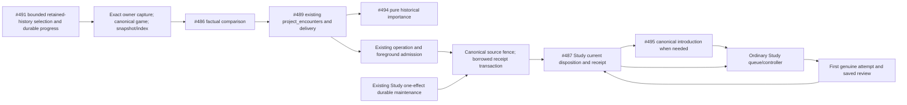

# Retained encounters to normal Study: next practical release

Local executable candidate **`cf777b5250a9d2c32f289f58377d635cb8e79504`**
passes the named 18-case native integration file. This separate #488 branch
starts at qualified first-feedback `ab2e5e6e`; it has not been published,
installed or activated. The original first candidate is unchanged.

## Consumed owner checkpoints

| Owner | Exact input |
| --- | --- |
| #482 encounter values and approved targeted exception, PR #533 | `092b574d` |
| #483 current repertoire reader | `4198bfc8` |
| #486 encounter facts and exact retained day-only correction | published `ab402547` plus local-only `24819dfa` |
| #487 current Study receiver and targeted disposition | `9af90d08` |
| #489 same canonical command projection/delivery, PR #535 | `17291652` |
| #494 typed historical importance, PR #532 | `cc6937aa` |
| #495 narrow canonical introduction, PR #527 | `bebdc5f6` |

The #486 correction is tested locally but its publication was denied. This
candidate must remain local while either publication hold remains. No alternate
branch or tool may publish the held work.

## Existing path and ownership

[`prepare_captured_encounters`](capture.py) wires the exact retained canonical
source, #483 snapshot/index and #486 comparer into #489's existing
`project_encounters`. It retains unresolved findings and original shared
`GameEncounter` values, source identity and detection facts. Its local preparation
bundle is not a new transport contract. It performs no I/O, acquisition, progress
write, PGN reconstruction or effect. #491 retains bounded history selection,
durable progress, root/router/worker and activation ownership.

[`importance_from_encounters`](importance.py) reexports #494's typed function
unchanged. Historical misses remain importance before introduction and after
later learning. Correct encounters supply frequency. Composition duplicates no
scoring/dedup policy and never reinterprets historical importance as a new lapse.

[`receive_admitted_encounter`](receiver.py) first checks the current operation
stop decision and existing foreground admission. It then selects #495's approved
`encounter_exception` and delegates to [`receive_captured_encounter`](receiver.py):
the source owner locks/rereads the canonical imported bytes, and #487 fences
current exact repertoire/card facts and owns disposition, first introduction,
queue and receipt. All writes borrow the caller's existing receipt transaction.
Only Study can choose lapse, priority without rewind, first introduction or
frequency-only disposition. No alternate ledger, queue writer or scheduler is
introduced here.

The existing [`feedback_maintenance.py`](../feedback_maintenance.py) also handles
pending encounter payloads. One current effect, canonical source fence, Study
owner, durable cursor and task receipt commit together. It imports no Games
module. Applied recovery and real-review settlement retain their existing Study
hooks, independent of optional producers.

## Actual control source

The retained settings schema and `study_priority.control_snapshot()` contain no
separate global full-Study-pause field. Zero allowance and Study-only are ordinary
introduction controls, not proof of full pause. Per-work durable pause controls
and the Games runtime stop Event do exist. The root must supply its actual
current operation stop/control decision to the required `operation_stopped`
callback; no permissive default is provided. Unknown/non-Boolean or stopped
control defers before a source lock or Study write.

Positive operation admission then calls the existing
`activity_gate.check_background_admission()`, which defers for foreground work
or unavailable configured Redis/HTTP admission. The caller still owns background
database/maintenance admission. The maintenance path uses the existing durable
claim pause predicate and current task-generation/lease fence; pause prevents the
next bounded unit, and stale deliveries cannot publish. That actual admission
supplies the narrow capability's explicit `paused` Boolean. No new pause
service, setting, schema or UI exists or is claimed.

Andy approved targeted encounters bypassing ordinary caps, including zero or
exhausted allowance, and Study-only. Global settings and unrelated ordinary
introductions retain their controls. The exact Study-owned
`study_game_feedback` task now shares `daily_queue`'s Study-only admission;
unknown/unrelated optional kinds retain their prior restrictions and durable
pause remains. `queue_ordering._priority_projection` recognizes
`product_game_encounter` through the existing protected ordering policy.
The two exact shared editing windows ended at `e0764c24`.

## Focused evidence

At executable **`cf777b52`**, `make python-file
FILE=backend/tests/test_product_encounter_integration.py` passed **18 cases in
5.32s**, using the capped task-owned schema051 PostgreSQL fixture:

- Real retained canonical captures/current mappings and protected issued heads.
- Correct and missed first introductions with zero allowance plus Study-only;
  first actual ordinary Study review, no fake Again/review/backdating.
- Bounded explicitly selected two-game fixture: **2 scanned, 2 matched,
  0 unresolved, 0 remaining; 1 correct and 1 missed**. Both re-compared after
  learning retained original game/decision/source identity and receipts.
- Historical relevance and priority preserve later learning; ordinary admission
  winning the race is not reset or charged again.
- Stop/resume, actual durable task pause, stale lease and repeat delivery safety;
  unrelated optional task admission retains its Study-only restriction.
- Pending encounter maintenance proceeds independently of Games; existing lapse
  maintenance and cold no-Games-import preservation separately passed (2 cases).

The previously failing two retained date-only cases now pass with #486's exact
local correction; no precise timestamp/current introduction fact is fabricated.
One queue presentation case passed (0.14s), four pre-write admission cases passed
(0.29s), four typed importance cases passed (0.33s), and the scoped dependency
guard passed (1 selected/89 deselected, 0.17s). Unchanged owner evidence is reused,
including #495's 21 policy/import plus 26 schema051 native cases and #489's
persistence/delivery checks. No broad leaf suite or UI/image rebuild was run.
Owned PostgreSQL cleanup is verified and the validation lock is released.

These are honest synthetic retained fixtures, not private live-game evidence.
The full #491 selected-window operator entry/durable progress/root binding still
needs its own final composition evidence. No full synchronization, new UI,
engine evaluation or full D storage is required by this receiving slice.
Existing capture/current-source size guards remain; tiny fixtures do not prove
unbounded real-user source support. Larger sources require a supported bounded
owner path or explicit deferral, never dropped alternatives or waived guards.

No live reads, data/settings changes, merge, deployment or activation occurred
in this lane. Optional GitHub metadata and the new integration branch push were
denied before execution and have not been retried or routed elsewhere. The local
checkout, source checkpoints and verified bundle are retained until publication
and dependent integration are resolved.

The canonical introduction factory is a declared module dependency, loaded during
receiver/capture preparation before the short history writer opens. This moves
code loading only: operation-stop/foreground checks, source and current-mapping
fences, canonical introduction, priority promotion and command receipt/cursor
still share the existing transaction. There is no cache warmup or extra task.

Retained-history and pending-maintenance composition prepare the Study-owned
priority overlay before opening the short command writer. The optional immutable
value is passed through to Study; no queue policy or query is implemented here.
Actual operation-stop/foreground admission and source/current-task fences still
run in their original units. Study's canonical writer rechecks current presentation
facts before atomically changing only the planned positions with its receipt.
