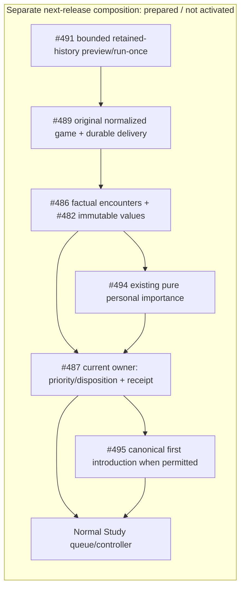

# Encounter importance to normal Study: next practical release

This separate #488 lane starts at qualified first-feedback `ab2e5e6e`. It does
not change that installation. The practical entry is #491's bounded retained
history preview/run-once workflow using #489's durable source/delivery identity;
there is no separate encounter-only endpoint or second historical ingestion.

Published inputs consumed: #533 encounter contracts `46f07e9a`, #486 factual
comparison `ab402547`, #532 typed importance `cc6937aa`, #487 receiver
`d7fccbe8`, #483 current reader `4198bfc8`, and #495 introduction source
`5f87902f`. Shared values are
`GameEncounter`, `EncounterReceipt`, `GameEffectKey`, `IntroductionGameScope` and
`DecisionPresentation`. No substitute DTO or scheduling policy is defined here.

[`importance_from_encounters`](importance.py) reexports #494's frozen
`GameEncounter` consumer directly. No translation/scoring/dedup copy remains. That owner
deduplicates source-game/revision supports and retains historical differing-play
importance separately from correct-play frequency for both current introduction
states. Composition does not filter relevance by old-lapse eligibility or later
learning. A supplied current approved mapping remains subject to Study's current
transaction fence; importance calculation grants no effect/admission authority.

The #487 receiver must own one semantic disposition/receipt per original event:
existing eligible lapse, priority without schedule rewind, or genuine first
introduction with fresh scheduling. #495 supplies only the needed canonical
introduction capability. #489 retains the original observation, detection and
source identity through lost acknowledgments, retries, later admission and
recomparison. A correctly played encounter never becomes an invented failure.

The pure output retains `source_encounters` as the original shared commands;
#489's same durable sender consumes these commands rather than a new aggregate
score DTO. [`receive_captured_encounter`](receiver.py) fences retained canonical
source bytes and borrows #487's actual factory/transaction. Its introduction
capability and policy are explicit arguments, with no live default. Receipts
remain provisional until the existing command transaction commits. #491 retains
root/router/worker ownership; actual bounded-run binding remains pending its
published history and workflow checkpoints.

## Prepared normal-Study fixtures and acceptance

Current focused evidence: four typed-importance adapter cases passed. At
`3e779dfb`, the current receiver/race selection passed 10 cases with the two known
factual regressions deselected (3.58s). It uses real retained captures, current
mapping/importance, honest pending receipts, historical ordinary-Study
save/settlement and an ordinary canonical-admission race with no reset/fake lapse.
The scoped dependency guard passed (1 selected/80 deselected) after #489 adoption.
Published #494 combined81 Python/60 TypeScript contract evidence is reused after
restoring byte-identical published contract tests with unchanged AST/test bodies.
The later SPEC amendment is documentation only; #482's approved-policy checkpoint
`092b574d` is consumed without repeating unchanged positive boundary evidence.
No leaf-suite or UI build is repeated.

Two additional actual retained date-only historical cases currently FAIL at the
#486→#489 factual seam: matched play produces no finding; differing play produces
`known_unavailable` despite source-scoped introduced_before_game=False. The
published workflow filters both out. This is not a receipt/receiver failure;
the direct receiving path already preserves old relevance without FSRS rewind.
These two focused regressions remain required and are not counted as passes.

`backend/tests/product_encounter_fixtures.py` reuses the capped disposable
PostgreSQL owner fixture. It creates two honest synthetic retained games, exact
approved routes/current physical cards, and a protected unrelated card with an
ordinary issued queue origin. An unintroduced target has no introduction, FSRS
state or prior Study review. The later-learning target has actual introduction
and a saved review after the old game. Captures use the existing bounded owner,
current integrity facts and #483 projection, never original-PGN reconstruction.

| Required result | Prepared scenario |
| --- | --- |
| Useful bounded history result | Two retained source games: differing move and correct expected move |
| First introduction once | Never-introduced target; both played responses; first real Study attempt |
| Historical priority without lapse | Both games predate actual introduction and later saved learning |
| Current-state race | Capture while unintroduced; ordinary canonical admission wins before delivery |
| Duplicate/recomparison safety | Same source/key after acknowledgment loss and later introduction |
| Full-pause protection | Persist evidence/deferred reason; no availability claim or scheduling/admission mutation |
| Preserve working Study | Keep unrelated issued origin, history, schedule and first pipeline behavior |

The prepared nine-case native selection covers six exact source/current-owner
mapping/importance cases, two honest pending unintroduced receipts without a
chosen policy, and one historical-priority path through ordinary Study without
rewinding later learning. Full bounded-run/first-introduction/race/full-pause
acceptance is not claimed by these fixture preparations.
Effect acceptance will extend the same narrow integration file using the real
owner receiver, canonical introduction and existing ordinary Study controller.
The four-case pure file verifies the published typed importance API without a
fake Study receipt. Source syntax checks pass; runtime selections have not yet
started because the advisory slot is occupied. The native receiver uses existing
schema051 only: no broader introduction charge/rotation/ranking DDL is installed
or required. The narrow #495 canonical-state capability remains pending. No broad
suite or browser/UI rebuild is selected.

## Decided targeted exception and release boundaries

Andy explicitly approved targeted real-game first introductions bypassing ordinary
new-card allowance (including zero/exhausted allowance) and Study-only. Ordinary
unrelated introductions retain their controls. The owner implementation must still
honor explicit full Study pause, foreground/maintenance admission, exact current
source/identity/legality/conflict fences and one actual introduction under races.
No global cap or Study-only setting is changed. This decision is for the separately
qualified next release; it is not live activation or a default chosen here.

The public receiver requires an explicit policy/canonical capability. Existing
policy-pending fixture cases test honest handling of a missing capability; they
do not represent the newly approved live policy. Fresh targeted introduction,
zero/exhausted allowance, Study-only, full-pause and unchanged-unrelated-control
acceptance await #495/#487's narrow published capability. No broader introduction
charge/rotation/ranking DDL is installed by this lane.

The current source fencer still limits a supplied source to 64 routes/128 physical
cards/256 mappings. Small fixtures do not establish real-user support beyond those
bounds. Larger actual sources need a supported bounded explicit-decision owner
path or honest size deferral; alternatives/guards are never dropped.

A bounded retained-history product run also needs #491's published canonical
history entry. The current #489 acquisition page requires nonempty original
`GameRecord.pgn`; the installed retained-game capture has canonical moves and no
original PGN. This lane never reconstructs PGN and calls it original, supplies a
fake record to satisfy that shape, or starts a second backfill/delivery ledger.
The receiving adapter deliberately authenticates the existing retained canonical
bytes through their current owning source adapter.

No live scan, activation, deployment, data/settings change or held graph migration
is authorized here. #491 retains root/router/worker/schema-registration ownership.
The qualified first installation stays unchanged while the practical bundle is
qualified and coordinated. Optional GitHub ownership/status comments and a push
of this new branch were rejected by approval review and did not execute; this
checkpoint remains local, with no retry or alternate publication.
