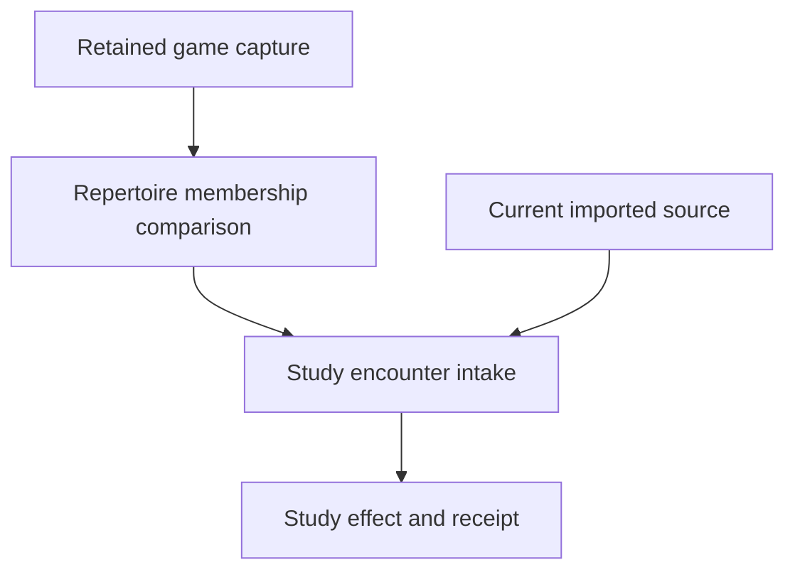

# Current encounter composition

This package binds the current retained game capture to the existing Study intake.
It starts no provider, worker or recurring task when imported.

- [`capture.py`](capture.py) exposes `prepare_captured_encounters`, using the
  existing repertoire comparison and original source identity.
- [`receiver.py`](receiver.py) exposes `receive_admitted_encounter` and
  `receive_captured_encounter`. The caller owns the transaction. The receiver
  checks the current imported source and delegates accepted effects to Study.
- [`__init__.py`](__init__.py) exports only those current capture/intake functions.

The unused encounter-importance/ranking export and its Analysis implementation
were removed in the November 10 reduction. Accepted Study feedback does not need
that scoring projection. Original observations, effect identities and Study
receipts remain owned by their existing capture and intake paths.

This is source composition evidence. No database migration or installed behavior
is asserted by this documentation change.
