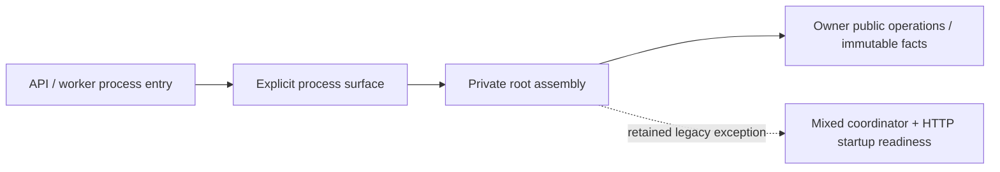

# Composition entry points

Owner: #501. Runtime roots select an explicit process surface; domain components
never import composition. The namespace eagerly loads no optional feature.

- `analysis` exports the unchanged typed `CoverageRequest`, settings digest and
  `prepare_coverage`. No provider, worker or default settings are constructed.
- `worker.run_legacy_worker` is the explicit process operation. It lazily selects
  the retained coordinator and storage writer, registers the same fifteen durable
  and three maintenance handlers once, and releases partially started resources.
  No API module is imported to register handlers.
- Private `stockfish_bridge.py` retains the unchanged bounded Python-to-owned-worker
  transport. Composition supplies it through the existing semantic engine port;
  the generic Analysis runner no longer owns this process adapter.
- Private `readiness.py` binds the existing bounded storage/one-second Celery
  observations to `app.operations.interfaces.evaluate_readiness` and HTTP503.

The old worker HTTP readiness wait is retained to preserve SQLite schema-startup
ordering. Removing it requires the storage startup owner/precondition; this is
not completed lifecycle isolation. The mixed coordinator still imports Games,
Study maintenance and optional producers; their separation remains explicit
follow-on work. Moving registration into composition does not certify Study
independence, deployed resource isolation or a newly activated feature.

Focused fake-capability checks cover cold public imports, exact registration,
request/write/wake order, readiness failure ordering and partial-start cleanup.
Existing policy/native evidence is reused where source is unchanged. No broad
runtime build, server, live health request or deployment is part of these checks.
